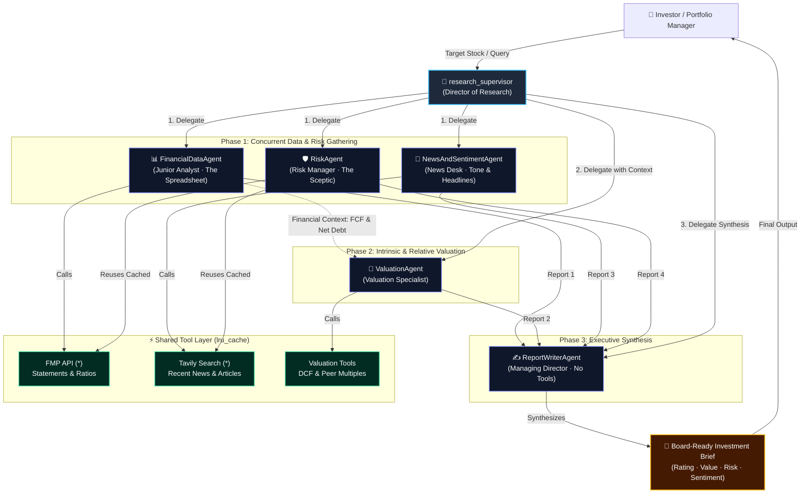

# 📈 Fundamental Equity Analysis System
### Multi-Agent Supervisor-Worker Architecture with AWS Strands & Amazon Bedrock

A modular, institutional-grade equity research pipeline built using the **AWS Strands Agents SDK** and **Amazon Bedrock (Nova Lite)**. The system coordinates specialized AI agents to analyze company financials, news sentiment, downside risks, intrinsic valuation, and synthesizes them into a board-ready **Investment Brief**.

---

## 🏛️ System Architecture Diagram



---

## 🔄 Code Flow Diagram

```mermaid
sequenceDiagram
    autonumber
    actor User as Investor / PM
    participant Sup as research_supervisor (agents.py)
    participant Fin as FinancialDataAgent
    participant Val as ValuationAgent
    participant News as NewsAndSentimentAgent
    participant Risk as RiskAgent
    participant Writer as ReportWriterAgent
    participant Tools as tools.py (Cached *)
    participant APIs as External APIs (FMP, Tavily, Bedrock)

    User->>Sup: Request: "Provide investment brief for AAPL"
    Note over Sup: Identifies target stock (defaults to AAPL)

    rect rgb(15, 23, 42)
        Note over Sup,Fin: Phase 1: Fundamental Data Gathering
        Sup->>Fin: Call worker: Fetch financial statements & ratios
        Fin->>Tools: get_income_statement(), get_balance_sheet(), compute_key_ratios()
        Tools->>APIs: HTTP GET /stable/ (Financial Modeling Prep)
        APIs-->>Tools: Raw Financial Statements JSON
        Tools-->>Fin: Normalized Financial Statements & Ratios JSON
        Fin-->>Sup: Structured Financial Summary (Revenue, FCF, Margins, Net Debt)
    end

    rect rgb(30, 27, 75)
        Note over Sup,Val: Phase 2: Valuation Modeling
        Sup->>Val: Call worker: Run valuation with financial context
        Val->>Tools: run_dcf_model(symbol, FCF, WACC=9%, g=8%)
        Val->>Tools: get_peer_multiples(symbol)
        Tools->>APIs: Fetch current price & peer multiples
        APIs-->>Tools: Multiples data (P/E, EV/EBITDA, P/S)
        Tools-->>Val: DCF Implied Price ($139.91) & Peer Multiples (+83% premium)
        Val-->>Sup: Valuation Verdict: OVERVALUED
    end

    rect rgb(20, 30, 45)
        Note over Sup,News: Phase 3: Sentiment & Headwind Analysis
        Sup->>News: Call worker: Research recent headlines & sentiment
        News->>Tools: search_recent_news(), analyze_sentiment()
        Tools->>APIs: Tavily Search API
        APIs-->>Tools: 6 News Articles & Citations
        Tools-->>News: Net Sentiment: BULLISH (+0.33)
        News-->>Sup: Catalysts ($100B Buyback, Services Growth) & Headwinds
    end

    rect rgb(35, 20, 30)
        Note over Sup,Risk: Phase 4: Sceptic Downside Stress Test
        Sup->>Risk: Call worker: Downside risk analysis
        Risk->>Tools: get_balance_sheet() [CACHE HIT], compute_key_ratios() [CACHE HIT]
        Risk->>Tools: search_recent_news() [CACHE HIT]
        Tools-->>Risk: Cached Financials & News (0ms latency)
        Risk-->>Sup: Risk Scorecard: MODERATE (Multiple Compression Risk)
    end

    rect rgb(30, 40, 20)
        Note over Sup,Writer: Phase 5: Managing Director Synthesis
        Sup->>Writer: Call worker: Synthesize all 4 reports into final brief
        Note over Writer: Synthesis only (No external tools called)
        Writer-->>Sup: Board-Ready Investment Brief (Executive Table + Thesis)
    end

    Sup-->>User: Complete Investment Brief (Word for word)
```



---

## 👥 Agents Breakdown

1. **`research_supervisor` (Director of Research)**:
   - **Architecture Role**: Central coordinator using the Supervisor-Worker pattern.
   - **Tools Available**: Wraps all 5 specialists via `.as_tool()`.
   - **Key Responsibilities**: Receives target stock queries, delegates to specialist workers, and delivers the final board-ready Investment Brief word for word.

2. **`financial_data_agent` (Junior Analyst · "The Spreadsheet")**:
   - **Architecture Role**: Quantitative corporate financial statement analysis.
   - **Tools Available**: `get_income_statement`, `get_balance_sheet*`, `get_cash_flow_statement`, `compute_key_ratios*`, `get_financial_data`.
   - **Key Responsibilities**: Extracts revenue, margins, balance sheet health, cash flows, and operating ratios; defaults to `AAPL`.

3. **`valuation_agent` (Valuation Specialist)**:
   - **Architecture Role**: Intrinsic and relative market pricing specialist.
   - **Tools Available**: `run_dcf_model`, `get_peer_multiples`.
   - **Key Responsibilities**: Ingests financial context to run 5-year DCF intrinsic valuation models and benchmark peer multiples.

4. **`news_sentiment_agent` (Head of News Desk)**:
   - **Architecture Role**: Market news narrative and sentiment evaluation.
   - **Tools Available**: `search_recent_news*`, `analyze_sentiment`.
   - **Key Responsibilities**: Gathers recent headlines via Tavily and quantitatively scores sentiment (`BULLISH`, `NEUTRAL`, `BEARISH`).

5. **`risk_agent` (Chief Risk Officer · "The Sceptic")**:
   - **Architecture Role**: Downside risk analysis and institutional devil's advocate.
   - **Tools Available**: `get_balance_sheet*`, `compute_key_ratios*`, `search_recent_news*`.
   - **Key Responsibilities**: Stress-tests solvency, debt leverage, multiple compression fragility, and regulatory risks.

6. **`report_writer_agent` (Managing Director)**:
   - **Architecture Role**: Elite executive synthesis (no external tools called).
   - **Tools Available**: *None (Synthesis only)*.
   - **Key Responsibilities**: Synthesizes all 4 reports into the final board-ready **Investment Brief** formatted in clean numbered bullet points.

> **Shared Tool Caching (`*`)**: Tools marked with an asterisk (`*`) are decorated with `@lru_cache`. When `FinancialDataAgent` or `NewsAndSentimentAgent` executes, subsequent queries by `RiskAgent` and `ValuationAgent` hit the in-memory cache, avoiding redundant network latency and API costs.

---

## 🛠️ Tool Suite Reference (`tools.py`)

All tools automatically default to **Apple Inc. (`AAPL`)** if the symbol parameter is omitted or empty:

1. **`get_income_statement(symbol='AAPL')`**: Pulls annual revenue, gross profit, operating income, net income, and EPS via FMP `/stable/` API.
2. **`get_balance_sheet(symbol='AAPL')`** `*`: Pulls cash & short-term investments, total debt, net debt, and stockholders' equity.
3. **`get_cash_flow_statement(symbol='AAPL')`**: Pulls operating cash flow, capex, and free cash flow (FCF).
4. **`compute_key_ratios(symbol='AAPL')`** `*`: Computes TTM valuation multiples (P/E, P/S, P/B, EV/Sales), profitability (ROE, ROA, ROIC, Margins), and leverage metrics.
5. **`search_recent_news(symbol='AAPL')`** `*`: Real-time stock news search via Tavily, returning headline titles, sources, and article URLs.
6. **`analyze_sentiment(symbol='AAPL')`**: Lexicon-based sentiment scoring returning classification (`BULLISH`, `NEUTRAL`, `BEARISH`), net polarity score (-1.0 to +1.0), and bullish/bearish signal keywords.
7. **`run_dcf_model(symbol='AAPL', discount_rate=0.09, terminal_growth_rate=0.03, growth_rate=0.08)`**: Computes 5-year Discounted Cash Flow valuation, terminal value, enterprise value, and implied intrinsic share price vs. market price.
8. **`get_peer_multiples(symbol='AAPL')`**: Benchmarks target stock against relevant sector peers (e.g. `MSFT`, `GOOGL`, `AMZN`) and computes peer average premiums/discounts.

---

## 📋 Prerequisites & Configuration

Create a `.env` file in the root workspace directory with your credentials:

```ini
# AWS Bedrock Configuration (Nova Lite)
AWS_ACCESS_KEY_ID=your_aws_access_key_id
AWS_SECRET_ACCESS_KEY=your_aws_secret_key_id
AWS_REGION=us-east-1
BEDROCK_MODEL_ID=amazon.nova-lite-v1:0

# Financial Modeling Prep (FMP) API Key (Free key at financialmodelingprep.com)
FINANCIAL_MODELING_PREP_API_KEY=your_fmp_api_key

# Tavily Web Search API Key (Free key at tavily.com)
TAVILY_API_KEY=your_tavily_api_key
```

---

## 📦 Installation Instructions

1. **Activate your Python environment**:
   ```bash
   cd /home/pankaj/Workspace/ai-projects
   source .venv/bin/activate
   ```

2. **Install project dependencies**:
   ```bash
   pip install -r projects/01-fundamental-analysis/requirements.txt
   ```

---

## 🚀 Running the Code

### 1. Run the Complete System with Interactive Stock Prompt
Run `agents.py` to start the research supervisor. The script will interactively prompt you for the stock ticker symbol you wish to analyze (or press Enter to default to Apple / `AAPL`):
```bash
python projects/01-fundamental-analysis/agents.py
```
*Interactive Prompt:*
```text
Enter stock ticker symbol to analyze (press Enter to default to AAPL / Apple): MSFT
>> Delegating equity research to specialist team for: MSFT ...
```

### 2. Programmatic Python Execution
You can also import and invoke the supervisor agent directly in your own scripts:
```python
import sys
sys.path.insert(0, 'projects/01-fundamental-analysis')
from agents import supervisor_agent

# Defaults to Apple (AAPL)
response = supervisor_agent("Provide a comprehensive investment brief on our target company.")
print(response)

# Or pass any custom ticker
response = supervisor_agent("Provide an investment brief for NVDA.")
print(response)
```

---

## 🧪 Testing the Code (`test_financial_agent.py`)

A single, unified test suite is provided at `test_financial_agent.py` to verify every layer of the system. If you run the test without providing a stock symbol, it interactively prompts you to enter one (or press Enter to default to `AAPL`).

### 1. Interactive End-to-End Test (Prompts for Ticker)
```bash
python projects/01-fundamental-analysis/test_financial_agent.py --supervisor
```
*Prompts:*
```text
Enter stock ticker symbol (press Enter to default to AAPL / Apple): 
```
*Pressing Enter proceeds with Apple (`AAPL`), or type any ticker like `NVDA`, `MSFT`, or `TSLA`.*

### 2. Benchmark Parallel Execution (Stage 1 Workers)
Runs `FinancialDataAgent`, `NewsAndSentimentAgent`, and `RiskAgent` simultaneously via `asyncio.gather`:
```bash
python projects/01-fundamental-analysis/test_financial_agent.py --parallel
```
- **Benchmark:** Completes in **~11.0s** wall-clock time vs. ~35s sequential (~70% latency reduction).
- **Cache Verification:** Verifies shared cache hits (`*`) across tools.

### 3. Quick Tool Suite Verification (All 8 Tools)
Tests all underlying API endpoints and models without waiting for full LLM turns:
```bash
python projects/01-fundamental-analysis/test_financial_agent.py --tools
```

### 4. Test Individual Specialist Agents
Target any individual agent in isolation:
```bash
# 1. Financial Data Agent ("junior analyst · the spreadsheet")
python projects/01-fundamental-analysis/test_financial_agent.py --financial

# 2. Valuation Agent (5-yr DCF & peer multiples)
python projects/01-fundamental-analysis/test_financial_agent.py --valuation

# 3. News and Sentiment Agent (news desk & sentiment score)
python projects/01-fundamental-analysis/test_financial_agent.py --news

# 4. Risk Agent (risk manager · the sceptic)
python projects/01-fundamental-analysis/test_financial_agent.py --risk

# 5. Report Writer Agent (managing director · synthesis only)
python projects/01-fundamental-analysis/test_financial_agent.py --writer
```

### 5. Test Any Other Stock Ticker
Pass any ticker symbol before the flag to run tests for other companies:
```bash
python projects/01-fundamental-analysis/test_financial_agent.py NVDA --tools
python projects/01-fundamental-analysis/test_financial_agent.py MSFT --valuation
python projects/01-fundamental-analysis/test_financial_agent.py TSLA --supervisor
```

---

## 📊 Sample Output (Apple Inc. / `AAPL`)

```markdown
# 📊 Institutional Investment Brief: Apple Inc. (AAPL)

## 1. Executive Summary & Verdict
- **Overall Recommendation**: **HOLD**
- **Conviction Level**: **MEDIUM**
- **Target Fair Value Range**: $139.91 vs. **Current Market Price**: $347.73
- **One-Sentence Thesis**: Apple exhibits exceptional fundamental strength and cash flow generation, but trades at a high valuation premium that leaves limited margin of safety against potential multiple compression.

## 2. Executive Pillar Ratings
1. **Financial Health**: **STRONG** — Revenue $416B, Gross Margin 46.9%, Operating Margin 32.0%, Net Margin 27.0%, Free Cash Flow $98.8B.
2. **Valuation**: **EXPENSIVE** — DCF intrinsic value $139.91 vs market $347.73; trading at an 83.4% P/E premium vs peer group average (P/E 39.74 vs peer 21.75).
3. **Market Sentiment**: **BULLISH** — Net sentiment score (+0.33), $100B share buyback authorization, Services business expansion.
4. **Risk Profile**: **MODERATE** — Manageable net debt $76.4B (0.26x EBITDA), primary vulnerability is multiple compression risk.

## 3. Pillar-by-Pillar Deep Dive
- **Fundamental Quality**: $416B revenue scale, 46.9% gross margins, 32.0% operating margin, and $98.8B in annual free cash flow.
- **Valuation Dynamics**: 5-year DCF model indicates fair value of $139.91; trading at an 83.4% P/E premium vs peer group average (MSFT, GOOGL, AMZN).
- **News, Catalysts & Sentiment**: Net sentiment +0.33 (Bullish); strong buyback authorization ($100B) offset by supply headwinds and tariff warnings.
- **Risk Audit**: Manageable solvency profile (0.26x Net Debt/EBITDA); primary risk is multiple compression if growth moderates.

## 4. Investment Decision & Watchlist
- **Upgrade Catalysts**: Faster-than-expected Services margin expansion, accelerated AI device upgrade cycles.
- **Downgrade Catalysts**: Multiple compression, persistent tariff/supply disruptions, margin erosion.

---
*Disclaimer: Educational fundamental analysis for institutional research purposes only. Not individual financial advice.*
```

---

## 📂 Project Directory Structure

```
projects/01-fundamental-analysis/
├── architecture.png            # Reference architecture diagram
├── agents.py                   # 5 Specialist workers + Supervisor definition
├── tools.py                    # 8 Financial, Valuation, News & Sentiment tools
├── test_financial_agent.py     # Single unified test suite CLI runner
├── requirements.txt            # Project dependencies
└── README.md                   # Complete system documentation
```
