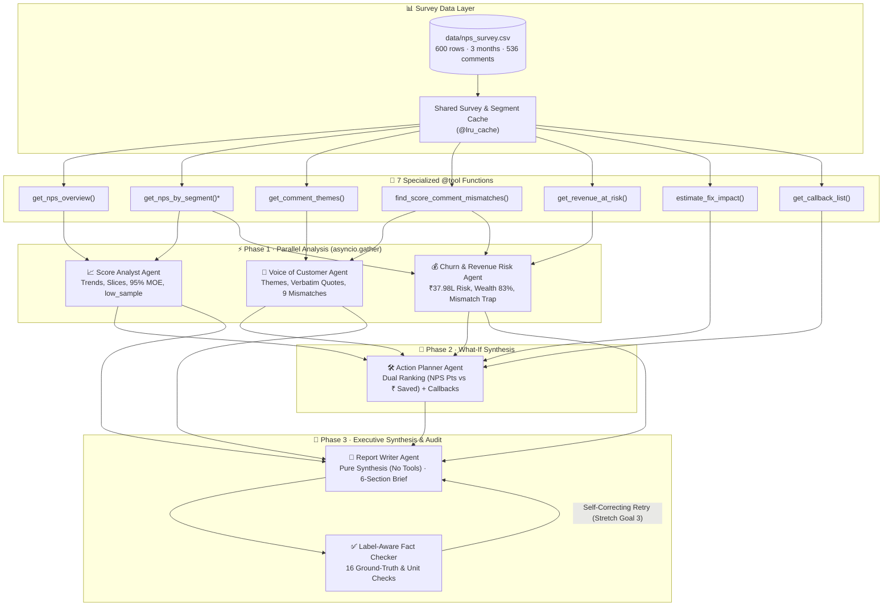
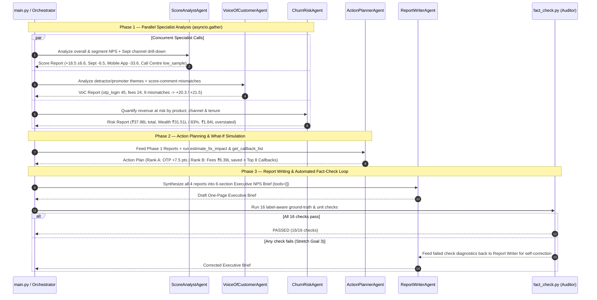

# Future With Shivank Bank — NPS Analyst in a Box

A multi-agent **Net Promoter Score (NPS) & Customer Experience Intelligence System** built with the **Strands Agents SDK** (`strands-agents`) and **Amazon Bedrock (`amazon.nova-lite-v1:0`) / OpenAI (`gpt-4o-mini`)**.

This system turns **600 quarterly banking NPS survey rows** into a board-ready, fact-checked **One-Page Executive Brief** — complete with 95% confidence margins of error, segment drill-downs, verbatim customer voice, expected annual revenue at risk, dual-ranked what-if fix simulations, a prioritized callback list, and an automated **16-check label-aware Auditor**.

---

## Table of Contents

1. [Project Overview & Business Problem](#1-project-overview--business-problem)
2. [The Three Hidden Stories in the Data](#2-the-three-hidden-stories-in-the-data)
3. [System Architecture](#3-system-architecture)
4. [Three-Phase Execution Pipeline](#4-three-phase-execution-pipeline)
5. [Agents Breakdown](#5-agents-breakdown)
6. [Tool Suite Reference (7 Specialized Tools)](#6-tool-suite-reference-7-specialized-tools)
7. [Milestones & Stretch Goals](#7-milestones--stretch-goals)
8. [Project Structure](#8-project-structure)
9. [Installation & Setup](#9-installation--setup)
10. [Usage & CLI Reference](#10-usage--cli-reference)
11. [Sample Output](#11-sample-output)

---

## 1. Project Overview & Business Problem

Every quarter, **Future With Shivank Bank** collects **600 customer NPS survey responses** across:
- **3 Months**: `2026-07` (July), `2026-08` (August), `2026-09` (September) — 200 responses per month
- **3 Products**: `Savings Account` ($n=312$), `Credit Card` ($n=185$), `Wealth` ($n=103$)
- **3 Channels**: `Mobile App` ($n=324$), `Branch` ($n=188$), `Call Centre` ($n=88$)
- **3 Tenure Buckets**: `<1 yr` ($n=183$), `1-3 yrs` ($n=246$), `3+ yrs` ($n=171$)

Each response includes a `0–10` likelihood-to-recommend score, customer segment metadata, `annual_revenue_inr`, and an optional free-text comment (`536` written comments, `64` blank).

### How NPS & Statistical Confidence Work

$$\text{NPS} = \%\text{Promoters (9–10)} - \%\text{Detractors (0–6)} \quad \in [-100, +100]$$

Because NPS is a difference of proportions ($p_{\text{prom}} - p_{\text{det}}$), every slice is reported with its **95% confidence margin of error**:

$$\text{SE}(\text{NPS}) = 100 \times \sqrt{\frac{p_{\text{prom}} + p_{\text{det}} - (p_{\text{prom}} - p_{\text{det}})^2}{n}}, \qquad \text{MOE}_{95\%} = 1.96 \times \text{SE}(\text{NPS})$$

Any slice with $n < 30$ responses (such as `2026-09 Call Centre` with $n = 26$, $\text{MOE} = \pm 31.4$) is automatically flagged `low_sample = True` so no agent or executive mistakes small-sample noise for a real trend.

---

## 2. The Three Hidden Stories in the Data

A naive headline reading says *"Overall NPS is +18.5"*. Our multi-agent pipeline uncovers three critical stories hidden beneath the surface:

| # | Hidden Story | What the Agents Discover |
|---|---|---|
| **1** | **Why NPS Collapsed in September** | Overall NPS fell **36.5 points** in one month: from **`+32.0`** (`2026-07`) and **`+30.0`** (`2026-08`) to **`-6.5`** (`2026-09`). Drilling into September by channel reveals `Mobile App` crashed to **`-33.6`** ($n=113$: 25 Promoters vs. 63 Detractors), while `Branch` stayed strong at **`+34.4`**. Comment themes pinpoint **`otp_login`** (`45` detractor comments, `42` of them in September) and **`app_performance`** (`21` comments) after the September app update. |
| **2** | **Loud $\neq$ Expensive (Where Revenue at Risk Sits)** | Under house churn assumptions (`3%` Promoter / `10%` Passive / `25%` Detractor), total expected annual revenue at risk is **`₹37.98 lakh`** (`₹24.54 lakh` from detractors) out of `₹304.43 lakh`. Although `Savings Account` has the most detractors (`73`), **`Wealth`** (only `31` detractors, NPS `+1.0`) holds **`₹31.51 lakh` (`83.0%`)** of total revenue at risk (`₹20.53 lakh` detractor risk), driven by `24` **`fees_and_charges`** complaints (`₹10.66 lakh` detractor risk). |
| **3** | **Score-Comment Mismatch Data Quality Trap** | **`9` responses** (`R0003`, `R0136`, `R0191`, `R0195`, `R0243`, `R0262`, `R0273`, `R0362`, `R0554` — 8 in `Branch`, 1 in `Call Centre`) gave a score of `0` or `1` while writing glowing praise (*"Amazing support from the relationship manager, thank you!"*). Two are high-value `Wealth` accounts (`R0191` ₹3.48L, `R0262` ₹3.03L). Excluding them raises NPS from **`+18.5` to `+20.3`**; reclassifying them as Promoters raises NPS to **`+21.5`** and removes **`₹1.84 lakh`** of overstated detractor revenue at risk. |

---

## 3. System Architecture

The system implements a **Three-Phase Multi-Agent Pipeline** (plus an interactive `OrchestratorAgent` using the Agent-as-Tool pattern) backed by a shared, cached tool layer (`@lru_cache`) and a deterministic **Label-Aware Auditor**.



---

## 4. Three-Phase Execution Pipeline



---

## 5. Agents Breakdown

All agents are defined in [`nps_insights_agent/agents/__init__.py`](file:///home/pankaj/Workspace/ai-bootcamp/projects/02-nps-analyst/nps_insights_agent/agents/__init__.py):

| Agent | Phase | Assigned Tools | Core Responsibility |
|---|---|---|---|
| **`ScoreAnalystAgent`** | Phase 1 (Parallel) | `get_nps_overview`, `get_nps_by_segment` | Computes overall NPS (`+18.5 ±6.6`), monthly trajectory (`+32.0`, `+30.0`, `-6.5`), product/channel/tenure breakdowns, and drills into `2026-09` by channel (`Mobile App -33.6`, `Call Centre +15.4` with `low_sample` warning). |
| **`VoiceOfCustomerAgent`** | Phase 1 (Parallel) | `get_comment_themes`, `find_score_comment_mismatches` | Categorizes `536` comments into 7 deterministic themes, extracts verbatim customer quotes, and isolates the `9` positive-comment / low-score mismatches (`+20.3` excluded / `+21.5` reclassified). |
| **`ChurnRiskAgent`** | Phase 1 (Parallel) | `get_revenue_at_risk`, `find_score_comment_mismatches`, `get_nps_by_segment` | Calculates expected annual revenue at risk (`₹37.98 lakh` total, `₹24.54 lakh` detractor), proves `Wealth` holds `₹31.51 lakh` (`83.0%`), and flags `₹1.84 lakh` in overstated mismatch risk. |
| **`ActionPlannerAgent`** | Phase 2 (Sequential) | `estimate_fix_impact`, `get_callback_list` | Runs cautious what-if simulations (`Detractor -> Passive`, `25% -> 10%` churn) to present **both** rankings (`otp_login` `#1` by NPS points `+7.5`; `fees_and_charges` `#1` by rupees saved `₹6.39 lakh`) and builds the top-8 genuine detractor callback list. |
| **`ReportWriterAgent`** | Phase 3 (Synthesis) | *None (`tools=[]`)* | Pure synthesis agent. Combines the 4 specialist reports into a structured 6-section executive brief without inventing numbers or adding `%` to NPS scores. |
| **`OrchestratorAgent`** | Interactive / CLI | Wraps all 5 specialists via `@tool` | Interactive supervisor agent that can answer ad-hoc executive questions or delegate full/partial analyses. |

---

## 6. Tool Suite Reference (7 Specialized Tools)

All tools return structured JSON strings and handle invalid inputs defensively without raising unhandled exceptions:

### [`nps_insights_agent/tools/survey_tools.py`](file:///home/pankaj/Workspace/ai-bootcamp/projects/02-nps-analyst/nps_insights_agent/tools/survey_tools.py)
1. **`get_nps_overview()`**
   - Returns overall NPS (`+18.5`), 95% MOE (`±6.6`), bucket counts (`268` Promoters, `175` Passives, `157` Detractors), verdict (`NEEDS WORK`), alert (`RED`), and monthly trend (`2026-07: +32.0`, `2026-08: +30.0`, `2026-09: -6.5`).
2. **`get_nps_by_segment(segment_col: str, month: str = "all")`** *(shared & cached via `@lru_cache`)*
   - Breaks NPS down by `product`, `channel`, `tenure`, or `month`, optionally filtered to a single month (e.g., `month="2026-09"`). Automatically sets `low_sample=True` when $n < 30$ and excludes low-sample slices from `best_reliable_segment` / `worst_reliable_segment`.

### [`nps_insights_agent/tools/theme_tools.py`](file:///home/pankaj/Workspace/ai-bootcamp/projects/02-nps-analyst/nps_insights_agent/tools/theme_tools.py)
3. **`get_comment_themes(bucket: str = "detractor")`**
   - Groups written comments in `detractor`, `passive`, `promoter`, or `all` buckets into 7 transparent keyword themes (`otp_login`, `fees_and_charges`, `app_performance`, `call_centre_ivr`, `interest_rates_rewards`, `general_sentiment`, `positive_mismatch`), returning counts, percentages, product/channel/month breakdowns, revenue at risk, and sample verbatim quotes.
4. **`find_score_comment_mismatches()`**
   - Detects the `9` detractor rows (`score <= 6`) whose comments contain unmistakable praise, returning their IDs, channels (`8 Branch`, `1 Call Centre`), affected revenue (`₹7.35 lakh`), overstated detractor risk (`₹1.84 lakh`), and recomputed NPS (`+20.3` if excluded, `+21.5` if reclassified as Promoters).

### [`nps_insights_agent/tools/whatif_tools.py`](file:///home/pankaj/Workspace/ai-bootcamp/projects/02-nps-analyst/nps_insights_agent/tools/whatif_tools.py)
5. **`get_revenue_at_risk(by_col: str = "product")`**
   - Applies the house churn model (`3%` Promoter, `10%` Passive, `25%` Detractor) across `product`, `channel`, or `tenure`, returning total revenue (`₹304.43 lakh`), total expected revenue at risk (`₹37.98 lakh`), detractor revenue at risk (`₹24.54 lakh`), and segment risk shares (`Wealth = 83.0%`).
6. **`estimate_fix_impact(theme: str = "all")`**
   - Simulates fixing one or all complaint themes under both **cautious** (`Detractor -> Passive`, `25% -> 10%` churn) and **optimistic** (`Detractor -> Promoter`, `25% -> 3%` churn) assumptions, returning `ranked_by_nps_gain` and `ranked_by_rupees_saved`.
7. **`get_callback_list(limit: int = 8)`**
   - Ranks the highest-revenue **genuine** detractors (automatically excluding the `9` positive mismatch rows) for immediate relationship-manager outreach, complete with suggested remediation actions.

---

## 7. Milestones & Stretch Goals

| Milestone | File(s) | Status | Description |
|---|---|---|---|
| **M0 · NPS by Hand** | [`nps_by_hand.py`](file:///home/pankaj/Workspace/ai-bootcamp/projects/02-nps-analyst/nps_by_hand.py) | ✅ Complete | Pure `pandas` warm-up verifying `+18.5 ±6.6`, monthly trend, segment tables, and `₹37.98L` risk. |
| **M1 · Tool Suite** | [`try_tools.py`](file:///home/pankaj/Workspace/ai-bootcamp/projects/02-nps-analyst/try_tools.py), `tools/*.py` | ✅ Complete | All 7 `@tool` functions tested standalone with defensive JSON error handling and `@lru_cache`. |
| **M2 · Specialist Agents** | [`agents/__init__.py`](file:///home/pankaj/Workspace/ai-bootcamp/projects/02-nps-analyst/nps_insights_agent/agents/__init__.py) | ✅ Complete | 5 focused specialist agents (`ScoreAnalyst`, `VoC`, `ChurnRisk`, `ActionPlanner`, `ReportWriter`). |
| **M3 · 3-Phase Pipeline** | [`main.py`](file:///home/pankaj/Workspace/ai-bootcamp/projects/02-nps-analyst/nps_insights_agent/main.py) | ✅ Complete | `asyncio.gather` runs Phase 1 analysts in parallel (`--trace` logs all 3 `CALL`s before any `OUTPUT`). |
| **M4 · Auditor Fact Check** | [`fact_check.py`](file:///home/pankaj/Workspace/ai-bootcamp/projects/02-nps-analyst/nps_insights_agent/fact_check.py) | ✅ Complete | 16 label-aware regex & unit checks verifying numbers, signs, caveats, and that NPS never has `%`. |
| **M5 · Stretch Goals** | `stretch/llm_theme_tagger.py`, `main.py`, `fact_check.py` | ✅ Complete | **Stretch 1**: LLM vs. Keyword Theme Tagger (`99.3%` agreement on 139 detractor comments). **Stretch 2**: `--verbose`, `--stream`, `--log-dir` JSONL telemetry. **Stretch 3**: Self-correcting retry loop when fact checks fail. |

---

## 8. Project Structure

```text
projects/02-nps-analyst/
├── README.md                          # Project documentation, architecture & sample output
├── requirements.txt                   # Python dependencies (strands-agents, boto3, openai, pandas)
├── nps_by_hand.py                     # Milestone M0: Pure pandas verification script
├── try_tools.py                       # Milestone M1: Standalone verification of all 7 tools
├── test_nps_agent.py                  # Unified test suite (--tools, --fact-check, --agents, --pipeline, --stretch)
├── data/
│   └── nps_survey.csv                 # 600 quarterly banking NPS responses (2026-07 to 2026-09)
├── stretch/
│   └── llm_theme_tagger.py            # Stretch Goal 1: Batched LLM vs. Keyword theme classifier
└── nps_insights_agent/
    ├── __init__.py
    ├── config.py                      # Bedrock Nova Lite / OpenAI model loader & house constants
    ├── fact_check.py                  # Milestone M4: 16-check label-aware Auditor
    ├── main.py                        # Milestone M3 & Stretch 2/3: 3-Phase CLI runner & JSONL logger
    ├── agents/
    │   └── __init__.py                # Milestone M2/M3: 5 Specialist Agents + Orchestrator + Async Pipeline
    └── tools/
        ├── __init__.py
        ├── survey_tools.py            # get_nps_overview, get_nps_by_segment (cached)
        ├── theme_tools.py             # get_comment_themes, find_score_comment_mismatches
        └── whatif_tools.py            # get_revenue_at_risk, estimate_fix_impact, get_callback_list
```

---

## 9. Installation & Setup

1. **Install dependencies** (from the repository root or `projects/02-nps-analyst`):
   ```bash
   pip install -r projects/02-nps-analyst/requirements.txt
   ```

2. **Configure environment credentials** in `.env` (supports Amazon Bedrock Nova Lite by default, with automatic fallback to OpenAI):
   ```ini
   # Option A: Amazon Bedrock (Default)
   AWS_ACCESS_KEY_ID=your_access_key
   AWS_SECRET_ACCESS_KEY=your_secret_key
   AWS_REGION=us-east-1
   BEDROCK_MODEL_ID=amazon.nova-lite-v1:0

   # Option B: OpenAI Fallback
   OPENAI_API_KEY=your_openai_key
   OPENAI_MODEL_ID=gpt-4o-mini
   ```

---

## 10. Usage & CLI Reference

### Milestone M0: Verify Numbers by Hand (`pandas` only, no LLM)
```bash
python3 projects/02-nps-analyst/nps_by_hand.py
```

### Milestone M1: Test All 7 Tools Directly (no LLM)
```bash
python3 projects/02-nps-analyst/try_tools.py
```

### Milestone M3 & M4: Run the Full Three-Phase Multi-Agent Pipeline + Auditor
```bash
# Run with parallel execution trace and automated 16-point fact check
python3 projects/02-nps-analyst/nps_insights_agent/main.py --trace

# Run with verbose intermediate agent outputs, token streaming, and JSONL logs
python3 projects/02-nps-analyst/nps_insights_agent/main.py --trace --verbose --stream --log-dir projects/02-nps-analyst/logs
```

### Unified Test Suite (`test_nps_agent.py`)
```bash
# Fast deterministic unit tests (M1 tools + M4 fact-checker on valid & tampered briefs)
python3 projects/02-nps-analyst/test_nps_agent.py --tools --fact-check

# Full end-to-end LLM pipeline test
python3 projects/02-nps-analyst/test_nps_agent.py --pipeline

# Run all tests including individual specialist agents and Stretch Goal 1
python3 projects/02-nps-analyst/test_nps_agent.py --all
```

### Stretch Goal 1: Compare Keyword Tagger vs. LLM Theme Tagger
```bash
python3 projects/02-nps-analyst/stretch/llm_theme_tagger.py
```

---

## 11. Sample Output

### Parallel Execution Trace (`main.py --trace`)
```text
===========================================================================
🏦 FUTURE WITH SHIVANK BANK · NPS ANALYST IN A BOX
✓ Model      : Amazon Bedrock (amazon.nova-lite-v1:0 in us-east-1)
✓ Survey CSV : projects/02-nps-analyst/data/nps_survey.csv
✓ Pipeline   : Phase 1 (3 Parallel Analysts) -> Phase 2 (Action Planner) -> Phase 3 (Report Writer) -> Auditor
===========================================================================
─── Phase 1 · Parallel Analysis (3 concurrent specialist calls) ───
[  0.00s] CALL   -> ScoreAnalystAgent
[  0.00s] CALL   -> VoiceOfCustomerAgent
[  0.01s] CALL   -> ChurnRiskAgent
[  4.82s] OUTPUT <- VoiceOfCustomerAgent (4.82s)
[  5.41s] OUTPUT <- ScoreAnalystAgent (5.41s)
[  6.15s] OUTPUT <- ChurnRiskAgent (6.14s)

─── Phase 2 · Action Planning (What-If Impact & Callback List) ───
[  6.15s] CALL   -> ActionPlannerAgent
[ 11.08s] OUTPUT <- ActionPlannerAgent (4.93s)

─── Phase 3 · Executive Report Synthesis (No Tools) ───
[ 11.08s] CALL   -> ReportWriterAgent
[ 15.92s] OUTPUT <- ReportWriterAgent (4.84s)
```

### Sample Executive NPS Brief & Fact-Check Audit
```markdown
# FUTURE WITH SHIVANK BANK — Q3 EXECUTIVE NPS & CHURN RISK BRIEF

## 1. Headline Verdict & Alert
* **Executive Alert Level:** **RED** (Verdict: **NEEDS WORK**)
* **Headline NPS:** **+18.5** (±6.6 at 95% confidence) across **600** survey responses (`268` Promoters `44.7%`, `175` Passives `29.2%`, `157` Detractors `26.2%`).
* **Monthly Trajectory:** **`+32.0`** (±10.6) in `2026-07` → **`+30.0`** (±10.9) in `2026-08` → **`-6.5`** (±11.8) in `2026-09` (a **-36.5 point** collapse in September).

## 2. Where the Drop Happened (Segment & Channel Breakdown)
* **By Product:** `Savings Account` leads at **`+23.1`** (±8.9, $n=312$), `Credit Card` is **`+20.5`** (±11.5, $n=185$), and `Wealth` is worst at **`+1.0`** (±16.1, $n=103$).
* **By Channel (All Months):** `Branch` leads at **`+33.0`** (±10.5, $n=188$), `Mobile App` is **`+12.3`** (±8.9, $n=324$), and `Call Centre` is **`+10.2`** (±16.8, $n=88$).
* **By Tenure:** `1-3 yrs` is **`+20.7`** (±10.0, $n=246$), `3+ yrs` is **`+18.7`** (±11.8, $n=171$), and `<1 yr` is **`+15.3`** (±11.9, $n=183$).
* **September (`2026-09`) Channel Drill-Down (Hidden Story 1):**
  * **`Mobile App` crashed to `-33.6`** (±15.0, $n=113$: 25 Promoters vs. 63 Detractors).
  * **`Branch` held steady at `+34.4`** (±18.1, $n=61$).
  * **`Call Centre` registered `+15.4`** (±31.4, $n=26$) — flagged **`low_sample`** ($n < 30$); sample is too small to rank as best or worst.

## 3. Why Customers Are Unhappy (Voice of Customer)
* **`otp_login` — 45 detractor comments (32.4%, ₹3.94 lakh risk):** Concentrated in `2026-09` (`42` of `45` comments) on `Mobile App`.
  * *Verbatim [R0401]:* `"OTP never arrives after the new update. Locked out of my account twice."`
* **`fees_and_charges` — 24 detractor comments (17.3%, ₹10.66 lakh risk):** Concentrated in `Wealth` (`22` of `24` comments).
  * *Verbatim [R0087]:* `"Hidden costs in the portfolio statement. Fees are much higher than promised."`
* **`app_performance` — 21 detractor comments (15.1%, ₹0.74 lakh risk):** Crashes and freezing during UPI/bill pay in September (`19` of `21` in `2026-09`).
* **`call_centre_ivr` — 18 detractor comments (12.9%, ₹1.68 lakh risk):** Long hold times and IVR loops.

## 4. Revenue at Risk (Hidden Story 2: Loud ≠ Expensive)
* **Total Portfolio Revenue:** **₹304.43 lakh** | **Total Expected Revenue at Risk:** **₹37.98 lakh** (`12.5%` of portfolio; **₹24.54 lakh** from detractors) under house churn assumptions (**3%** Promoter, **10%** Passive, **25%** Detractor).
* **`Wealth` Holds 83.0% of Total Risk:** Despite having only `31` detractors, **`Wealth` accounts for ₹31.51 lakh** of total expected revenue at risk (**₹20.53 lakh** detractor risk), compared to **₹3.75 lakh** (`9.9%`) in `Credit Card` and **₹2.73 lakh** (`7.2%`) in `Savings Account`.

## 5. Recommended Actions & Callback List
* **Dual What-If Fix Rankings (Cautious Assumption: Detractor → Passive, 25% → 10% Churn):**
  * **Ranking A — By NPS Points Gained:** #1 Fix **`otp_login`** (`45` detractors) → **+7.5 NPS points** (raises NPS to **+26.0**) and saves **₹2.36 lakh**. #2 Fix **`fees_and_charges`** → **+4.0 NPS points** (to **+22.5**). #3 Fix **`app_performance`** → **+3.5 NPS points** (to **+22.0**).
  * **Ranking B — By Rupees Saved:** #1 Fix **`fees_and_charges`** (`24` detractors) → saves **₹6.39 lakh** (and adds **+4.0 NPS points**). #2 Fix **`otp_login`** → saves **₹2.36 lakh**. #3 Fix **`call_centre_ivr`** → saves **₹1.01 lakh** (+3.0 NPS points).
* **Immediate Priority Callback List (Top Genuine Wealth Detractors, Excluding Mismatches):**
  1. **R0314** (`Wealth`, Score 6, Branch, Rev **₹5.45 lakh**, Risk **₹1.36 lakh**) — Fee structure review
  2. **R0182** (`Wealth`, Score 3, Branch, Rev **₹5.04 lakh**, Risk **₹1.26 lakh**) — Quarterly charge breakdown
  3. **R0087** (`Wealth`, Score 4, Mobile App, Rev **₹5.01 lakh**, Risk **₹1.25 lakh**) — Portfolio fee audit
  4. **R0364** (`Wealth`, Score 4, Branch, Rev **₹4.79 lakh**, Risk **₹1.20 lakh**) — Advisory fee waiver/review
  5. **R0070** (`Wealth`, Score 3, Branch, Rev **₹4.55 lakh**, Risk **₹1.14 lakh**) — Senior RM outreach

## 6. Data Quality & Methodology Caveats (Hidden Story 3)
1. **Low-Sample Warning (`n < 30`):** `2026-09 Call Centre` has only **26** responses (95% MOE **±31.4**) and is flagged `low_sample`; it must not be ranked as best or worst.
2. **Assumed Churn Probabilities:** Revenue-at-risk figures rely on house annual churn rate assumptions (**3%** Promoter, **10%** Passive, **25%** Detractor), not observed account closures.
3. **Score-Comment Mismatches (9 Responses):** **9** responses (`8` in `Branch`, `1` in `Call Centre`, including Wealth accounts `R0191` and `R0262`) recorded scores of `0` or `1` alongside glowing praise (*"Amazing support from the relationship manager, thank you!"*). Excluding these 9 rows raises overall NPS to **+20.3**; reclassifying them as Promoters raises NPS to **+21.5** and reduces overstated detractor revenue at risk by **₹1.84 lakh** (across **₹7.35 lakh** of affected revenue).
```

```text
===========================================================================
AUDITOR FACT CHECK (Label-Aware) : PASSED ✓ (16/16 checks passed)
===========================================================================
  [✓] Executive Alert Level (RED)
  [✓] Total Survey Responses (600)
  [✓] Overall NPS (+18.5) with sign and no %
  [✓] Overall 95% Margin of Error (±6.6)
  [✓] 2026-07 (July) NPS (+32.0)
  [✓] 2026-08 (August) NPS (+30.0)
  [✓] 2026-09 (September) NPS (-6.5)
  [✓] Hidden Story 1 · Sept Mobile App Collapse (-33.6) & OTP/Login Root Cause
  [✓] Total Revenue at Risk (₹37.98 lakh)
  [✓] Hidden Story 2 · Wealth Revenue at Risk (₹31.51 lakh / 83.0%)
  [✓] Action Ranking A · OTP Fix NPS Gain (+7.5 pts)
  [✓] Action Ranking B · Fees Fix Rupees Saved (₹6.39 lakh)
  [✓] Caveat 1 · Low-Sample Flag on 2026-09 Call Centre (n=26 < 30)
  [✓] Caveat 2 · House Churn Rate Assumptions (3% / 10% / 25%)
  [✓] Hidden Story 3 & Caveat 3 · 9 Score-Comment Mismatches & Alternative NPS (+20.3 or +21.5)
  [✓] Unit Rule · NPS written as a signed score, never with '%'
===========================================================================
```

