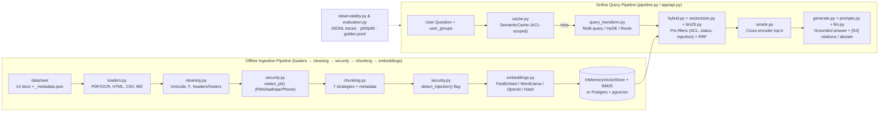

# Production RAG from Scratch — Project Map

> **Directory:** [`study-material/01-production-rag/`](file:///Users/pankaj/Workspace/ai-bootcamp/study-material/01-production-rag)  
> **Domain & Running Example:** *Nimbu Mart* (fictional Indian online store) — 14 multi-format documents + 33 golden evaluation questions  
> **Course Companion:** [`01-Production_RAG_Course_Shivank_Agrawal.html`](file:///Users/pankaj/Workspace/ai-bootcamp/study-material/01-production-rag/01-Production_RAG_Course_Shivank_Agrawal.html) · [`01-Production_RAG_Revision_Notes.md`](file:///Users/pankaj/Workspace/ai-bootcamp/study-material/01-production-rag/01-Production_RAG_Revision_Notes.md)

---

## 1. Architecture & Pipeline Flow

The codebase is split into a modular library ([`code/rag_core/`](file:///Users/pankaj/Workspace/ai-bootcamp/study-material/01-production-rag/code/rag_core)), 14 progressive lesson scripts ([`code/labs/`](file:///Users/pankaj/Workspace/ai-bootcamp/study-material/01-production-rag/code/labs)), and a containerized production service ([`code/app/`](file:///Users/pankaj/Workspace/ai-bootcamp/study-material/01-production-rag/code/app)) backed by FastAPI, Redis/RQ, and PostgreSQL + `pgvector`.



---

## 2. Annotated Directory & File Tree

```text
study-material/01-production-rag/
├── 01-Production_RAG_Course_Shivank_Agrawal.html  # Interactive offline course (15 modules, 11 simulations, quizzes)
├── 01-Production_RAG_Revision_Notes.md            # Condensed revision notes, Mermaid diagrams & cheat sheet
├── 01-Production_RAG_Project_Map.md               # This project map
├── README.md                                      # Course entry point & top-level folder overview
└── code/
    ├── .dockerignore                              # Excludes venv/caches/data artifacts from Docker build context
    ├── .env                                       # Active local environment configuration
    ├── .env.example                               # Template for EMBEDDER, LLM_PROVIDER, DATABASE_URL, REDIS_URL
    ├── .gitignore                                 # Ignores .venv, .env, blobs, logs, and local caches
    ├── Dockerfile                                 # Python 3.11-slim image with Tesseract OCR + requirements
    ├── README.md                                  # Setup guide, lab index (00–13), Docker/local service commands
    ├── docker-compose.yml                         # Stack: pgvector/pgvector:pg17 (db), redis:7-alpine, api, worker
    ├── requirements.txt                           # Core + service deps (fastembed, pymupdf, faiss-cpu, fastapi, rq, psycopg, pgvector)
    │
    ├── rag_core/                                  # Core modular RAG library (one file per course chapter)
    │   ├── __init__.py                            # Package metadata & chapter-to-module map (__version__ = "1.0.0")
    │   ├── config.py                              # Settings dataclass, _auto_provider(), get_settings() from .env
    │   ├── documents.py                           # Core data contracts: Page, Document, Chunk, stable_chunk_id()
    │   ├── loaders.py                             # Ch 5: extract_pdf (with OCR fallback), extract_html, extract_csv, load_corpus
    │   ├── cleaning.py                            # Ch 5: normalize_unicode, normalize_currency, fix_hyphenation, remove_repeated_lines, clean_text
    │   ├── chunking.py                            # Ch 6: 7 strategies (fixed, sliding, recursive, structure_aware, semantic, llm_based, parent_child)
    │   ├── embeddings.py                          # Ch 7: Embedder base + FastEmbed, OpenAI, WordLlama, Hashing embedders + fingerprint()
    │   ├── vectorstore.py                         # Ch 8: InMemoryVectorStore with pre-scoring metadata filtering (matches)
    │   ├── bm25.py                                # Ch 8: From-scratch BM25 keyword index + SKU/code-preserving tokenize()
    │   ├── hybrid.py                              # Ch 8: Hit dataclass, HybridRetriever, rrf() & minmax() score fusion
    │   ├── query_transform.py                     # Ch 8: multi_query, hyde, rewrite_with_history, self_query, route
    │   ├── rerank.py                              # Ch 8: CrossEncoderReranker (FastEmbed), KeywordOverlapReranker, get_reranker()
    │   ├── prompts.py                             # Ch 9: SYSTEM_PROMPT, ABSTAIN, XML <source> fencing (format_sources), JSON/self-check prompts
    │   ├── llm.py                                 # Ch 9: Unified LLM client (openai, anthropic, ollama, extractive) + LLMResult
    │   ├── generate.py                            # Ch 9: Answer dataclass, build_context, extractive_answer, answer(), self_check()
    │   ├── evaluation.py                          # Ch 10: load_golden, retrieval_metrics (hit@k, MRR, nDCG), answer_correct, heuristic_faithfulness, llm_judge
    │   ├── security.py                            # Ch 11: redact_pii (Verhoeff Aadhaar, Luhn card, PAN/phone/email), acl_filter, detect_injection, output_leaks
    │   ├── cache.py                               # Ch 12: ACL- & index-version-scoped SemanticCache
    │   ├── observability.py                       # Ch 12: Trace, Tracer (JSONL), percentiles(), estimate_cost()
    │   ├── pipeline.py                            # Full RAGPipeline class wiring build(), filters(), retrieve(), ask()
    │   └── utils.py                               # Terminal formatting helpers: banner, step, table, timer, show_hits
    │
    ├── app/                                       # Module 13: Production HTTP API + async worker + pgvector DB
    │   ├── __init__.py                            # Service package docstring
    │   ├── settings.py                            # Service env vars (DATABASE_URL, REDIS_URL, BLOB_DIR, S3_BUCKET, TOP_K, HNSW_EF_SEARCH)
    │   ├── db.py                                  # Postgres + pgvector schema (documents, chunks, HNSW & GIN indexes), migrate(), hybrid_search()
    │   ├── storage.py                             # Original file blob storage: LocalBlobStore, S3BlobStore, get_store()
    │   ├── worker.py                              # RQ background worker job: ingest_document() (extract → redact → chunk → scan → embed → upsert)
    │   ├── api.py                                 # FastAPI app: /documents (POST/GET/DELETE), /query, /health, /
    │   └── reembed.py                             # Blue/green zero-downtime re-embedding CLI (--embedder, --model, --cutover)
    │
    ├── labs/                                      # 14 runnable hands-on lessons (00–13)
    │   ├── _common.py                             # Path setup + embedder_or_exit(), llm_status(), default_groups()
    │   ├── lab00_check_setup.py                   # Setup verification (Python, packages, Tesseract, embedder, LLM)
    │   ├── lab01_rag_in_60_lines.py               # Module 2: Minimal RAG in ~60 lines + demonstrates E102 keyword failure
    │   ├── lab02_extraction_and_ocr.py            # Module 5: Page routing, Tesseract OCR on scans, table extraction, cleaning
    │   ├── lab03_chunking_strategies.py           # Module 6: Side-by-side comparison & retrieval scoring across 6 chunkers
    │   ├── lab04_embeddings.py                    # Module 7: Cosine similarity, memory sizing, quantization, Hindi cross-lingual test
    │   ├── lab05_vector_indexes.py                # Module 8: FAISS exact vs HNSW vs IVF vs IVF-PQ + pre/post-filter recall trap
    │   ├── lab06_hybrid_search.py                 # Module 8: BM25 vs vector vs RRF hybrid, metadata filters, self-query
    │   ├── lab07_query_transforms.py              # Module 8: Multi-query, HyDE, conversational rewrite, intent routing
    │   ├── lab08_reranking.py                     # Module 8: Two-stage retrieval with cross-encoder reranking
    │   ├── lab09_grounded_generation.py           # Module 9: Grounded prompts, [S#] citations, refusal threshold, JSON mode
    │   ├── lab10_evaluation.py                    # Module 10: Golden-set harness generating reports/eval_report.md
    │   ├── lab11_security.py                      # Module 11: PII redaction, ACL filtering, prompt-injection defense
    │   ├── lab12_advanced_patterns.py             # Module 12: Contextual retrieval, ACL-scoped semantic cache, mini agentic RAG
    │   └── lab13_observability_and_cost.py        # Module 12: JSONL span tracing, p50/p95 latency, monthly cost estimation
    │
    ├── scripts/                                   # Utility & demo automation scripts
    │   ├── ask.py                                 # CLI client querying POST /query with --groups and --archived flags
    │   ├── ingest_samples.py                      # Uploads all data/raw/_metadata.json docs to POST /documents and polls status
    │   ├── make_sample_pdfs.py                    # Generates travel_reimbursement_policy.pdf, warranty_terms_scanned.pdf, vendor_onboarding_mixed.pdf
    │   └── run_all_labs.py                        # Smoke runner executing lab00–lab13 sequentially
    │
    ├── data/raw/                                  # Fictional Nimbu Mart knowledge base (14 documents + metadata)
    │   ├── _metadata.json                         # Access groups, version, effective_date, status, trust, language per doc
    │   ├── refund_policy_2025.md                  # Active 2025 returns policy (public)
    │   ├── refund_policy_2024.md                  # Archived 2024 policy (tests version superseding)
    │   ├── delivery_and_shipping.md               # Shipping rules & city tiers (tests reasoning facts)
    │   ├── nimbu_plus_membership.html             # HTML membership page with nav/scripts/pricing table
    │   ├── error_codes_runbook.md                 # Checkout error codes E101–E110 (employees; tests exact-token BM25)
    │   ├── product_catalog.csv                    # Structured SKU table e.g. NM-PHN-4821 (public)
    │   ├── hr_leave_policy.md                     # Employee leave rules (access: employees)
    │   ├── salary_bands_confidential.md           # Confidential compensation table (access: hr)
    │   ├── support_tickets_sample.txt             # Sample tickets containing phone, email, PAN, Aadhaar (tests PII redaction)
    │   ├── community_tips_untrusted.md            # User-generated tips containing prompt injection (trust: untrusted)
    │   ├── faq_hindi.md                           # Hindi FAQ (tests multilingual embeddings)
    │   ├── travel_reimbursement_policy.pdf        # Digital PDF with tables, headers/footers, ligatures (employees)
    │   ├── warranty_terms_scanned.pdf             # Image-only scanned PDF (requires Tesseract OCR)
    │   └── vendor_onboarding_mixed.pdf            # Mixed PDF: text + embedded checklist image on same page
    │
    ├── eval/
    │   └── golden.jsonl                           # 33 golden Q&A pairs with relevant_docs, evidence strings, ACL groups & answerable flags
    │
    └── tests/
        └── test_core.py                           # Fast offline unit tests using HashingEmbedder (cleaning, chunking, BM25, RRF, ACL, metrics)
```

---

## 3. Core Library & Service Breakdown

### `rag_core/` Key Symbols & Responsibilities

| File | Key Classes / Functions | Responsibility |
|---|---|---|
| [`config.py`](file:///Users/pankaj/Workspace/ai-bootcamp/study-material/01-production-rag/code/rag_core/config.py) | `Settings`, `get_settings()`, `_auto_provider()` | Loads `.env` and selects embedder, reranker, LLM provider, and retrieval defaults |
| [`documents.py`](file:///Users/pankaj/Workspace/ai-bootcamp/study-material/01-production-rag/code/rag_core/documents.py) | `Page`, `Document`, `Chunk`, `stable_chunk_id()` | Shared data types flowing from loaders through chunkers into stores and citations |
| [`loaders.py`](file:///Users/pankaj/Workspace/ai-bootcamp/study-material/01-production-rag/code/rag_core/loaders.py) | `extract_pdf()`, `extract_html()`, `extract_csv()`, `load_document()`, `load_corpus()` | Format-specific parsing with PyMuPDF page routing and Tesseract OCR fallback |
| [`cleaning.py`](file:///Users/pankaj/Workspace/ai-bootcamp/study-material/01-production-rag/code/rag_core/cleaning.py) | `clean_text()`, `remove_repeated_lines()`, `normalize_currency()`, `fix_hyphenation()` | Fixes PDF ligatures, broken line wraps, currency symbols, and repeated headers/footers |
| [`chunking.py`](file:///Users/pankaj/Workspace/ai-bootcamp/study-material/01-production-rag/code/rag_core/chunking.py) | `Tokenizer`, `fixed_size()`, `sliding_window()`, `recursive()`, `structure_aware()`, `semantic()`, `llm_based()`, `parent_child()`, `chunk_documents()` | Implements and dispatches all chunking strategies while preserving heading paths |
| [`embeddings.py`](file:///Users/pankaj/Workspace/ai-bootcamp/study-material/01-production-rag/code/rag_core/embeddings.py) | `Embedder`, `FastEmbedEmbedder`, `OpenAIEmbedder`, `WordLlamaEmbedder`, `HashingEmbedder`, `get_embedder()`, `fingerprint()` | Pluggable vector encoders with model fingerprinting (`provider:model:dim`) |
| [`vectorstore.py`](file:///Users/pankaj/Workspace/ai-bootcamp/study-material/01-production-rag/code/rag_core/vectorstore.py) | `InMemoryVectorStore`, `matches()` | Exact cosine search with pre-scoring metadata filtering (`$in`, `$ne`, `$gte`, `$lte`) |
| [`bm25.py`](file:///Users/pankaj/Workspace/ai-bootcamp/study-material/01-production-rag/code/rag_core/bm25.py) | `BM25`, `tokenize()` | Keyword scoring preserving alphanumeric codes (`E102`, `NM-PHN-4821`) |
| [`hybrid.py`](file:///Users/pankaj/Workspace/ai-bootcamp/study-material/01-production-rag/code/rag_core/hybrid.py) | `Hit`, `HybridRetriever`, `rrf()`, `minmax()` | Fuses dense vector and BM25 rankings using Reciprocal Rank Fusion or min-max |
| [`query_transform.py`](file:///Users/pankaj/Workspace/ai-bootcamp/study-material/01-production-rag/code/rag_core/query_transform.py) | `multi_query()`, `hyde()`, `rewrite_with_history()`, `self_query()`, `route()` | Pre-retrieval query expansion, hypothetical doc generation, and metadata filter extraction |
| [`rerank.py`](file:///Users/pankaj/Workspace/ai-bootcamp/study-material/01-production-rag/code/rag_core/rerank.py) | `CrossEncoderReranker`, `KeywordOverlapReranker`, `get_reranker()` | Second-stage reranking of top candidates to final `top_n` |
| [`prompts.py`](file:///Users/pankaj/Workspace/ai-bootcamp/study-material/01-production-rag/code/rag_core/prompts.py) | `SYSTEM_PROMPT`, `ABSTAIN`, `format_sources()`, `user_prompt()`, `JSON_INSTRUCTIONS`, `SELF_CHECK_PROMPT` | Builds grounded XML-fenced prompts (`<sources>`) with anti-injection instructions |
| [`llm.py`](file:///Users/pankaj/Workspace/ai-bootcamp/study-material/01-production-rag/code/rag_core/llm.py) | `LLM`, `LLMResult` | Provider-agnostic completion wrapper (`openai`, `anthropic`, `ollama`, `extractive`) |
| [`generate.py`](file:///Users/pankaj/Workspace/ai-bootcamp/study-material/01-production-rag/code/rag_core/generate.py) | `Answer`, `build_context()`, `extractive_answer()`, `answer()`, `self_check()` | Context packing, similarity refusal gating, `[S#]` citation extraction, and offline extractive fallback |
| [`evaluation.py`](file:///Users/pankaj/Workspace/ai-bootcamp/study-material/01-production-rag/code/rag_core/evaluation.py) | `load_golden()`, `retrieval_metrics()`, `evaluate_retrieval()`, `answer_correct()`, `heuristic_faithfulness()`, `llm_judge()`, `evaluate_answers()` | Computes `hit@k`, `recall@k`, `precision@k`, `MRR`, `nDCG@k`, `context_precision`, and answer quality |
| [`security.py`](file:///Users/pankaj/Workspace/ai-bootcamp/study-material/01-production-rag/code/rag_core/security.py) | `redact_pii()`, `acl_filter()`, `detect_injection()`, `output_leaks()`, `verhoeff_ok()`, `luhn_ok()` | Redacts PAN/Aadhaar/cards/phones/emails, builds ACL filters, flags injection patterns |
| [`cache.py`](file:///Users/pankaj/Workspace/ai-bootcamp/study-material/01-production-rag/code/rag_core/cache.py) | `SemanticCache` | Cosine-similarity response cache partitioned by `(user_groups, index_version)` |
| [`observability.py`](file:///Users/pankaj/Workspace/ai-bootcamp/study-material/01-production-rag/code/rag_core/observability.py) | `Trace`, `Tracer`, `percentiles()`, `estimate_cost()` | Span timing logger to JSONL and latency/cost aggregation |
| [`pipeline.py`](file:///Users/pankaj/Workspace/ai-bootcamp/study-material/01-production-rag/code/rag_core/pipeline.py) | `RAGPipeline` | Wires ingest (`build`) and query (`filters`, `retrieve`, `ask`) into one reference object |

### `app/` Production Service Endpoints & Components

| Component | Details |
|---|---|
| [`app/api.py`](file:///Users/pankaj/Workspace/ai-bootcamp/study-material/01-production-rag/code/app/api.py) | `POST /documents` (202 queued + SHA-256 dedup), `GET /documents`, `GET /documents/{doc_id}`, `DELETE /documents/{doc_id}`, `POST /query` (`X-User-Groups` header), `GET /health`, `GET /` |
| [`app/db.py`](file:///Users/pankaj/Workspace/ai-bootcamp/study-material/01-production-rag/code/app/db.py) | Tables `documents` and `chunks` (`vector(dim)`, generated `tsv`), HNSW & GIN indexes, `pgvector 0.8+` iterative scan support, SQL RRF `hybrid_search()` |
| [`app/worker.py`](file:///Users/pankaj/Workspace/ai-bootcamp/study-material/01-production-rag/code/app/worker.py) | RQ worker executing `ingest_document()`: blob fetch → extract → PII redaction → structure-aware chunking → injection flag → batch embed → DB upsert |
| [`app/storage.py`](file:///Users/pankaj/Workspace/ai-bootcamp/study-material/01-production-rag/code/app/storage.py) | `LocalBlobStore` (default `./blobs`) and `S3BlobStore` (S3/MinIO) |
| [`app/reembed.py`](file:///Users/pankaj/Workspace/ai-bootcamp/study-material/01-production-rag/code/app/reembed.py) | Adds `embedding_next` column, backfills in batches, builds HNSW index, shadow-evaluates against `golden.jsonl`, and performs transactional `--cutover` |

---

## 4. Quick Run & Config Reference

Run all commands from [`study-material/01-production-rag/code/`](file:///Users/pankaj/Workspace/ai-bootcamp/study-material/01-production-rag/code):

```bash
python labs/lab00_check_setup.py      # Check environment (runs offline without API keys)
python scripts/run_all_labs.py        # Execute all 14 labs (lab00 .. lab13)
pytest -q                             # Run fast unit tests in tests/test_core.py

# Production App (Docker + scripts)
docker compose --profile app up --build
python scripts/ingest_samples.py
python scripts/ask.py "What does error E102 mean?" --groups public,employees
```

- **Key `.env` variables** ([`.env.example`](file:///Users/pankaj/Workspace/ai-bootcamp/study-material/01-production-rag/code/.env.example)): `EMBEDDER` (`fastembed` | `openai` | `wordllama` | `hashing`), `EMBED_MODEL`, `RERANKER_MODEL`, `LLM_PROVIDER` (`openai` | `anthropic` | `ollama` | `none`), `LLM_MODEL`, `MIN_SIMILARITY`, `DATABASE_URL`, `REDIS_URL`, `USE_RERANKER`.
