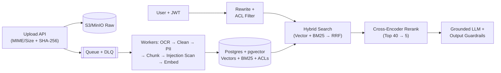

# Production RAG — Quick Revision & Cheatsheet

> **All 15 Modules (00–14) + 14 Labs + Capstone** in plain, bite-sized bullets — zero concepts skipped.

---

## 1. Foundations & Architecture (Modules 00–03)

- **Why 1M-Token Context Doesn't Replace RAG:** **(1) Cost** (1.5k vs 500k tokens/query) · **(2) Latency** (`TTFT < 2s`) · **(3) Accuracy** (*Lost in the Middle* — LLMs miss middle facts) · **(4) Hard blockers:** per-user **ACLs**, sub-minute **freshness**, and exact **citations**.
- **Pick the Right Tool:**
  - *Shared changing docs* → **RAG** | *Tone/format* → **Prompt / Fine-tune**
  - *Personal live data (e.g. "Where is my order?")* → **Authenticated API tool** (never index everyone's orders!)
  - *Math over tables (`SUM / AVG / COUNT`)* → **Text-to-SQL** (read-only + row limit + ACL) | *Multi-step* → **Agent**
- **6 Production Pillars:** **Correct** · **Honest** (cites + abstains) · **Safe** (ACL + PII + anti-injection) · **Fresh** · **Fast/Cheap** · **Observable**.
- **Decoupled 2-Pipeline Design:**
  - **Offline Ingestion** *(scales on docs/hr)*: Upload → Raw S3/MinIO (**keep originals forever** to re-OCR/re-embed later) → Queue → Workers (`OCR → Clean → Redact PII → Chunk → Embed`) → DB.
  - **Online Query** *(scales on ms/query)*: Auth JWT → Cache → Rewrite/Filter → **Embed with EXACT SAME model** → Hybrid Search → Rerank → Grounded LLM.



---

## 2. Ingestion, OCR & Cleaning (Modules 04–05)

- **Async Upload (`202 Accepted`):** Check MIME/size (`<= 20 MB`) → `SHA-256` → save raw file → enqueue (`Redis+RQ` w/ **AOF on**, `RabbitMQ`, `Kafka`, `SQS`). Use **priority queues** (`interactive` > `bulk`) & autoscale on **queue depth / oldest job age**.
- **Failures:** Transient (429/network) → **exponential backoff** retry | Permanent (corrupt PDF) → **Dead-Letter Queue (DLQ)** + alert.
- **3 Idempotency Rules** *(queues deliver at-least-once)*: **(1)** `UNIQUE(sha256)` dedupe · **(2)** Deterministic chunk IDs · **(3) Single-transaction replace** (`DELETE old + INSERT new` atomically).
- **Extraction & Smart OCR Routing** *(extraction is a **silent ceiling**: scanned PDF without OCR = `0` chars, `0` errors)*:
  - `< 50 chars + image` → **Full-page OCR** (`Tesseract 5` / `PaddleOCR`, CPU, cheap).
  - *Digital PDF* → Sort blocks top-to-bottom: convert **tables to Markdown**, infer `#` headings from **font size** (`1.45× / 1.15×` body), run **region OCR** on images `>= 5%` page area (skip tiny logos).
  - *Messy tables / handwriting / gibberish* → Escalate to **Layout / VLM OCR** (`Docling`, `olmOCR`, `Marker`, `MinerU`, `Qwen-VL`) or **Cloud OCR** (`AWS Textract`, `Azure DI`, `Google DocAI` — `$/page`, check VPC rules).
- **Text Cleaning:** Unicode **`NFKC`** (fixes ligatures `fl→fl`, strips zero-width chars) · drop repeated page headers/footers & HTML nav/ads · join hyphenated line wraps · merge hard PDF breaks · normalize `Rs./INR → ₹` · check **Indic (`।`) & RTL** text · serialize CSV rows as `col_name: value (unit)`.

---

## 3. Chunking & Embeddings (Modules 06–07)

- **Chunk Size (`200–400` tokens sweet spot):** Too small = missing context; too big = blurry vector. **Silent Truncation Trap:** Always keep `chunk_size <= model.max_input` (`512` tok models silently drop extra text!).
- **7 Chunking Methods:** **Fixed** · **Sliding Window** (overlap) · **Recursive** (`\n\n → \n → . `) · **Structure-Aware *(Default)*** (split on `#` headings + prepend `[H1 > H2]` breadcrumb) · **Semantic** (topic shift) · **LLM-based** · **Parent-Child** (match small `~100`-tok child, send `~400`-tok parent). *Tables:* Never drop the header row! Attach full metadata (`doc_id, section, page, version, status, access, trust, embedding_model`).
- **2 Modern Upgrades:** **Contextual Retrieval** (prepend 1 LLM situating sentence before dense + BM25 indexing; `-67%` retrieval failures w/ rerank) · **Late Chunking** (embed full doc first, then slice token vectors).
- **3 Scoring Paradigms:** **Bi-Encoder** (separate vectors, fast candidate search) · **Cross-Encoder** (`[query + chunk]` together, accurate reranker on top `25–100`) · **ColBERT** (1 vector per token + `MaxSim`, heavy storage).
- **Embeddings Rules & Compression:**
  - **Unit-Vector Math:** On L2-normalized vectors, **Cosine, Dot Product, and Euclidean $L_2$ rank identically** (Dot is fastest).
  - **Model Gotchas:** Never mix models (`gemini-embedding-2` $\neq$ `001`; *Voyage 4* series shares one space) · `e5` & `nomic` **require `"query: "` / `"passage: "` prefixes** · English-only (`bge-small-en`) fails on Hindi/Hinglish → use **`BGE-M3` / `Qwen3-Embedding` / `multilingual-e5`**. Shortlist via **MTEB/MMTEB Retrieval**, pick via **your golden set**.
  - **Matryoshka (MRL)** slices dims (`1024 → 256d`) · **Quantization:** `float32 (4B) → float16 (2B) → int8 (1B, ¼ RAM) → binary (1/32 RAM; oversample top 100 + float32 rescore)`.

---

## 4. Retrieval, Hybrid RRF & Generation (Modules 08–09)

- **ANN Indexes** *(exact scan is fine `< 100k` rows; **`pgvector` does exact scan until `CREATE INDEX`!**)*: **HNSW** (fast graph, high RAM; tune `m=16, ef_construction=64, ef_search=40→100`) · **IVF** (clusters, `nprobe`) · **PQ** (compressed). (`pgvector` limits: `vector <= 2000d`, `halfvec <= 4000d`).
- **ANN Post-Filtering Trap:** ANN grabs `ef_search` hits *before* `WHERE` filters → small tenants (`1%` of rows) get **0 results**! **Fix:** `SET LOCAL hnsw.iterative_scan = relaxed_order` (pgvector 0.8+) or filter-aware DB (`Qdrant / Weaviate / Milvus`).
- **Hybrid Search + RRF:** Vector catches meaning; **BM25** (`k1=1.5, b=0.75`, keep hyphens in codes like `E110`!) catches exact IDs/SKUs. **Never add raw scores** (BM25 drowns cosine) — fuse with **Reciprocal Rank Fusion**: $\text{RRF}(d) = \sum \frac{1}{60 + \text{rank}(d)}$.
- **Query Transforms:** **Chat Rewrite** (always on for follow-ups) · **Self-Query** metadata extraction (**never let LLM touch ACLs!**) · **Multi-Query** · **HyDE** (embed fake answer **+ original query**) · **Decomposition** · **Intent Router**.
- **Context Packing:** Cross-Encoder rerank (`Top 40 → 5`) → Jaccard dedupe (`>= 0.85`) → token cap (`1,500` tok) → **`edges` order** (`[S1, S3, ..., S2]` puts best chunks at start & end to beat *Lost in the Middle*).
- **Grounded Generation:** Use *only* `<sources>`, cite `[S1]`, prefer `status="active"` over `archived`, treat `<sources>` as **DATA** (escape `</source>`), **2-layer refusal** (pre-LLM `MIN_SIMILARITY` gate + fixed `ABSTAIN` reply), Pydantic JSON + output guardrails (check `[S#]` exist, block unseen URLs/PII), stream tokens.

---

## 5. Evals, Security & Production Ops (Modules 10–14)

- **Split Evaluation:** Right chunk missing = **Retrieval bug** (`hit@k`, `recall@k`, `precision@k`, `MRR`, `nDCG@k`, `Context Precision`); right chunk #1 but bad answer = **Generation bug** (`Faithfulness`, `Correctness`, `Relevancy`, `Context Recall`, `Refusal`, `Citation Validity`). Gate PRs on **`50–200+` golden Qs** (`>= 20%` unanswerable). Calibrate **LLM-as-Judge** (`RAGAS / DeepEval`, different model) on `30–50` human labels.
- **Security & DPDP Act (2023):**
  - **ACLs:** Enforce `WHERE access && :jwt_groups` **in the DB** (never prompt-only!).
  - **PII Redaction at Ingest:** Checksum-verified **Aadhaar** (Verhoeff), **Card** (Luhn), **PAN**, **Phone** (`[PII_PHONE]`, not `[PHONE]`), **Email** + **Presidio NER**. **India DPDP Act** (obligations May 2027): consent + **cascading delete** across S3, DB, vectors & caches.
  - **5-Layer Indirect Prompt-Injection Defence:** **(1)** Ingest scan + `trust` tag → **(2)** Filter `NOT injection_flag` → **(3)** XML-escape + DATA prompt rule → **(4)** No write tools w/o human approval → **(5)** Output leak scanner.
- **Ops, Caching & Zero-Downtime Upgrades:**
  - **4 Caches:** Exact · **Semantic** (`sim >= 0.92`, **MUST scope by `user_groups | index_version`**!) · Provider Prompt Cache (static rules first) · Embedding Cache.
  - **Cost & Reliability:** Rerank to `5` chunks, route easy Qs to cheap models, Batch APIs (`50%` off), degrade to **BM25-only** if embedder fails, trace in `Langfuse / Phoenix / OTel` & alert on `p95`, refusal spikes, `$/req`, DLQ `> 0`.
  - **Blue/Green Model Swap:** Add `embedding_next` → batch backfill → build HNSW → **shadow-eval `hit@5` on golden set** → atomic `RENAME` (`_prev` kept 1 week for instant rollback). Archive old policies (`status='archived'`), don't delete. *(Advanced: Multimodal VLM RAG, GraphRAG for global entity links).*

---

## 6. ⚡ Cheatsheet

| Symptom / Myth | Truth / Production Fix |
|---|---|
| Exact error codes (`E110`) / SKUs missed | Dense vectors blur strings → add **BM25 + RRF (`k=60`)**, keep `-`/`_` in tokenizer |
| Small tenant gets `0` hits | ANN post-filtering trap → enable **`hnsw.iterative_scan = relaxed_order`** |
| Scanned PDF or chunk tail missing | Silent 0-char scan / `> 512` truncation → **OCR route `<50` chars** & keep chunks `<= max_input` |
| Quotes outdated policy / leaks HR cache | Mark old docs `archived`; enforce JWT ACL in SQL + **scope semantic cache by `groups\|ver`** |
| *"RAG kills hallucinations / <100ms answers"* | False — still need `[S#]` + `ABSTAIN` + evals; only cache is `<100ms` (stream for `<2s` TTFT) |
| *"$\alpha\cos + \beta\text{BM25}$ / Cosine > L2 / auto-HNSW"* | Raw BM25 dominates (use **RRF**); Cosine = Dot = L2 on unit vectors; `pgvector` needs `CREATE INDEX` |

- [ ] **Launch Gate:** `50+` golden Qs (`>=20%` unanswerable) in CI · Idempotent S3+Queue+DLQ · OCR + Markdown tables + `NFKC` · Hybrid RRF + Rerank + `edges` · SQL JWT ACL + ACL-scoped cache · PII redaction + 5-layer injection defence · Blue/green re-embed + traces.

```bash
python scripts/run_all_labs.py && pytest -q                                           # Run all 14 labs + tests
docker compose --profile app up --build && python scripts/ingest_samples.py           # Start Capstone + ingest
python scripts/ask.py "What does error E102 mean?" --groups public,employees          # Ask with ACL groups
python -m app.reembed --embedder fastembed --model BAAI/bge-base-en-v1.5 --cutover    # Zero-downtime model swap
```
