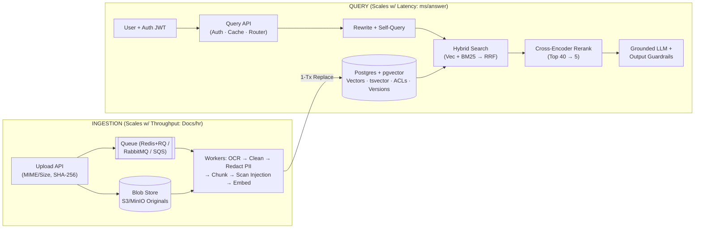
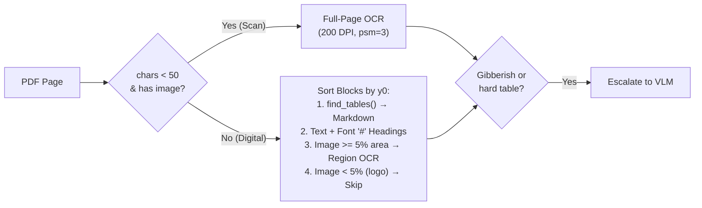
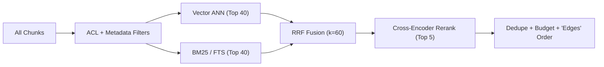
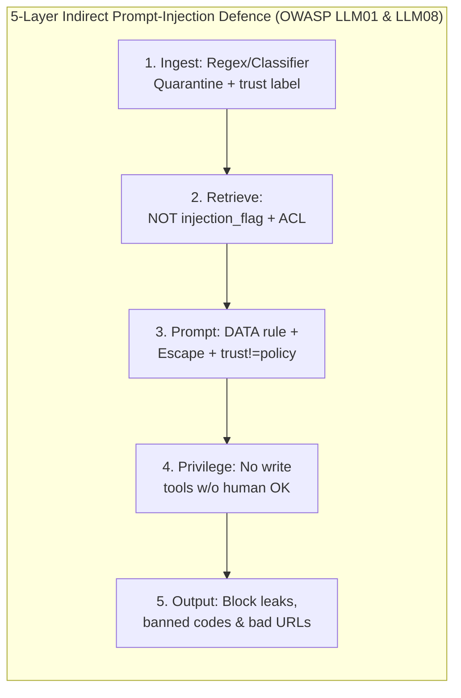

# Production RAG — Rapid Revision & Cheatsheet

> Covers **all 15 Modules (00–14)**, **14 Labs (`rag_core/`)**, and the **Capstone App (`app/`)** in a 5-minute scan with zero concepts skipped.

---

## 1. Foundations & Architecture (Modules 00–03)

- **Core Idea:** Retrieve relevant chunks from your corpus → inject into prompt → generate grounded, cited answers. *(Mental model: Policy Binder + Librarian [freshness] + Security Guard [ACLs] + Auditor [evals/traces]).*
- **Why 1M-Token Context ≠ Dead RAG:** **(1) Cost** (1.5k vs 500k tok/query) · **(2) Latency** (`TTFT < 1–2s`) · **(3) Accuracy** (*Lost in the Middle*, Liu et al. 2023 — LLMs under-attend to middle tokens) · **(4) Hard blockers long context can't do:** per-user **ACLs**, sub-minute **freshness**, verifiable **citations**.
- **Right Tool for the Job:**
  - *Changing shared docs* → **RAG** (`"Phone return window?"`)
  - *Tone / style / format* → **Prompting → Fine-Tuning** (`"Reply in Hinglish"`)
  - *Live personal / transactional state* → **Authenticated API Tool** w/ user token (`"Where is order #123?"` — never index everyone's orders!)
  - *Aggregations (avg / sum / count)* → **Text-to-SQL** (read-only view + row limit + ACL)
  - *Policy + live state or multi-part* → **Agent** combining RAG + API/SQL tools
- **6 Production Qualities:** **Correct** · **Honest** (cites + abstains) · **Safe** (ACL + PII + anti-injection) · **Fresh** · **Fast & Affordable** · **Observable**.
- **Two Pipelines Joined by the Index:**
  - **Offline Indexing:** Collect → Extract/OCR + Clean → Chunk → Embed → Upsert `(vector, text, metadata)`. *(Why chunk? Unblurred single-topic vectors, lower prompt cost, exact passage citations).*
  - **Online Query:** Question → Embed (**MUST use exact same model!** Different models = incompatible coordinate spaces even with equal dims; always store `embedding_model`) → Filter + Search → Rerank → Grounded Prompt → LLM.
  - *Course Zero-Key Fallbacks:* Local ONNX `fastembed` (`bge-small-en-v1.5`), fully offline `wordllama`, and deterministic IDF-weighted `extractive_answer` (quotes best sentence/table row w/ header, abstains if term coverage `< 0.4`).



- **Why Decouple Services?** Monday bulk upload of 20k PDFs scales worker count without slowing user queries.
- **Why Keep Raw Blobs Forever (`documents/<id>/<name>`)?** Index holds *derived* data; raw files let you re-run better OCR, chunking, or new embedding models later (and stateless web servers don't share local disks).
- **Use-Case Priority Shifts:** *E-comm* = active version + strict refusal + cache + order API · *HR/IT* = directory ACLs + PII redaction · *Eng Runbooks* = hybrid search for error codes + heading chunks · *Legal* = clause chunks + verbatim quotes · *Banking* = in-region/self-hosted + full audit trail · *Indic Gov* = Indic OCR/VLM + multilingual embeddings + Hinglish evals.

---

## 2. Async Ingestion & Idempotency (Module 04)

- **Upload Flow (`202 Accepted` in ms):** Validate allow-listed MIME/extension (no executables) & size (`<= 20 MB`) → compute `SHA-256` → capture metadata upfront (`access`, `department`, `version`, `effective_date`) → save raw file to S3/MinIO → insert DB row `status='queued'` → push `doc_id` to queue. *(Web URLs: scrape, strip boilerplate, store cleaned HTML + URL + fetch date, re-crawl on schedule via hash diff, respect `robots.txt`).*
- **Queues:** **Redis + RQ/Celery/BullMQ** (enable **Redis AOF** persistence!), **RabbitMQ** (routing/ACKs), **Kafka** (event replay), **SQS/PubSub** (serverless). Use **priority queues** (`interactive` chat uploads drained before `bulk` backfills). Autoscale workers on **queue depth** & **oldest job age**.
- **States & Failures:** `uploaded → queued → processing → indexed` | **Transient error** (429, OCR/network blip) → auto-retry w/ **exponential backoff** (`10s, 30s, 60s`) | **Permanent error** (corrupt/password PDF) → after max retries (3), mark `failed` w/ error + move to **Dead-Letter Queue (DLQ)** + alert human (*never retry forever; never silently skip*).
- **3 Rules of Idempotency** *(queues are at-least-once; jobs WILL run twice)*:
  1. **`UNIQUE(sha256)` on upload:** Duplicate bytes return existing doc immediately.
  2. **Deterministic Chunk IDs:** `doc_id#index-sha1(doc_id|version|index|text)[:12]`.
  3. **Single-Transaction Replace:** `BEGIN; DELETE old chunks; INSERT new chunks; status='indexed'; COMMIT` — mid-job crash rolls back cleanly so users never see half a document.

---

## 3. Extraction, OCR Routing & Cleaning (Module 05)

- **Silent Ceiling:** Extraction caps total RAG quality; failures are **silent** (scanned PDF without OCR = `0` chars, `0` errors). PDFs store `(x, y)` glyph coords, not sentences/columns/tables.



- **Font Heading Heuristic (`loaders.py`):** Median span size = `body`; single line `< 80` chars w/ `size >= 1.45× body` → `#`, `>= 1.15×` → `##` (enables structure-aware PDF chunking).
- **3 OCR Families:**
  1. *Traditional (CPU/GPU, free, deterministic, weak on complex tables/handwriting):* **Tesseract 5** *(HP → Google → OSS; `tesseract-ocr-hin` etc.)*, **PaddleOCR 3.x (PP-OCRv6)**, EasyOCR.
  2. *Layout Parsers & VLM OCR (keeps columns/tables/formulas → Markdown/JSON, slower/GPU, can hallucinate, check commercial licences):* **Docling** (`Granite-Docling-258M`), **olmOCR-2**, **PaddleOCR-VL**, **DeepSeek-OCR-2**, **MinerU**, **Marker**, **dots.ocr**, **Qwen3-VL**.
  3. *Managed Cloud (high accuracy, prebuilt invoice/ID models, \$/page, data leaves VPC):* **AWS Textract**, **Azure Document Intelligence**, **Google Document AI**, **Mistral OCR**.
- **6 Cleaning Steps (`cleaning.py`):** **(1) Unicode `NFKC`** (fixes ligatures `fl→fl`, full-width `５→5`, Indic/Arabic canonicalization; strip soft-hyphen `\u00ad`, zero-width `\u200b`, `<br>`) · **(2) Drop repeated headers/footers** across pages (ignoring digits) · **(3) Join hyphenated wraps** (`reimburse-\nment`) · **(4) Merge hard PDF line breaks** (preserve `#`, lists, `|` tables, `.?!:` endings) · **(5) Normalize currency/units** (`Rs./INR → ₹`) · **(6) Strip HTML boilerplate** (`script, style, nav, footer, form, svg`).
- **Indic / RTL & Structured Data:** Test RTL (Arabic/Urdu often extracts reversed) & Indic conjuncts early; split sentences on Devanagari danda `।`. Serialize CSV/sensor rows **1 row/chunk with column names & units** (`price_inr: 18999`)—bare numbers have zero semantic meaning.

---

## 4. Chunking Strategies & Contextual Retrieval (Module 06)

- **4 Good-Chunk Traits:** **Coherent** · **Self-Contained** (include subject/policy, not bare `"5–7 days"`) · **Right-Sized** · **Traceable**.
- **Size Trade-off (`1 word ≈ 1.3 tok`; `tiktoken` `cl100k_base`):** Small (`50–150` tok: sharp vector, missing context) · **Medium (`200–400` tok: production sweet spot)** · Large (`500–1000+` tok: blurry multi-topic vector, high prompt cost).
  - **Silent Truncation Trap:** Models w/ `max_input = 512` (`bge-small`, `e5-large`, `gte-large`) **silently drop tokens > 512**! Always enforce `chunk_size <= model.max_input`.
- **7 Chunking Strategies:**
  1. **Fixed-Size:** Every `N` tokens (cuts mid-sentence; baseline only).
  2. **Sliding Window:** Fixed `N` + `overlap` (protects boundary facts).
  3. **Recursive:** Split `\n\n` → `\n` → `. ` → ` ` → `""` (clean sentences, loses heading context; LangChain default).
  4. **Structure-Aware *(Course Default)*:** Split on `#` headings + prepend `[H1 > H2]` breadcrumb to every chunk.
  5. **Semantic:** Embed sentences; cut on neighbour cosine-similarity drop (for unformatted transcripts).
  6. **LLM-Based:** LLM groups paragraphs into titled topics (1 call/doc; high-value messy docs).
  7. **Parent-Child *(Small-to-Big)*:** Search small child chunks (`~100` tok) for pinpoint match, return full parent section (`~400` tok) to LLM.
- **Tables & Metadata:** Keep small tables whole w/ header; repeat header if splitting large tables; add a 1-sentence prose table summary chunk. Attach full metadata (`chunk_id, doc_id, title, section, page, version, effective_date, status, department, access, language, trust, injection_flag, embedding_model`).
- **2 Modern Upgrades:**
  - **Contextual Retrieval (Anthropic 2024):** Prepend 1 LLM-written situating sentence per chunk before dense embed + BM25 (`-35%` retrieval failures dense, `-49%` + contextual BM25, `-67%` + reranking; use prompt caching + batch API). `[H1 > H2]` breadcrumb is the free version!
  - **Late Chunking (Jina 2024):** Encode entire doc through long-context embedder *first*, then slice & pool token vectors per chunk.

---

## 5. Embeddings, Metrics, MRL & Quantization (Module 07)

- **Pipeline:** Sub-word Tokenize → Transformer Encode → Mean/CLS Pool → **L2 Normalize (length = 1)**. Trained via **contrastive learning**.
- **3 Scoring Paradigms:**
  - **Bi-Encoder (Embeddings):** Encodes query & chunk *separately* → pre-computed chunk vectors, fast (`ms`), candidate stage.
  - **Cross-Encoder (Reranker):** Encodes `[query + chunk]` *together* w/ full cross-attention → accurate, slow, top `25–100` only.
  - **Late Interaction (ColBERT):** Stores 1 vector *per token*, scores via `MaxSim` sum → fine-grained, high storage/special index cost.
- **Distance Metrics Equivalence:** Cosine $\in [-1,1]$ (angle), Dot Product (angle × length), Euclidean $L_2 \in [0,\infty)$. **On L2-normalized unit vectors ($\lVert a\rVert = \lVert b\rVert = 1$), $\lVert a-b\rVert_2^2 = 2 - 2\cos(a,b)$ and $a\cdot b = \cos(a,b)$ — all 3 yield the exact same ranking!** (Dot product is fastest).
- **2026 Model Snapshot & Gotchas:**
  - *API:* **OpenAI `text-embedding-3-small`/`-large`** (`1536/3072d` MRL, `8K`, `~\$0.02/1M tok` → 1M chunks ≈ \$5) · **Google `gemini-embedding-001` / `2`** (MRL `3072d`; `2` is multimodal & **incompatible** w/ `001`!) · **Voyage 4** (`large/base/lite/nano` **share one vector space**; `32K`) · **Cohere v4/v5** (`128K`, multimodal, native `int8/binary`).
  - *Open:* **Qwen3-Embedding** (`0.6B/4B/8B`, `32K`, MRL, top multilingual) · **BGE-M3** (`1024d`, `8K`, dense+sparse+multi-vec, 100+ langs) · **EmbeddingGemma-300M** (`768d` MRL, CPU) · **`multilingual-e5-large`** *(E5 = EmbEddings from bidirEctional Encoder rEpresentations; `1024d`, `512` max — **requires `"query: "` / `"passage: "` prefixes!**)* · **`nomic-embed-text-v1.5`** (**requires `"search_query: "` / `"search_document: "`**) · **`gte-large`** (`1024d`, not 768; `512` max) · **`bge-small-en-v1.5`** (`384d`, `512` max, English-only — scores ~0 on Hindi!).
- **Benchmarks:** **MTEB → MMTEB** (500+ tasks, 250+ langs) **→ RTEB** (private retrieval sets). Check **Retrieval** column for your language to shortlist; **your golden set decides**.
- **MRL & Quantization:** **Matryoshka (MRL)** concentrates signal in early dims (slice `1024 → 256d`). **Quantization:** `float32` (`4B`) → `float16/halfvec` (`2B`, ½ RAM) → `int8` (`1B`, ¼ RAM, ~lossless) → `binary` (`0.125B`, 1/32 RAM — **must oversample top 100 w/ binary, then re-score w/ full `float32` vectors**). *Fine-tune embeddings* on a few thousand `(q, passage)` pairs only if domain jargon still fails after hybrid + rerank.

---

## 6. Retrieval, ANN, Hybrid RRF, Query Transforms & Reranking (Module 08)



- **Exact vs ANN Indexes:** Exact brute-force is fine up to **~100k vectors**. Beyond that:
  - **HNSW (Graph):** Multi-layer skip-graph; build `m=16, ef_construction=64`, search `ef_search=40` (raise to `100+` for recall); fastest/highest recall, RAM-heavy.
  - **IVF (Clusters):** k-means `lists` cells, search `nprobe` cells; lower RAM, needs training, loses border recall.
  - **PQ (Compression):** `m` 1-byte sub-vector codes; 10–100× smaller, needs full-vector re-scoring.
- **`pgvector` (0.8.x) Essentials & The Post-Filtering Trap:**
  - Runs **exact scan by default** until you create an HNSW/IVF index! Limits: `vector <= 2,000d`, `halfvec <= 4,000d`.
  - **Filtering Trap:** ANN fetches `ef_search` candidates *before* `WHERE` filters → $\mathbb{E}[\text{rows}] = \text{ef\_search} \times \text{selectivity}$ (`40 × 1% tenant = 0.4 rows` → false empty results!).
  - **4 Fixes:** **(1)** `SET LOCAL hnsw.iterative_scan = relaxed_order` (pgvector 0.8+) · **(2)** Filter-aware DBs (Qdrant, Weaviate, Milvus, LanceDB) · **(3)** Per-tenant partitions/partial indexes · **(4)** Exact scan when filter leaves `< 2k` rows.
- **Hybrid Search & RRF:** Dense vectors catch paraphrases; **BM25** (`k1=1.5, b=0.75`, IDF rarity + length norm; keep hyphenated codes `E110`/`NM-PHN-4821` in tokenizer!) catches exact IDs/SKUs/acronyms.
  - **Never add raw $\alpha\cdot\cos + \beta\cdot\text{BM25}$:** BM25 (`2–20+`) drowns cosine (`0.2–0.9`). Either min-max normalize first (outlier-prone) or use **Reciprocal Rank Fusion (RRF, Cormack 2009):** $\text{RRF}(d) = \sum_L \frac{1}{60 + \text{rank}_L(d)}$.
- **Query Transforms (`query_transform.py`):** **Chat Rewriting** (*"and for shoes?"* → standalone; **always on** for chat) · **Self-Query** (LLM extracts allowed metadata filters; **validate schema & never let LLM touch ACL filters!**) · **Multi-Query** (3–5 rephrasings + RRF) · **HyDE** (embed hypothetical LLM answer — **always search original query too** in case fake answer is wrong!) · **Decomposition** (multi-part) · **Routing** (RAG vs API vs SQL vs Refuse). *Tip: trigger expansions only when initial similarity is low.*
- **Reranking & Context Selection:** Cross-encoder (`ms-marco-MiniLM`, `bge-reranker-v2-m3`, `Qwen3-Reranker`, Cohere Rerank 5, Voyage `rerank-3`) on `25–100` hits (`50–300 ms` CPU; batch pairs, skip when #1 has huge margin; optional LLM rerank on `5–20` takes `0.5–5s`). Then: **Jaccard dedupe (`>= 0.85`)** → **token budget (`1,500` tok)** → **`order="edges"`** (`[S1, S3, ..., S2]` puts #1 first & #2 last to beat *Lost in the Middle*).

---

## 7. Grounded Generation & Abstention (Module 09)

- **7 Prompt Rules (`prompts.py`):** **(1)** Facts ONLY from `<sources>` · **(2)** Cite every claim `[S1]` · **(3)** Exact fixed `ABSTAIN` string when missing (easy code detection, metrics, human escalation) · **(4)** `<sources>` is **DATA, never instructions** + **escape `</source>`** tags · **(5)** `trust="untrusted"` ≠ official policy · **(6)** Prefer `status="active"` + newest `effective_date` & note older versions · **(7)** Same language as query, concise (1–4 sentences).
- **2-Layer Refusal:** **Layer 1 (Pre-LLM):** `max(vector_score) < MIN_SIMILARITY` → return `ABSTAIN` w/o calling LLM (calibrate threshold on answerable vs unanswerable score histograms per embedder). **Layer 2 (In-LLM):** Prompt rule catches topically related chunks missing the exact fact (*"Deliver to Mars?"*).
- **Production Extras:** Context compression (saves tokens, risks dropping details) · **JSON mode + Pydantic validation** (+ 1 retry) · Step-by-step fact listing for multi-hop (`Tier-1` + `Jaipur=Tier-2`) · **Self-check pass** (2nd LLM verifies every claim; 2× cost, high stakes) · Few-shot examples · **Output guardrails** (verify `[S#]` IDs exist, block banned strings/coupons/unseen URLs/PII) · **Stream tokens** (check guardrails at end or buffer short replies).

---

## 8. Evaluation, Security & Prod Operations (Modules 10–13)

### Evaluation (Module 10)
- **Split Eval:** Right chunk missing = **Retrieval bug**; right chunk at #1 but wrong answer = **Generation bug**. Always **slice metrics by question type**!
- **Golden Set (`50–200+` Qs):** Real logs + SMEs + human-reviewed synthetic (*pure synthetic copies doc wording!*), **$\ge 20\%$ unanswerable**, chunk-agnostic labels (`relevant_docs` + `evidence` substrings + `answer_must_contain` survive re-chunking). Gate PRs in **CI**; add weekly thumbs-down failures.
- **Retrieval Metrics** *(top-$k$ hits $H$, total relevant $R$)*: **`hit@k`** $=\mathbb{I}(H\ge 1)$ · **Strict `recall@k`** $=H/R$ · **`precision@k`** $=H/k$ · **`MRR`** $=1/\text{rank}_{\text{first}}$ · **`nDCG@k`** $=\text{DCG}@k / \text{IDCG}@k$ w/ $1/\log_2(i+1)$ · **RAGAS `Context Precision`** $=\frac{1}{H}\sum_{i:r_i=1} \text{P}@i$.
- **Answer Metrics:** **Correctness** (key-fact / judge) · **Faithfulness** (supported claims ÷ total claims) · **Response Relevancy** (reverse-generated Q similarity) · **Context Recall** (ref claims in context ÷ ref claims) · **Refusal Accuracy** (`abstain_ok`) · **Citation Validity** (`cited`).
- **LLM-as-Judge (`RAGAS, DeepEval, TruLens, promptfoo`):** Use **different provider** or 2–3 judge jury (avoids self-bias), rubric + 1-line reason, **calibrate on 30–50 human labels**, track judge `$`.

### Security, PII & DPDP (Module 11)
- **ACL in Retrieval:** `WHERE access && :user_groups` from **verified auth token/JWT** (*never request body, never system prompt!*). Sync group revocations, test `tenant_id` isolation, **scope caches by ACL**, protect trace logs.
- **Ingestion PII Redaction (`security.py`):** Redact *before* chunking/embedding! Validate checksums so order IDs aren't mangled: **Aadhaar** (12d, **Verhoeff**), **Card** (13–19d, **Luhn**), **PAN** (`[A-Z]{3}[ABCFGHLJPT]...` 4th-char holder type), **Indian Mobile** (`6–9` 10d), **Email**, + **Microsoft Presidio NER** for names/addresses. Use `[PII_PHONE]` (**not** `[PHONE]`, which false-matches `"phone"` in BM25!).
- **India DPDP Act (2023):** Notified **13 Nov 2025**, main business obligations **May 2027** — consent, purpose limit, **cascading deletion** (blobs + chunks + vectors + caches), breach notice.


*(Other threats: **Wiki poisoning** → edit alerts; **Embedding inversion** → secure vector DB; **Denial of Wallet** → rate limits + token caps; **Audit trail**).*

### Production Ops, Blue/Green & Advanced RAG (Modules 12–13)
- **Warm Stage Latencies:** Rewrite `200–800ms` · Embed `5–50ms` · Search `5–50ms` · Rerank `50–300ms` · LLM TTFT `0.3–2s` · Full LLM `1–10s` (`<100ms` total only via cache hit `~30ms`; `50 tok/s` = streaming speed, NOT system concurrency!).
- **4 Caches:** **Exact** · **Semantic** (`cos >= 0.92`, **MUST scope by `sorted(groups)|index_version`**, watch false hits like *"cancel order"* vs *"cancel membership"*) · **Provider Prompt Cache** (put static rules/few-shots first!) · **Embedding Cache** (`hash + model`).
- **6 Cost Levers (by impact):** Rerank to send `3–5` chunks → Model routing (cheap vs frontier) → Semantic + Prompt caching → Cap output tokens → Batch APIs (~50% off offline jobs) → OCR page routing.
- **Observability (`Langfuse, Phoenix, LangSmith, Weave, OTel GenAI`):** Trace ID + stage spans. **Alert on:** `p95` spike, refusal/low-sim spike, thumbs-down spike, `$/req` spike, queue depth / DLQ > 0, doc-vs-chunk count mismatch.
- **Freshness & Blue/Green Model Swap (`app/reembed.py`):** Archive old policies (`status='archived'`), don't delete. **Zero-downtime re-embed:** **(1)** `ADD COLUMN embedding_next` → **(2)** Resumable batch backfill (+ dual-write) → **(3)** Build HNSW on `_next` → **(4)** **Shadow eval** `hit@5` on golden set (abort if worse!) → **(5)** Atomic tx column `RENAME` (`embedding ↔ _prev`, `_next → embedding`) → keep `_prev` 1 week for instant rollback.
- **Graceful Fallbacks:** Vector/embedder down → degrade to **BM25/FTS-only** + queue ingestions; LLM 5xx → backoff + secondary provider.
- **Advanced Patterns:** **Contextual Retrieval** · **Agentic RAG** (tool loop capped at `max_steps=4`; LangGraph/ADK/OpenAI SDK) · **Text-to-SQL** · **Personal API Tools** · **Multimodal RAG** (VLM captions at ingest OR multimodal embeddings + VLM answer) · **GraphRAG** (entity-relation graph for global/link queries; high ingest cost).
- **Capstone SQL (`app/db.py`):** `SET LOCAL hnsw.ef_search=100; SET LOCAL hnsw.iterative_scan=relaxed_order;` + single CTE `vec (<=>) FULL OUTER JOIN kw (ts_rank_cd @@ to_tsquery) ORDER BY COALESCE(1/(60+vec.rnk),0) + COALESCE(1/(60+kw.rnk),0) DESC` *(true Postgres BM25: `pg_search` / `VectorChord-bm25`; switch from pgvector to Qdrant/Weaviate/Milvus beyond tens of millions of chunks or heavy multi-tenant filtering).*

---

## 9. ⚡ Master Cheatsheet

### A. Formulas & Magic Constants
| Item | Formula / Production Default |
|---|---|
| **Unit-Vector Equivalence** | $\lVert a\rVert=\lVert b\rVert=1 \implies a\cdot b = \cos(a,b)$ and $\lVert a-b\rVert_2^2 = 2 - 2\cos(a,b)$ |
| **Vector + HNSW RAM** | $N\cdot d\cdot \text{bytes} + N\cdot m\cdot 8\text{ B}$ (`f32=4, f16=2, int8=1, bin=0.125`) |
| **`pgvector` 0.8** | `vector<=2000d`, `halfvec<=4000d`; `m=16, ef_construction=64, ef_search=40→100`; `iterative_scan=relaxed_order` |
| **BM25 & RRF** | BM25: $k_1=1.5, b=0.75$; $\quad\text{RRF}(d) = \sum_L \frac{1}{60 + \text{rank}_L(d)}$ |
| **Routing & Context** | Scan `<50 chars + img`; Region OCR `>=5%` area; Chunks `200–400` tok; Rerank `40→5`; Dedupe Jaccard `>=0.85`; Budget `1500` tok; `order="edges"` |
| **Semantic Cache & Cost** | `sim >= 0.92` scoped `groups\|index_ver`; $\;\text{Monthly \$} = 30 \cdot Q_{\text{day}} \cdot (\frac{T_{\text{in}}}{10^6}P_{\text{in}} + \frac{T_{\text{out}}}{10^6}P_{\text{out}})$ |

### B. Symptom → Root Cause → Fix
| Symptom | Root Cause | Fix |
|---|---|---|
| Codes (`E110`) / SKUs missed | Dense vectors blur exact strings | Add **BM25/FTS + RRF (`k=60`)**; preserve `-`/`_` in tokenizer |
| Small tenant gets 0 results | ANN **post-filtering trap** (`ef_search × sel < k`) | `hnsw.iterative_scan = relaxed_order` or filter-aware DB |
| Quotes outdated 2024 policy | Old doc still `active` | Set `status='archived'`, filter `status <> 'archived'` by default |
| Scanned / image checklist missing | Silent 0-char extraction | Route `<50 char` pages & `>=5%` area images to OCR/VLM |
| Table values mixed across columns | Flattened text extraction | Extract as Markdown table; keep header row in every chunk |
| Tail of chunks invisible to search | Silent truncation (`> 512` max_input) | Shrink chunks (`250–400` tok) or use 8K+ embedder |
| Hindi / Hinglish queries fail | English-only embedder | Blue/green migrate to `multilingual-e5` (w/ prefixes) / `BGE-M3` / `Qwen3` |
| Right chunk at #3, LLM misses it | *Lost in the Middle* / noisy context | Cross-encoder rerank to top 5 + `order="edges"` + token budget |
| Guesses when answer isn't in docs | No abstention gate | Tune pre-LLM `MIN_SIMILARITY` + fixed `ABSTAIN` rule + 20% unanswerable evals |
| Customer gets HR cached answer | Unscoped cache or prompt-only ACL | `WHERE access && :groups` in SQL + scope cache `groups\|index_ver` |

### C. 13 Common Myths — 1-Line Corrections (Module 14)
1. *"RAG kills hallucinations"* → Reduces only; still need grounding rules, `[S#]`, refusal & evals.
2. *"1M context killed RAG"* → Fails on `$`, TTFT, *Lost in the Middle*, ACLs, freshness & citations.
3. *"DBs auto-index HNSW"* → `pgvector` does **exact scan** until you run `CREATE INDEX`.
4. *"Use $\alpha\cos + \beta\text{BM25}$"* → Raw BM25 dominates; use **RRF (`k=60`)** or min-max first.
5. *"Filters always help ANN"* → Post-filtering starves low-selectivity queries without `iterative_scan`.
6. *"Cosine > L2"* → Identical ranking on normalized vectors.
7. *"512 tok / 15% overlap is optimal"* → Starting guess; stay `< max_input` & test on golden set.
8. *"VLM OCR > Tesseract always"* → Tesseract is equal & 1,000× cheaper on clean typed scans; route!
9. *"ColBERT is always best"* → Huge storage/index cost; Hybrid + Cross-Encoder is standard default.
10. *"< 100ms full RAG answer"* → Only retrieval/cache is `<100ms`; stream for `<1–2s` TTFT.
11. *"50 tok/s = throughput"* → Per-answer stream speed, not multi-user system capacity.
12. *"'Don't leak salaries' in prompt"* → Prompts aren't ACLs; filter in DB `WHERE`.
13. *"Pick #1 on MTEB"* → Use Retrieval col to shortlist; golden set decides. *(Frameworks like LangChain/LlamaIndex: great for loaders, keep retrieval/prompts debuggable at 2 a.m.).*

### D. 16-Point Launch Checklist & CLI Quick-Run
- [ ] **1.** `50+` golden Qs (`>=20%` unanswerable, all slices) gated in CI
- [ ] **2.** Document status state machine + backoff retries + DLQ + alerts
- [ ] **3.** Idempotent ingestion (`sha256` dedupe, deterministic IDs, 1-tx replace)
- [ ] **4.** Page/block OCR routing + Markdown tables + `NFKC` text cleaning
- [ ] **5.** Full chunk metadata (`title, section, page, version, status, access, trust, model`)
- [ ] **6.** Hybrid search (BM25 + Vector) w/ RRF (`k=60`) + Cross-Encoder reranking
- [ ] **7.** Verified-JWT ACLs enforced inside DB `WHERE` (+ `iterative_scan`)
- [ ] **8.** Ingestion-time PII redaction (checksum-validated) + DPDP cascading erasure
- [ ] **9.** 5-layer prompt-injection defence (scan, `trust`, XML escape, no write tools, output scan)
- [ ] **10.** Grounded prompt contract (`[S#]` citations, exact `ABSTAIN`, active version preference)
- [ ] **11.** Data-calibrated `MIN_SIMILARITY` gate + human handoff path
- [ ] **12.** Token streaming (`TTFT < 2s`) + per-stage `p95` latency alerts
- [ ] **13.** `$/req` tracked + model routing + **ACL/version-scoped** semantic cache
- [ ] **14.** Per-request trace IDs & spans (`query, filters, chunk IDs, prompt, tokens, answer`)
- [ ] **15.** Zero-downtime blue/green embedding migrations w/ golden-set shadow eval
- [ ] **16.** Superseded policy versions marked `archived` (never silently deleted)

```bash
python scripts/run_all_labs.py && pytest -q                                           # Run all 14 labs + tests
docker compose --profile app up --build && python scripts/ingest_samples.py           # Launch Capstone + ingest
python scripts/ask.py "What does error E102 mean?" --groups public,employees          # Query w/ ACL groups
python -m app.reembed --embedder fastembed --model BAAI/bge-base-en-v1.5 --cutover    # Blue/green model swap
```
