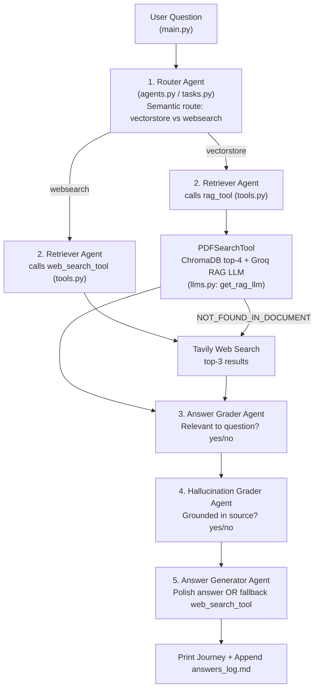

# Agentic RAG with DeepSeek + CrewAI — Project Map

> **Directory:** [`study-material/02-agentic-rag/`](file:///Users/pankaj/Workspace/ai-bootcamp/study-material/02-agentic-rag)  
> **Architecture:** 5-Agent sequential CrewAI workflow with a Two-LLM strategy (Main reasoning brain + fast Groq RAG tool brain)  
> **Course Companion:** [`02-Agentic_RAG_Guide.html`](file:///Users/pankaj/Workspace/ai-bootcamp/study-material/02-agentic-rag/02-Agentic_RAG_Guide.html) · [`02-Agentic_RAG_Revision_Notes.md`](file:///Users/pankaj/Workspace/ai-bootcamp/study-material/02-agentic-rag/02-Agentic_RAG_Revision_Notes.md)

---

## 1. Architecture & Execution Flow

This project contrasts single-pass **Plain RAG** (`step1_plain_rag.py`) against a **5-Agent CrewAI system** (`main.py`, `agents.py`, `tasks.py`, `tools.py`) that routes questions between a private PDF (ChromaDB + `BAAI/bge-small-en-v1.5`) and live Tavily web search, then grades relevance and groundedness before emitting a final answer.



---

## 2. Annotated Directory & File Tree

```text
study-material/02-agentic-rag/
├── 02-Agentic_RAG_Guide.html         # Interactive 20-section study guide explaining every concept & file
├── 02-Agentic_RAG_Revision_Notes.md  # Quick revision notes, metro-map diagram & troubleshooting cheat sheet
├── 02-Agentic_RAG_Project_Map.md     # This project map
└── code/
    ├── .env                          # Active local environment secrets & model config
    ├── .env.example                  # Template for OpenRouter/Groq/Tavily keys, LLM_MODE, PDF_PATH, PDF_TOPIC
    ├── .python-version               # Python version pin for the project environment
    ├── README.md                     # Setup instructions, file run order, Ollama guide & common errors
    ├── requirements.txt              # crewai[tools], sentence-transformers, tavily-python, python-dotenv
    │
    ├── step0_simulate_flow.py        # Zero-dependency pure-Python simulation of all 5 agents & toy vector DB
    ├── step1_plain_rag.py            # Baseline single-pass RAG (PDFSearchTool + 1 LLM call, no routing/grading)
    ├── config.py                     # Centralized .env settings loader + check_keys() startup validator
    ├── llms.py                       # Two-LLM factory: get_main_llm() + get_rag_llm() + clean_text()
    ├── tools.py                      # rag_tool (ChromaDB + PDFSearchTool) and web_search_tool (Tavily)
    ├── agents.py                     # CrewAI Agent definitions for the 5 specialized roles
    ├── tasks.py                      # CrewAI Task definitions & context=[...] data-flow wiring
    ├── main.py                       # Orchestrator: downloads PDF, builds Crew, runs single/--chat, logs to answers_log.md
    └── data/                         # Target directory for private PDF (default: attention_is_all_you_need.pdf) & Chroma store
```

---

## 3. File-by-File Breakdown

| File | Key Symbols | Purpose & Behavior |
|---|---|---|
| [`step0_simulate_flow.py`](file:///Users/pankaj/Workspace/ai-bootcamp/study-material/02-agentic-rag/code/step0_simulate_flow.py) | `words()`, `split_into_chunks()`, `embed()`, `cosine()`, `rag_tool()`, `web_search_tool()`, `router_agent()`, `retriever_agent()`, `answer_grader_agent()`, `hallucination_grader_agent()`, `answer_generator_agent()`, `run()` | Pure-Python learning simulator with word-count embeddings and a fake web dict; includes `make_it_lie=True` demo showing the Hallucination Grader catching invented claims |
| [`step1_plain_rag.py`](file:///Users/pankaj/Workspace/ai-bootcamp/study-material/02-agentic-rag/code/step1_plain_rag.py) | `plain_rag()` | "Before" baseline: searches the PDF with `create_pdf_search_tool()` and makes a single `get_main_llm().call()` without routing, web fallback, or self-grading |
| [`config.py`](file:///Users/pankaj/Workspace/ai-bootcamp/study-material/02-agentic-rag/code/config.py) | `OPENROUTER_API_KEY`, `GROQ_API_KEY`, `TAVILY_API_KEY`, `LLM_MODE`, `RAG_LLM_MODE`, `PDF_PATH`, `PDF_TOPIC`, `MAX_RPM`, `check_keys()` | Single switchboard for API keys, model names, knowledge-base metadata (`PDF_TOPIC` guides the Router), rate limits, and startup config validation |
| [`llms.py`](file:///Users/pankaj/Workspace/ai-bootcamp/study-material/02-agentic-rag/code/llms.py) | `get_main_llm()`, `get_rag_llm()`, `_groq_llm()`, `clean_text()` | Implements the Two-LLM strategy: `get_main_llm()` configures OpenRouter DeepSeek / Groq / local Ollama; `get_rag_llm()` supplies a fast Groq model for `PDFSearchTool`; `clean_text()` strips `<think>...</think>` blocks |
| [`tools.py`](file:///Users/pankaj/Workspace/ai-bootcamp/study-material/02-agentic-rag/code/tools.py) | `create_pdf_search_tool()`, `create_rag_tool()`, `web_search_tool()` | `create_pdf_search_tool()` configures `PDFSearchTool` (ChromaDB + local `BAAI/bge-small-en-v1.5` embeddings); `create_rag_tool()` wraps it as `@tool("rag_tool")` with `NOT_FOUND_IN_DOCUMENT` sentinel; `web_search_tool()` queries Tavily (`WEB_RESULTS=3`) |
| [`agents.py`](file:///Users/pankaj/Workspace/ai-bootcamp/study-material/02-agentic-rag/code/agents.py) | `create_router_agent()`, `create_retriever_agent()`, `create_answer_grader_agent()`, `create_hallucination_grader_agent()`, `create_answer_generator_agent()` | Defines the 5 CrewAI agents (`allow_delegation=False`, `max_iter=5`) with role-specific backstories |
| [`tasks.py`](file:///Users/pankaj/Workspace/ai-bootcamp/study-material/02-agentic-rag/code/tasks.py) | `create_router_task()`, `create_retriever_task()`, `create_grader_task()`, `create_hallucination_task()`, `create_answer_task()` | Chains the 5 tasks via `context=[...]` and enforces concise task outputs (`vectorstore`/`websearch`, `yes`/`no`) |
| [`main.py`](file:///Users/pankaj/Workspace/ai-bootcamp/study-material/02-agentic-rag/code/main.py) | `download_pdf()`, `build_crew()`, `one_word()`, `ask()`, `main()` | Ensures the PDF exists, assembles `Crew(..., process=Process.sequential, max_rpm=config.MAX_RPM)`, runs one-off or `--chat` queries, and logs `route=... relevant=... grounded=...` to `answers_log.md` |

---

## 4. Quick Run & Config Reference

Run commands from [`study-material/02-agentic-rag/code/`](file:///Users/pankaj/Workspace/ai-bootcamp/study-material/02-agentic-rag/code):

```bash
python step0_simulate_flow.py                              # Pure Python flow demo (no API keys needed)
python step1_plain_rag.py "What is multi-head attention?"   # Plain RAG baseline
python main.py                                              # Agentic RAG on default Transformer question
python main.py "What is the latest version of Python?"      # Routed to Tavily web search
python main.py --chat                                       # Interactive multi-turn Q&A session
```

- **Key `.env` variables** ([`.env.example`](file:///Users/pankaj/Workspace/ai-bootcamp/study-material/02-agentic-rag/code/.env.example)): `LLM_MODE` (`openrouter` | `groq` | `ollama`), `RAG_LLM_MODE` (`groq` | `same`), `OPENROUTER_API_KEY`, `GROQ_API_KEY`, `TAVILY_API_KEY`, `PDF_PATH`, `PDF_TOPIC`, `EMBEDDING_MODEL`, `MAX_RPM`, `ANSWERS_LOG`.
