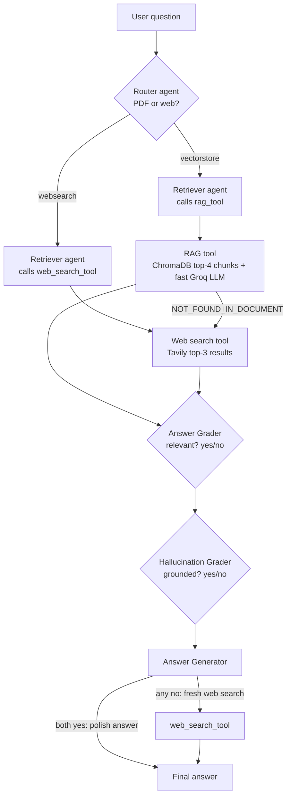
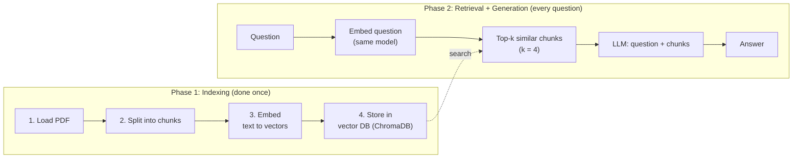
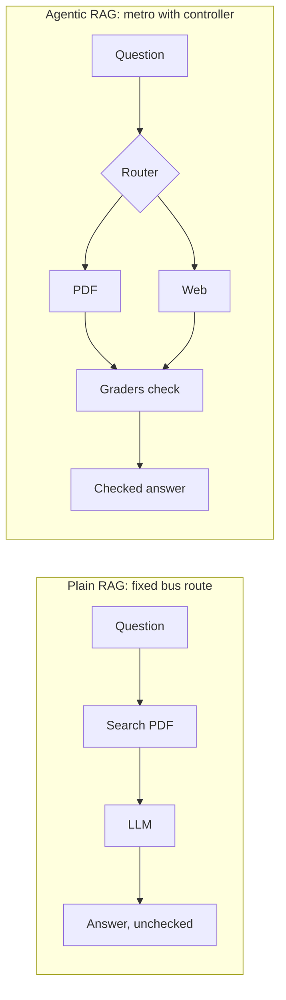
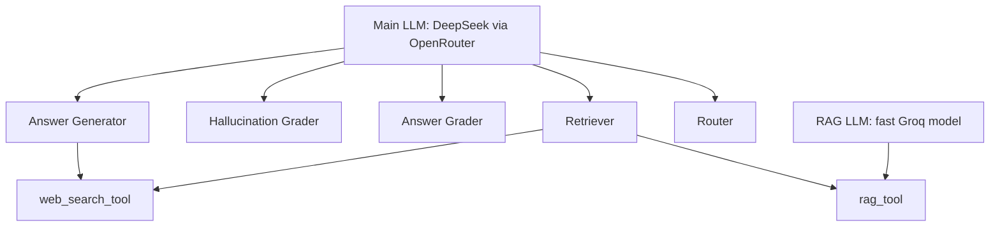
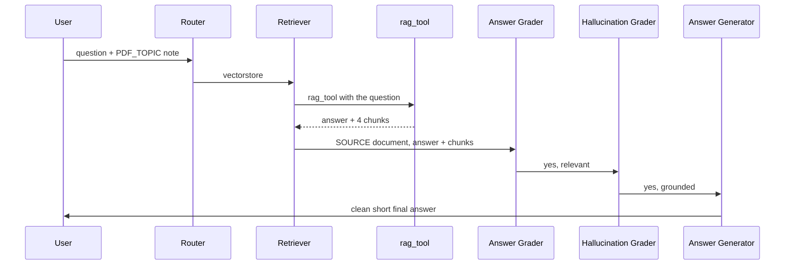
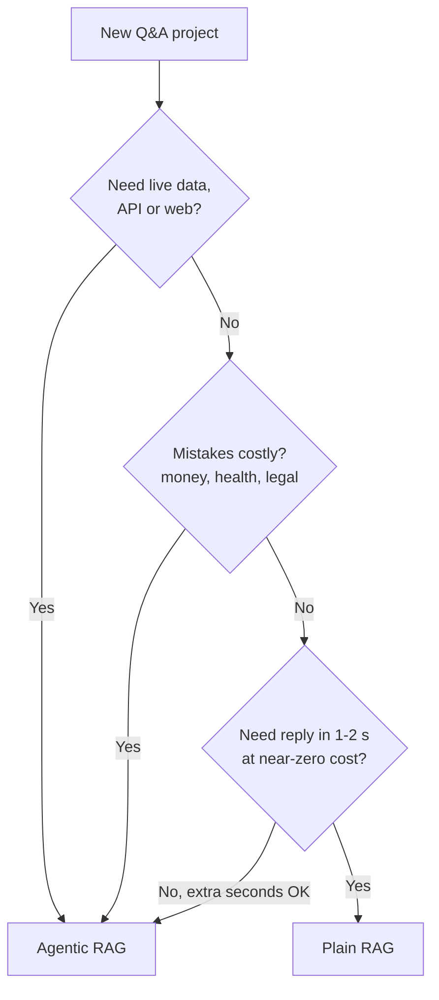
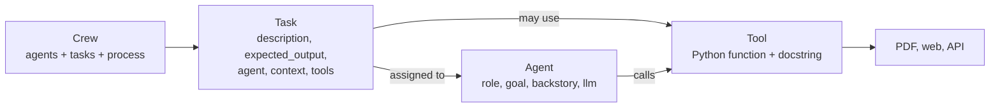
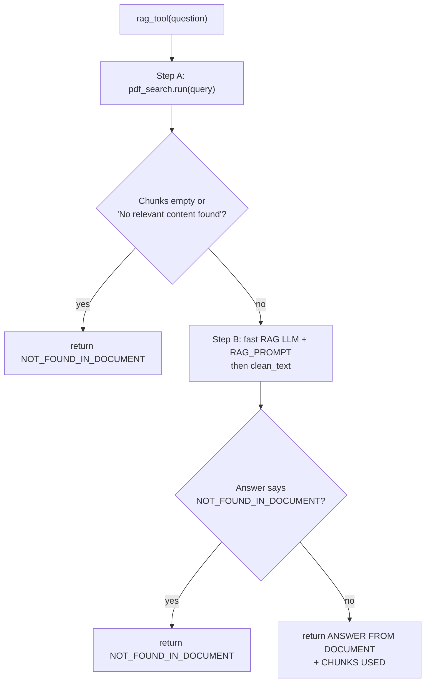
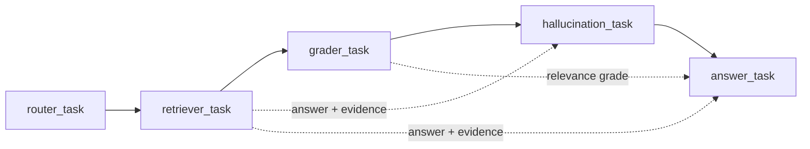

# Agentic RAG — Quick Revision Notes

**What this course is about:** You build a small **AI team** (with **CrewAI**) that answers questions from your own PDF. If the PDF has no answer, it searches the **internet**. It also **checks its own work** before it replies.
You learn plain RAG first, then the agentic version, file by file (`config.py`, `llms.py`, `tools.py`, `agents.py`, `tasks.py`, `main.py`). The brain is **DeepSeek**. You can run it in the cloud through OpenRouter or on your laptop with Ollama.

---

## Table of Contents

- [Big Picture: End-to-End Architecture](#big-picture-end-to-end-architecture)
1. [Why RAG exists](#1-why-rag-exists)
2. [Traditional RAG, step by step](#2-traditional-rag-step-by-step)
3. [Where plain RAG struggles](#3-where-plain-rag-struggles)
4. [Agentic RAG: the big idea](#4-agentic-rag-the-big-idea)
5. [Follow one question, end to end](#5-follow-one-question-end-to-end)
6. [Real-world use cases](#6-real-world-use-cases)
7. [The toolbox we use](#7-the-toolbox-we-use)
8. [Agent, Task, Tool, Crew](#8-agent-task-tool-crew)
9. [Set up the project](#9-set-up-the-project)
10. [Plain RAG first](#10-plain-rag-first)
11. [config.py and llms.py](#11-configpy-and-llmspy)
12. [tools.py](#12-toolspy)
13. [agents.py](#13-agentspy)
14. [tasks.py](#14-taskspy)
15. [main.py](#15-mainpy)
16. [Run it and read the output](#16-run-it-and-read-the-output)
17. [Run DeepSeek on your laptop](#17-run-deepseek-on-your-laptop)
18. [When things break](#18-when-things-break)
19. [Questions learners ask](#19-questions-learners-ask)
20. [Glossary](#20-glossary)
- [Cheat Sheet](#cheat-sheet)

---

## Big Picture: End-to-End Architecture

The course uses a **metro map** picture. A question enters at the **Router** junction. It takes either the **library line** (our PDF) or the **web line** (the internet). Then two inspectors (the graders) check it. If a check fails, a **red fallback line** goes to web search.



> **Tip:** The whole system has 5 agents, 5 tasks, 2 tools, and 2 LLMs. They run **sequentially** in one CrewAI **Crew**.

---

## 1. Why RAG exists

**In one line:** A smart LLM that has never seen your documents is still **guessing** about them. RAG hands it the right pages at the moment it needs them.

### Key concepts
- An **LLM (Large Language Model)**, such as DeepSeek, learned from huge amounts of **public** text. It knows general things like finance, Python, or Transformers.
- It has **never seen your private documents**: internal reports, HR policy, contracts, class notes.
- If you ask about them, it says "I don't know" or, worse, **confidently makes something up**. This is called **hallucination**.
- **RAG = Retrieval-Augmented Generation.** Read the words backwards:
  - **Generation:** the LLM writes an answer…
  - **Augmented:** …but first we **add extra information** to its prompt…
  - **Retrieval:** …which we **fetched** from our own documents.
- **No retraining and no fine-tuning.** We only add the right text to the prompt.
- **Analogy:** an **open-book exam**. The student (LLM) knows the subject but does better with the textbook open at the right page.

### Why not paste the whole document into the prompt?
- A PDF can be **hundreds of pages**. That is **slow** and **costly**, and it is often **more than the model can take in** at once.
- RAG sends only the **few most useful pieces**.

---

## 2. Traditional RAG, step by step

**In one line:** There are two phases. **Index the library once**, then **retrieve and generate** for every question.



### Step 1 — Load
- Read the documents: PDFs, Word files, web pages, text files.
- This project uses **one PDF**: *Attention Is All You Need*, the research paper that introduced the **Transformer** (the "T" in GPT).

### Step 2 — Split into chunks
- A **chunk** is a small piece of text, for example **1,000–2,000 characters**.
- Small pieces let us pick **only the parts that matter**.
- **Overlap:** neighbouring chunks often share a little text, so a sentence cut at the edge is not lost.
- **Trade-off:** **smaller chunks** are more precise but carry less context. **Bigger chunks** carry more context but also more noise.

### Step 3 — Embed (text → numbers)
- An **embedding model** turns each chunk into a list of numbers called a **vector**.
- The model used here is **`BAAI/bge-small-en-v1.5`**. It produces **384 numbers per chunk**.
- **Key property:** texts with **similar meaning** get **similar vectors**, even with different words. For example, "How do I cancel my order?" ≈ "Steps to stop a purchase".
- **Semantic search** means searching by **meaning**, not by exact words.

### Step 4 — Store in a vector database
- A **vector database** stores each vector plus its original text. It is built to **find the most similar vectors fast**.
- This project uses **ChromaDB**. It runs on your laptop and **saves to disk**, so indexing happens **only once**.

### Then, for every question
1. **Embed the question** with the **same embedding model**.
2. Ask the vector DB for the **top-k** most similar chunks. **k = 4** in our code.
3. Put the **question and the chunks** into a prompt and send it to the LLM.
4. The LLM writes the answer.

> **Tip (rule you must not break):** Embed the question and the documents with the **same embedding model**. Different models make different "maps", so distances between them mean nothing.

> **Tip:** In the agentic version, this **whole pipeline is wrapped inside one tool** (`rag_tool`).

---

## 3. Where plain RAG struggles

**In one line:** Plain RAG follows the **same fixed path every time**, even when that path is wrong.

| Problem | What happens |
|---|---|
| **Retrieval can miss** | The top-k chunks are only loosely related, so the LLM answers from the wrong material. |
| **Always searches the documents** | "What's the weather today?" still digs through the PDF and gives a bad answer. |
| **Can still hallucinate** | RAG reduces made-up facts a lot, but the LLM can still add facts that are not in the chunks. |
| **Nobody checks the work** | The output goes straight to the user. |

- **Analogy:** plain RAG is a **bus on one fixed route**. Agentic RAG is a **metro network**. A smart station controller (the Router) picks the line, and inspectors (the Graders) check the train before the final station.



---

## 4. Agentic RAG: the big idea

**In one line:** Replace the fixed pipeline with a **small team of AI agents** that **decide, fetch, and double-check**.

### What is an agent?
- An **agent** is an **LLM given a role, a goal, and permission to use tools**.
- The work is split across **five specialists**. Each one does **one narrow job**.

| # | Agent | One job | Real-life twin | Output |
|---|---|---|---|---|
| 1 | **Router** | Decides where the answer lives: the PDF or the internet | Hospital reception desk | `vectorstore` or `websearch` |
| 2 | **Retriever** | Calls the tool the Router picked and brings back the information | Librarian | Retrieved answer + evidence |
| 3 | **Answer Grader** | Checks whether the answer **addresses the question** (filters out wrong retrievals) | Teacher: "did you answer what was asked?" | `yes` / `no` |
| 4 | **Hallucination Grader** | Checks whether **every claim is supported** by the source text | Auditor: "show me the receipt" | `yes` (grounded) / `no` |
| 5 | **Answer Generator** | If both checks pass, polishes the answer. If either fails, searches the web and answers from that | News anchor | Final answer |

### Two tools
- **RAG tool:** the whole traditional RAG pipeline from Section 2, packed into one function.
- **Web search tool:** searches the internet and returns the **top 3 results**.
- Tools are **just functions**, so you can add more later: a SQL DB, a graph DB for customer relationships, a calculator, a company API. This makes the design **powerful and easy to extend**.

### Two LLMs
- **Main LLM:** **DeepSeek via OpenRouter**. It is the **brain of all five agents** and orchestrates the workflow.
- **RAG LLM:** a **fast model on Groq**. It lives **inside the RAG tool** and turns the retrieved chunks into a short answer. Speed matters here.



> **Tip (key shift):** In plain RAG, the path is **hard-coded**. In agentic RAG, an **LLM decides the path at run time** and **other LLMs verify** the result. You trade some **speed and cost** for **better routing and fewer wrong answers**.

---

## 5. Follow one question, end to end

**In one line:** It works like a **relay race**. Each agent does one lap and passes the baton.

### Library line: "What is self-attention?"



- **Router** receives the question and a one-line note about what the PDF holds. It says **`vectorstore`** because self-attention is a Transformer topic.
- **Retriever** calls `rag_tool("What is self-attention?")`. It returns `SOURCE: document`, the answer, and the **4 chunks** used.
- **Answer Grader** says **yes** because the answer is about self-attention.
- **Hallucination Grader** receives the answer, the 4 chunks, and the relevance grade. It says **yes** because every sentence traces to a chunk.
- **Answer Generator** receives the answer and both grades. It gives a clean final answer with **no mention of routing or grading**.

### Web line: "Who won yesterday's cricket match?"
- **Router** says **`websearch`**. A research paper can't know yesterday's score.
- **Retriever** calls `web_search_tool`. It returns `SOURCE: web` and the **top 3 results** with titles, links, and text.
- Both graders pass, so the Answer Generator writes a short answer from the search results.

### Failure line: the PDF answer contains a made-up fact
- Router → `vectorstore`. The Retriever gets good chunks, but the RAG answer **adds a date that is not in them**.
- **Answer Grader:** `yes`, because it is on topic.
- **Hallucination Grader:** `no`, because the date is not in the source chunks.
- **Answer Generator** sees a "no" and **does not trust** the answer. It runs a **fresh web search** and builds the final answer from the web results.

### What one question costs

| | Plain RAG | Agentic RAG |
|---|---|---|
| LLM calls | **1** | **About 7–8** |
| Time | A few seconds | **~15 s to a few minutes**, depending on model and provider |
| Money (DeepSeek V4 Flash) | Practically zero | **Well under ₹1 per question** |
| Live questions? | No | Yes, through web search |
| Self-checks? | No | **Yes, twice** |

---

## 6. Real-world use cases

**In one line:** The pattern is the same everywhere. **Private docs** go on the library line, **live data** on the web/live line, and **checks** are there because mistakes are costly.

| Use case | Library line (docs) | Live line (web/tool) | Why checks matter | Example question |
|---|---|---|---|---|
| **Bank support** | Loan/FD/credit-card policies, fee schedules | Repo rate news, current offers (web or bank API) | A wrong foreclosure charge leads to complaints and penalties | FD closed after 8 months: penalty? |
| **Hospital help desk** | Visiting rules, admission checklist, insurance/cashless docs | Doctor availability (appointment system tool) | A made-up fasting instruction can hurt a patient | Documents for cashless admission? |

### Plain RAG or agentic RAG?



> **Tip:** **Start simple.** Many teams build plain RAG first, **measure where it fails**, and only then add a router or graders for those failures.

---

## 7. The toolbox we use

| Name | What it is | Our use |
|---|---|---|
| **CrewAI** | Python framework for teams of AI agents ("crews") | Agents, tasks, tools, running the team |
| **DeepSeek** | Open LLM family from a Chinese AI lab. Strong at reasoning and agent work, and cheap | Main brain. **DeepSeek V4 Flash** in the cloud, **DeepSeek-R1** on a laptop |
| **OpenRouter** | One API key for hundreds of models from many providers (like a recharge that works on every network) | Calling DeepSeek in the cloud |
| **Groq** | Cloud provider running models on its own **LPU chips**, built for very fast inference | Fast LLM inside the RAG tool |
| **Ollama** | Free app to download and run LLMs locally | Optional: DeepSeek fully local |
| **Tavily** | Search API made for AI agents. Returns clean text, not messy web pages | Web search tool |
| **ChromaDB** | Lightweight local vector database | Storing the PDF's vectors |

- **Inference** means running a trained model to get an answer.

> **Tip (settings beat hard-coding):** Providers add and retire models often. **Groq stopped serving DeepSeek models in October 2025**, which is why the RAG tool uses a fast Groq-hosted model (not DeepSeek). At the time of writing, OpenRouter had **no free DeepSeek model**, so the default is a cheap paid one. Every model name lives in **`.env`**, so you can swap a model without code changes.

---

## 8. Agent, Task, Tool, Crew

**In one line:** Learn four words and any CrewAI project becomes readable.

| Term | Office analogy | Answers |
|---|---|---|
| **Agent** | An employee | **Who** |
| **Task** | An item on their to-do list | **What** |
| **Tool** | Equipment they may use (phone, library card) | **With what** |
| **Crew** | The whole team plus the work order | **How it runs** |



### Agent settings
- **`role`:** the job title, e.g. "Router".
- **`goal`:** what success means, e.g. "Route user questions to the vectorstore or web search."
- **`backstory`:** who the agent is and how it thinks ("You are an expert at deciding…"). You talk to it like a person with expertise.
- Also: **`llm`** (its brain), **`allow_delegation`** (may it hand work to another agent? Here: **no**), and **`verbose`** (print its thinking).

### Task settings
- **`description`:** the instructions, with a **`{question}`** placeholder.
- **`expected_output`:** the **exact shape** of the result, e.g. "one word: yes or no".
- **`agent`:** who does it.
- **`context`:** which **earlier tasks' outputs** it may read. This is how information flows down the line.

### Prompt engineering is the real work
Backstories and descriptions **are prompts**. Getting them right takes several rounds of trial and error. These three fixes came from real testing:

| Problem seen | Fix added to prompt |
|---|---|
| Router matched **keywords** instead of meaning | "make routing decisions based on the **semantic meaning** of the question, not just keyword matching" |
| Graders wrote **long explanations** that confused the next agent | "**exactly one word: yes or no**, no explanation" |
| Final answer **explained how it was found** | "the final answer contains **only the answer**, not how you found it" |

> **Tip:** When an agent misbehaves, **don't rewrite code first**. Read its output in the terminal, then tighten its **backstory, description, or expected_output**.

---

## 9. Set up the project

### Step 0 — feel the flow (no keys)
```bash
cd code
python step0_simulate_flow.py
```
- Shows the same 5 steps. In the demo, the **Hallucination Grader catches a made-up fact** ("What is multi-head attention?" → grounded? **no** → the Answer Generator uses a web result).

### Choose the brain (`LLM_MODE`)
| `LLM_MODE` | What runs | Cost | Speed | Best for |
|---|---|---|---|---|
| **`openrouter`** (default) | DeepSeek V4 Flash, cloud | Pay-as-you-go. A small credit lasts long | Good | Learning the real DeepSeek setup |
| **`groq`** | Fast open model on Groq (**not DeepSeek**) | Free tier | Very fast | Practice with zero payment |
| **`ollama`** | DeepSeek-R1 8B on your laptop | Free | Slow on normal laptops | Privacy, offline learning |

### `.env`
- Copy `.env.example` to a file named exactly **`.env`**. Paste keys after `=` (**no quotes, no spaces**).

> **Tip (security):** **Never share or upload `.env`.** Anyone with your keys can spend your credits. Add `.env` to `.gitignore`.

---

## 10. Plain RAG first

**In one line:** First see what **one person working alone** can and can't do. `step1_plain_rag.py` does search the PDF → one LLM call → print.

```python
def plain_rag(question):
    library = create_pdf_search_tool(config.PDF_PATH)   # 1. indexing (slow only the first time)
    chunks = library.run(query=question)                # 2. retrieval: top-k chunks
    llm = get_rag_llm()                                 # 3. generation: one LLM call
    return clean_text(llm.call(RAG_PROMPT.format(context=chunks, question=question)))
```

- **One LLM call**, so it is fast and cheap. There is **no router, no web, no checks**.

```bash
python step1_plain_rag.py "What is multi-head attention?"       # good answer
python step1_plain_rag.py "What is the weather in Delhi today?" # NOT_FOUND_IN_DOCUMENT
```

- For the weather question, the best plain RAG can do is **`NOT_FOUND_IN_DOCUMENT`**. It has **nowhere else to look**.

---

## 11. config.py and llms.py

**In one line:** `config.py` is the **one place for settings**. `llms.py` is the **one place for the two brains**.

### config.py
- **`LLM_MODE`** is a three-way switch: `openrouter` / `groq` / `ollama`. Ollama needs **~8 GB free RAM**.
- **`RAG_LLM_MODE`**: `groq` (fast cloud) or `same` (reuse the main brain, **no Groq key needed**).
- The main model **must support tools (function calling)**, because the Retriever calls tools. Not every model can. Check openrouter.ai/models.
- **`PDF_TOPIC`** is a one-line description of the PDF's contents. **The Router never opens the PDF.** It decides from this line plus the question. **Update it if you use your own PDF.**
- Safety limits:

| Setting | Default | Meaning |
|---|---|---|
| `WEB_RESULTS` | **3** | Web results to fetch |
| `TOP_K` | **4** | PDF chunks to retrieve |
| `MAX_RPM` | **10** | Max LLM calls per minute (free tiers are strict). Like a speed governor on a school bus |

### llms.py

- **`LLM(...)`** is CrewAI's **universal model connector**, like a universal charger with different tips. The **prefix before the first slash** picks the provider: `openrouter/…`, `ollama/…`, `openai/…`.
- **`temperature=0.1`** (main) keeps answers calm and consistent. Higher values are more creative, which is bad for routing and grading. The Groq LLM uses **`temperature=0.0`**.
- **`@lru_cache(maxsize=1)`** means **build once, reuse**. All five agents share **one brain object**.
- **`clean_text()`** strips **`<think>…</think>`** blocks. Reasoning models like **DeepSeek-R1** write private "rough work" there. We keep only the final answer.

---

## 12. tools.py

**In one line:** These are the **hands** of the agents. One searches our PDF, and one searches the web.

### `create_pdf_search_tool` — the library
- Uses CrewAI's **`PDFSearchTool`**, which does the **whole indexing phase**: load, chunk, embed, store in ChromaDB.
- **`collection_name`** is the "**shelf**". It is named `<pdf stem>_<embedding model name>`, with special characters replaced by `_` and **cut to 60 chars**. Switching the PDF or the model **never mixes old and new vectors**.
- Embedding provider **`"sentence-transformer"`** runs **locally**. The model downloads once from Hugging Face (**~130 MB**).

### `create_rag_tool` — retrieval + fast generation



- **`@tool("rag_tool")`** turns the function into something an agent can call.
- **The docstring is an instruction, not decoration.** The agent learns what the tool does **from its name and docstring**.
- **RAG_PROMPT** rules: "Use **ONLY** the context. No outside knowledge. If the answer isn't there, reply exactly **`NOT_FOUND_IN_DOCUMENT`**. Answer in **3 to 6** clear sentences."
- It returns **both the answer and the chunks**. The chunks are the **evidence** the Hallucination Grader needs, like receipts attached to an expense claim.

### `web_search_tool`
- **`TavilyClient(api_key).search(query=question, max_results=3)`**.
- It is wrapped in **`try/except`**. On failure (no internet, wrong key, limit reached) it returns **`WEB_SEARCH_FAILED: <error>`** instead of crashing the crew. One broken tool shouldn't stop the whole office.

> **Common mistake (real bug):** The web tool failed with **"missing 1 required positional argument"** because the agent called it **without the question**. The fix had two parts: the tool docstring says "**Input must be the user's full question**", and the task descriptions say "**pass it the question: '{question}'**". When an agent calls a tool wrongly, **fix the instructions it reads**.

---

## 13. agents.py

**In one line:** Five job descriptions with the **same structure** and a **different personality**.

All agents share these settings: `allow_delegation=False`, **`max_iter=5`**, `verbose=True`, `llm=get_main_llm()`.

| Agent | Goal (short) | Key backstory points |
|---|---|---|
| **Router** | Route to vectorstore (PDF) or web based on what the question is **really** about | Told what the DB contains via **`PDF_TOPIC`**. Decides by **semantic meaning, not keywords** |
| **Retriever** | Use the tool the router chose to fetch info | Calls **exactly** the tool it is told to. Passes the **full question**. Never adds facts not in the context |
| **Answer Grader** | Filter out wrong or irrelevant retrievals | Strict grader. Judges one thing: **does it address the question?** Key ideas present means relevant |
| **Hallucination Grader** | Catch made-up facts before they reach the user | Fact checker. Is every important claim supported by the source? Invented **facts, numbers, or names** = hallucination |
| **Answer Generator** | One clear, correct, concise final answer | Final editor. Polishes if checks pass. If they fail, does a fresh web search. **Never explains its internal process** |

- **`max_iter=5`:** at most **5 think-and-act rounds**, then it must answer. This **safety brake** stops endless loops that burn credits.

> **Tip:** **Tools are attached to tasks, not agents** in this design. That way the same agent can be reused for other tasks with different tools.

---

## 14. tasks.py

**In one line:** This is the to-do list, plus the **wiring (`context`)** that passes each result to the next agent.


*Solid arrows show the run order. Dashed arrows show extra context a task may read.*

| Task | Agent | `context` | `tools` | `expected_output` |
|---|---|---|---|---|
| **1. route** | Router | — | — | **Exactly one word**: `vectorstore` or `websearch`. No explanation or punctuation |
| **2. retrieve** | Retriever | `[router_task]` | `[rag_tool, web_search_tool]` | First line `SOURCE: document` or `SOURCE: web`, then the answer, then the supporting text **copied as is** |
| **3. grade** | Answer Grader | `[retriever_task]` | — | One word: `yes` (relevant) / `no` |
| **4. hallucination** | Hallucination Grader | `[retriever_task, grader_task]` | — | One word: `yes` (**grounded, no hallucination**) / `no` |
| **5. answer** | Answer Generator | `[retriever_task, grader_task, hallucination_task]` | `[web_search_tool]` | Clear, concise answer in plain language (**~3–6 sentences**) |

### Key rules inside the descriptions
- **`'{question}'`** is a placeholder. `crew.kickoff(inputs={"question": ...})` fills it in **everywhere**.
- **Router rules:** a topic covered by the document (**even with different words**) → `vectorstore`. Current or real-time info (news, prices, scores, today's events) or a general topic not in the doc → `websearch`.
- **Retriever rules:** `vectorstore` → `rag_tool`. `websearch` → `web_search_tool`. If `rag_tool` returns **`NOT_FOUND_IN_DOCUMENT`**, it **falls back to the web** with the same question. **Always pass the full question.**
- **Answer rules:** **both** grades `yes` → polish the retrieved answer. **Either** is `no` → call `web_search_tool` and answer from it. The final answer contains **only the answer**, not how it was found.
- **`context=[router_task]`** lets the retriever **read the router's output**. It does **not** re-run the router or share its tools.

> **Tip:** **Relevance ≠ grounding.** An answer can be **on-topic but invented**, or **true but off-topic**. That's why both checks exist.

> **Common mistake:** For the Hallucination task, **"yes" means SAFE** (grounded). It does **not** mean "yes, there is a hallucination".

---

## 15. main.py

**In one line:** main.py has **no intelligence**. It just **builds the team and presses start**.

### `build_crew()`
1. **Tools:** `create_rag_tool(PDF_PATH)`. This **triggers indexing** on the first run only; later runs reuse the vector DB.
2. **Crew:** `Crew(agents=[...], tasks=[...], process=Process.sequential, max_rpm=config.MAX_RPM, verbose=True)`.

- **`Process.sequential`**: tasks run **one after another in list order**. It is simple and easy to debug.
- **`max_rpm`**: at most **10 LLM calls per minute** for the whole team. If they go faster, **CrewAI waits**.

### `ask()` and `main()`

- **`crew.kickoff(inputs={"question": question})`** starts the team.
- After the run, **every task's output is still available**. The code reads the one-word results of the Router and both graders to print a **journey line**: `route=… relevant=… grounded=… time=…s` (like a train ticket listing the stations).
- **`config.check_keys()`** runs **before anything expensive** and prints "Please fix your .env file first".
- **`--chat`** mode keeps the team ready for question after question. The PDF is **indexed only once**. Type `exit` or `quit` (or press Enter on an empty line) to stop.

---

## 16. Run it and read the output

**In one line:** Ask one question the PDF can answer and one it can't, then read the agent-by-agent output.

```bash
python main.py
python main.py "What is multi-head attention?"
python main.py "What is the latest stable version of Python?"
python main.py --chat
```

### Why is it slow?
- About **7–8 LLM calls per question**: 5 agents, a tool call, and the RAG LLM.
- Fast providers take **~15–30 s**. Free or overloaded models can take **several minutes** (one slow free model once took **~10 min**). Ollama on a laptop also takes minutes.

---

## 17. Run DeepSeek on your laptop

**In one line:** With **Ollama** you need no API key for the brain and get full privacy, but it is **slower and less accurate** on small hardware.

```bash
ollama pull deepseek-r1:8b      # ~5 GB download; needs ~8 GB free RAM
```

- The brain then runs at **`http://localhost:11434`**. Only **Tavily (web search)** still needs the internet.

- An 8B model on a normal laptop is **for learning**. Production local setups **need a GPU**.

> **Common mistake:** Using the tiny **1.5B** model. It downloads fast, but small models **often fail to call tools in the right format**, so the Retriever gets stuck (like a fresher who knows theory but can't fill in office forms). Use **8B or bigger**.

---

## 18. When things break

| You see | Why | Fix |
|---|---|---|
| "Please fix your .env file first" | A key is empty | The file must be named **`.env`** (not `.env.example`) and sit in the `code` folder |
| **404** / model not found | The model ID no longer exists | Find a current ID on the provider's models page. Update `OPENROUTER_MODEL` / `GROQ_MODEL` |
| **429** / rate limit | Too many requests on a free tier | Wait, **lower `MAX_RPM`**, or use a paid model |
| `WEB_SEARCH_FAILED` | No internet, wrong Tavily key, or limit reached | Check key and connection. The rest of the team keeps working |
| **Embedding dimension error** | The DB was built with a different embedding model | The shelf name includes the model, so changing `EMBEDDING_MODEL` creates a fresh shelf. If you renamed things manually, use a new `PDF_PATH` name |

---

## 19. Questions learners ask

- **How does the Router know if the answer is in the PDF without reading it?** It judges the question's meaning against **`PDF_TOPIC`**. It's an **educated guess, not a lookup**. The safety nets are the **Retriever's fallback** and the **two graders**. A **stronger design** gives the Router a quick "**peek**" tool to check the vector DB first.
- **Why a vector DB and not SQL?** Text is split into **tokens**, and models represent meaning as long number lists. Large models use thousands of numbers per token; our embedding model uses **384 per chunk**. **SQL is great at exact matches** ("find customer 42") but bad at "find the 4 rows whose 384 numbers are closest". A vector DB is **built and indexed for similarity search**.
- **How would I deploy this?**
  - **Simple start:** put the API on a cloud server such as **AWS EC2**. Add a GPU only if you self-host the LLM.
  - **Many users:** run several copies behind a **load balancer**, plus a **queue** for long jobs (answers take seconds to minutes).
  - **Models:** APIs are fastest to ship. Self-hosting helps privacy and cost at scale but needs more maintenance.
- **Can I use it for company documents?** Yes. Put the PDF in `data/` and set `PDF_PATH` and a good `PDF_TOPIC`. For many docs, point the tool at a folder or build **one library per department**. **Test with 20–30 real user questions** and check the answers by hand. For confidential docs, use **Ollama** or a **company-approved provider**.
- **Why two LLMs?** Different jobs need different strengths. The **orchestrator needs reasoning**. The **RAG step is simple** ("summarise these chunks") but sits mid-flow, so a **very fast model** keeps the run snappy.

---

## 20. Glossary

| Term | Meaning |
|---|---|
| **Tool calling (function calling)** | The LLM's ability to request "run this function with these inputs" in a structured format |
| **Token** | A small piece of text (often part of a word). Pricing and limits are counted in tokens |

---

## Cheat Sheet

### The team at a glance
| Order | Agent | Reads (context) | Tools | Outputs |
|---|---|---|---|---|
| 1 | Router | question + `PDF_TOPIC` | — | `vectorstore` / `websearch` |
| 2 | Retriever | router | rag_tool, web_search_tool | `SOURCE: …` + answer + evidence |
| 3 | Answer Grader | retriever | — | `yes`/`no` (relevant?) |
| 4 | Hallucination Grader | retriever, grader | — | `yes`/`no` (**yes = grounded**) |
| 5 | Answer Generator | retriever, grader, hallucination | web_search_tool | Final 3–6 sentence answer |

### Pipeline steps
- **Indexing (once):** Load → Split (1,000–2,000 chars, overlap) → Embed (bge-small, 384-d) → Store (ChromaDB).
- **Per question (plain):** Embed question (same model) → top-k (4) → LLM → answer.
- **Per question (agentic):** Route → Retrieve (fallback to web if `NOT_FOUND_IN_DOCUMENT`) → Grade relevance → Grade grounding → Polish, or web fallback if any `no`.

### Decision rules
- Question is about a **topic in the doc** (even with different words) → **vectorstore**.
- **Real-time** info (news, prices, scores, today) or a general topic not in the doc → **websearch**.
- `rag_tool` returns `NOT_FOUND_IN_DOCUMENT` → **retry on the web**.
- **Both grades yes** → polish. **Any no** → fresh web search.
- All answers in docs, need 1–2 s, cheap mistakes, ~zero budget → **plain RAG**. Live data, costly mistakes, budget for several calls → **agentic RAG**.
- Speed and easy setup → **API**. Privacy or high volume → **self-host** (production needs a GPU).
- No Groq key → `RAG_LLM_MODE=same`. Free practice → `LLM_MODE=groq`. Offline/private → `LLM_MODE=ollama`.
- Agent misbehaves → **fix the prompt** (backstory/description/expected_output) before the code.

### Important numbers
| Item | Value |
|---|---|
| Top-k (`TOP_K`) | **4** |
| Web results (`WEB_RESULTS`) | **3** |
| `MAX_RPM` | **10** |
| `max_iter` per agent | **5** |
| Embedding size | **384** (bge-small-en-v1.5, ~130 MB) |
| Temperature | **0.1** main, **0.0** Groq |
| LLM calls per question | Plain **1**; agentic **~7–8** |
| Time per question | ~15–30 s fast; minutes on free/local (~10 min worst seen) |
| Ollama model | deepseek-r1:8b, **~5 GB**, **~8 GB RAM**, port **11434** |
| Pre-launch test set | **20–30** real questions |

### Defaults (`.env`)
`LLM_MODE=openrouter` · `OPENROUTER_MODEL=deepseek/deepseek-v4-flash` · `RAG_LLM_MODE=groq` · `GROQ_MODEL=llama-3.3-70b-versatile` · `EMBEDDING_MODEL=BAAI/bge-small-en-v1.5` · `PDF_PATH=data/attention_is_all_you_need.pdf` · `PDF_URL=https://arxiv.org/pdf/1706.03762`

### Commands
```bash
python step0_simulate_flow.py                 # feel the flow, no keys
pip install -r requirements.txt
python step1_plain_rag.py "question"          # plain RAG
python main.py "question"                     # agentic RAG
python main.py --chat                         # chat mode (type exit to stop)
ollama pull deepseek-r1:8b                    # local brain
```

### Key code idioms
- `LLM(model="openrouter/…" | "ollama/…" | "openai/…")`: the prefix picks the provider.
- `@lru_cache(maxsize=1)` → one shared brain. `@tool("name")` + **docstring** → agent tool.
- `Task(..., context=[earlier_tasks], tools=[...])` · `Crew(..., process=Process.sequential, max_rpm=10)`.
- `crew.kickoff(inputs={"question": q})` fills every `{question}`.

### Pitfalls
- Different embedding models for questions and docs → meaningless distances.
- Forgetting to update **`PDF_TOPIC`** for a new PDF → wrong routing.
- Reading the hallucination "yes" as "hallucinated". **It means grounded.**
- Vague tool docstrings → "missing required argument".
- Long grader explanations → confuse the next agent. Force **one word**.
- Tiny models (1.5B) → can't call tools. Use **≥ 8B**.
- Committing `.env` → leaked keys and spent credits.
- Free tiers → **429** after a few questions. Lower `MAX_RPM`.
- Expecting plain RAG to answer live questions → it can only say `NOT_FOUND_IN_DOCUMENT`.
