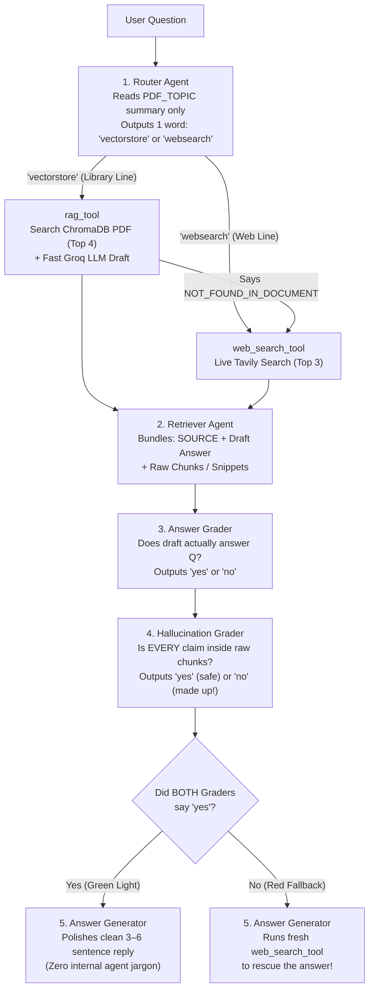

# Agentic RAG — Simple Revision Guide & Cheatsheet

> **All 21 Guide Sections + CrewAI Codebase (`code/`)** explained in plain, everyday English with clear diagrams, a cheatsheet, and step-by-step run commands — zero concepts skipped.

---

## 1. Plain RAG vs Agentic RAG — Why Upgrade? (Sections 1–5, 10)

- **Why RAG Exists *(The Open-Book Exam Analogy)*:** Left on its own, an LLM has three blind spots: a **training-date cutoff**, **zero access to your private PDFs**, and a habit of **guessing confidently** (hallucinating). RAG fixes this by looking up relevant paragraphs first so the model answers from open-book evidence instead of memory.
- **How Plain RAG Works (`step1_plain_rag.py` — 2 Simple Stages):**
  1. **Indexing *(Done once per PDF)*:** Load the PDF → chop into overlapping `1,000–2,000`-character chunks (overlap keeps boundary sentences whole) → turn each chunk into a `384`-number meaning vector using local `BAAI/bge-small-en-v1.5` → save on disk in **ChromaDB**.
  2. **Querying *(Every question)*:** Turn the user's question into a vector (**using the exact same embedding model!**) → fetch the `4` closest chunks (`TOP_K=4`) → ask the LLM to answer strictly from those chunks (or output `NOT_FOUND_IN_DOCUMENT`).
- **4 Ways Plain RAG Breaks in the Real World *(The "Fixed-Route Bus" Problem)*:**
  1. **Bad Retrieval:** If the user phrases a question awkwardly, top-4 search pulls the wrong paragraphs → wrong answer.
  2. **Blind PDF Lookup:** Ask *"What is the weather in Delhi today?"* and Plain RAG still searches your Machine Learning PDF! It has no way to go online.
  3. **Silent Hallucination:** When retrieved chunks only *half*-answer the question, the LLM quietly fills the gap with guesses.
  4. **Zero Self-Checking:** One straight line (`Search → Answer`). Nobody checks if the answer is relevant or truthful before showing it to the user.
- **How Agentic RAG Fixes This *(A Metro Network With a Junction & Two Inspectors)*:** Instead of one blind pass, **5 small specialist CrewAI agents** route the question to the right source, fall back to live web search whenever the PDF comes up short, and double-check both **relevance** and **factual grounding** before replying.

| What You Care About | Plain RAG (`step1_plain_rag.py`) | Agentic RAG (`main.py` — 5-Agent Crew) |
|---|---|---|
| **Where It Looks** | Your static PDF only | **Router** picks between **Private PDF** and **Live Web Search** |
| **If the PDF Lacks the Answer** | Gives up (`NOT_FOUND_IN_DOCUMENT`) | Automatically switches to **live Tavily Web Search** |
| **Quality & Truth Checks** | None (`0` checks) | **2 Inspector Agents:** Relevance Grader + Hallucination Grader |
| **Speed & Cost per Question** | `1` LLM call · `1–2 sec` · `~₹0` | `~7–8` LLM calls · `15–40 sec` cloud (`2–5 min` laptop) · `< ₹1` |
| **When to Use Which** | Simple FAQ over 1 unchanging document | High-trust assistants mixing internal policies + live world facts |

---

## 2. Meet the 5 CrewAI Agents & How Data Flows (Sections 6, 13–15)



### How CrewAI Connects the Team (`agents.py`, `tasks.py`, `main.py`)
- **3 Guardrails on Every Agent:**
  - `Process.sequential`: Agents run strictly in order `1 → 2 → 3 → 4 → 5`.
  - `allow_delegation=False`: Agents cannot randomly hand tasks sideways to each other — keeps execution predictable and cheap.
  - `max_iter=5` & `max_rpm=10`: Stops infinite tool-calling loops and prevents `429` rate-limit crashes on free API tiers.
- **Why Tools Are Attached to `Tasks` Instead of `Agents`:** Giving tools only to the specific *task* that needs them (`retriever_task` gets `[rag_tool, web_search_tool]`; `answer_task` gets `[web_search_tool]`) keeps agent definitions clean and reusable, and guarantees the Router and Graders can't accidentally trigger searches!

| Step | Agent (`Task`) | What Previous Output (`context`) It Reads | Exact Role in Simple Words |
|---|---|---|---|
| **1** | **Router** (`router_task`) | Only `{question}` (+ `PDF_TOPIC` in backstory) | **Traffic Police:** Never opens the PDF! Reads the 1-line `PDF_TOPIC` description, judges **meaning** (not keywords), and outputs `'vectorstore'` or `'websearch'`. |
| **2** | **Retriever** (`retriever_task`) | `[router_task]` | **Researcher:** Calls the chosen tool. If the PDF returns `NOT_FOUND_IN_DOCUMENT`, it **immediately calls `web_search_tool`**. Outputs **both** the draft answer and raw `CHUNKS USED` so Inspector #4 can verify facts. |
| **3** | **Answer Grader** (`grader_task`) | `[retriever_task]` | **Inspector #1 (Relevance):** Checks if the draft actually answers what the user asked (`'yes'` or `'no'`). |
| **4** | **Hallucination Grader** (`hallucination_task`) | `[retriever_task, grader_task]` | **Inspector #2 (Truth):** Compares every claim in the draft against the raw chunks. `'yes'` = 100% backed by evidence (good!); `'no'` = invented facts (reject!). |
| **5** | **Answer Generator** (`answer_task`) | `[retriever_task, grader_task, hallucination_task]` | **Writer & Safety Net:** If both inspectors said `'yes'`, writes a crisp `3–6` sentence reply. If **either** said `'no'`, runs a fresh `web_search_tool` search to save the day! |

---

## 3. Two LLMs, Two Crash-Proof Tools & Real Lessons (Sections 7–8, 11–12, 17–20)

### Why Does the Project Use Two Separate LLMs (`llms.py`)?
1. **The Main Brain (`get_main_llm()`, `temperature=0.1`):** Shared by all 5 agents (cached via `@lru_cache` so Python creates only one connection). **Crucial requirement:** This model **MUST support tool/function calling**, because Agents 2 and 5 call tools! *(Tiny local models like `deepseek-r1:1.5b` fail here — always use `8B` or larger).*
   - `LLM_MODE=openrouter` *(Default)*: Cloud `deepseek/deepseek-v4-flash` (costs a tiny fraction of a rupee per run).
   - `LLM_MODE=groq` *(100% Free Cloud)*: Runs `llama-3.3-70b-versatile` on Groq's OpenAI-compatible URL *(Groq retired DeepSeek in Oct 2025)*.
   - `LLM_MODE=ollama` *(100% Private on Laptop)*: Runs `deepseek-r1:8b` locally (`~5 GB` download, needs `~8 GB` free RAM).
2. **The Fast RAG Helper (`get_rag_llm()`, `temperature=0.0`):** Used *only* inside `rag_tool` to turn the 4 retrieved PDF chunks into a quick draft answer in under a second on Groq's LPU hardware (`RAG_LLM_MODE=groq`), or set `RAG_LLM_MODE=same` to reuse the Main Brain without needing a Groq key.
- **Cleaning `<think>` Tags (`clean_text()`):** Reasoning models like DeepSeek-R1 print their internal scratchpad inside `<think>...</think>`. A small regex strips that block before `one_word()` reads `'vectorstore'`/`'yes'`/`'no'` — otherwise the parser would read `<think>` instead of `'yes'`!

### Two Clever Safeguards Inside `tools.py`
- **`rag_tool` (Private PDF Search):**
  - **Smart Chroma Collection Naming (`f"{pdf_stem}_{embed_model}"`):** Bakes both the PDF filename and embedding model name into the ChromaDB collection. That way, if you switch PDFs or change from a `384d` to a `768d` embedder later, Chroma creates a fresh table instead of crashing with a vector-dimension mismatch!
  - **In CrewAI, a `@tool`'s Docstring IS Its Prompt:** The LLM reads your Python docstring to learn how to call the function. Writing `"Input must be the user's full question as a plain string"` prevents missing-argument crashes.
- **`web_search_tool` (Live Tavily Search):**
  - Uses **Tavily** (built for AI agents — returns `3` clean text extracts instead of messy HTML/ads) wrapped in `try/except`. If your internet drops or quota runs out, it returns plain text (`"WEB_SEARCH_FAILED: ..."`) instead of crashing the whole 5-agent crew!

### 3 Real Prompt-Engineering Fixes & Production Tips
1. **Teach Semantic Routing, Not Keyword Matching:** Early on, asking *"Explain self-attention"* went to `websearch` because the word *"Transformer"* wasn't in the question! Telling the Router to judge **topic meaning** fixed it.
2. **Force 1-Word Lowercase Verdicts:** Polite LLMs love replying *"Yes, this is grounded!"*. Combining strict `"Reply with ONLY one lowercase word"` prompts with `one_word()` (`raw.split()[0].strip(".'\"").lower()`) makes grading bulletproof.
3. **Forbid Internal Process Narration:** Without an explicit ban, Agent 5 writes *"Based on the retrieved chunks and grader approval..."*. Users just want the clean answer!
- **Swapping in Your Own PDF (The 2-Line Rule):** Whenever you change `PDF_PATH` in `.env`, **you MUST also update `PDF_TOPIC`**! Remember: the Router never opens your PDF — if `PDF_TOPIC` still talks about Transformers, it will send all your HR leave-policy questions to Google/Tavily!
- **Deploying to Production:** Build the crew once at startup inside **FastAPI** (`POST /ask`), host on a server with `>= 2–4 GB` RAM (for `sentence-transformers`), and put a **Redis background queue + status polling** in front so a `20–40s` multi-agent run never hits browser HTTP timeouts. *(Same blueprint powers Banking RBI bots, Hospital SOP + drug-recall bots, HR handbooks, E-commerce, University & Legal assistants).*

---

## 4. ⚡ Master Cheatsheet

| `.env` Setting or Common Error | Default Value / Plain-English Fix |
|---|---|
| `LLM_MODE` | `openrouter` (DeepSeek cloud) · `groq` (free cloud Llama) · `ollama` (private laptop) |
| `RAG_LLM_MODE` | `groq` (fast LPU helper inside `rag_tool`) · `same` (reuse `LLM_MODE`, no Groq key needed) |
| `EMBEDDING_MODEL` / `TOP_K` / `WEB_RESULTS` | `BAAI/bge-small-en-v1.5` (`384d` local) / `4` PDF chunks / `3` Tavily web results |
| `No endpoints support tool use` / `does not support tools` | Your chosen model can't call functions (e.g. `1.5b`) → use `deepseek-v4-flash`, `llama-3.3-70b-versatile`, or `deepseek-r1:8b` |
| `429 Rate limit exceeded` | Free API tier limit hit → lower `MAX_RPM=3` in `.env`, wait 60 seconds, and retry |
| `402 Insufficient credits` | OpenRouter wallet is empty → add \$2 credit or switch `LLM_MODE=groq` / `ollama` |
| Router sends my new PDF's questions to the web | You updated `PDF_PATH` but forgot to rewrite **`PDF_TOPIC`** in `.env`! |
| First run feels stuck for 1–3 minutes | Totally normal — downloading the `~130 MB` embedding model & indexing PDF into ChromaDB (fast from run #2 onwards) |

- [ ] **Quick Launch Check:** Python `3.10–3.12` venv active · `.env` passes `check_keys()` · Tool-supporting model selected · `PDF_TOPIC` matches `PDF_PATH` · All 3 journeys verified in `answers_log.md` (`route=vectorstore`, `route=websearch`, and PDF miss → Web fallback).

---

## 5. ▶️ Step-by-Step Guide to Run the Code

### Step 1: Set Up Python Environment *(Python 3.10–3.12)*
```bash
cd study-material/02-agentic-rag/code
python3 -m venv .venv && source .venv/bin/activate   # Windows: .venv\Scripts\Activate.ps1
pip install -r requirements.txt                      # First install takes a few mins (PyTorch + ChromaDB)
cp .env.example .env
```

### Step 2: Configure `.env` *(Pick ONE Option)*
- **Option A — Cloud DeepSeek *(Default, `< ₹1` per question)*:** Add `OPENROUTER_API_KEY`, `GROQ_API_KEY` (free at `console.groq.com`), and `TAVILY_API_KEY` (free at `app.tavily.com`). Leave `LLM_MODE=openrouter`.
- **Option B — 100% Free Cloud *(Zero payment card)*:** Set `LLM_MODE=groq`, and paste your free `GROQ_API_KEY` + `TAVILY_API_KEY`.
- **Option C — 100% Local Brain via Ollama *(Needs ~8 GB free RAM)*:**
  ```bash
  ollama serve                                       # Start Ollama server (or open the Ollama desktop app)
  ollama pull deepseek-r1:8b                         # ~5 GB download (do NOT use 1.5b — tool calls will fail)
  ```
  Then in `.env`, set `LLM_MODE=ollama`, `RAG_LLM_MODE=same`, and paste `TAVILY_API_KEY`.

### Step 3: Run the Scripts in Order
```bash
# 1. Instant pure-Python simulator — watch all 5 agent roles in action with ZERO keys or downloads
python step0_simulate_flow.py

# 2. Plain RAG baseline — see single-pass PDF Q&A (and watch it fail on live world questions)
python step1_plain_rag.py "What is multi-head attention?"

# 3. Full 5-Agent Crew — test the Private PDF route (route=vectorstore)
python main.py "What is the self-attention mechanism in Transformers?"

# 4. Full 5-Agent Crew — test the Live Web route (route=websearch)
python main.py "What is the latest version of Python?"

# 5. Interactive chat loop — ask anything; every answer + journey log is saved to answers_log.md
python main.py --chat
```

### Step 4: Use Your Own PDF Document
1. Drop your file into `data/` (for example, `data/leave_policy.pdf`).
2. Update **both** settings in `.env`:
   ```env
   PDF_PATH=data/leave_policy.pdf
   PDF_TOPIC=our company's leave, travel and reimbursement policy
   ```
3. Ask away: `python main.py "How many casual leaves do I get in a year?"`
