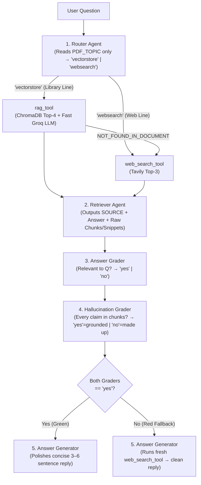

# Agentic RAG — Rapid Revision & Cheatsheet

> Covers **all 21 Guide Sections** and the **Complete CrewAI Codebase (`code/`)** in a 5-minute scan with zero concepts skipped.

---

## 1. Plain RAG vs Agentic RAG (Sections 1–5, 10)

- **Why RAG Exists *(Open-Book Exam Analogy)*:** LLMs have a **training cutoff**, **zero access to private files**, and **hallucinate confidently** when guessing. RAG retrieves relevant excerpts first so the LLM answers from evidence instead of memory.
- **Plain RAG = Fixed 2-Stage Pipeline (`step1_plain_rag.py`):**
  1. **Indexing *(Offline, once per PDF)*:** **Load** (`pypdf`) → **Split** (`1,000–2,000` chars w/ overlap so boundary sentences stay intact) → **Embed** (`BAAI/bge-small-en-v1.5`, `384d`, local `sentence-transformers` on CPU) → **Store** (`ChromaDB` on disk; skips re-embedding on subsequent runs).
  2. **Querying *(Online, per question)*:** **Embed question** (**MUST use exact same embedding model** as indexing!) → **Top-$k$ cosine search** (`TOP_K = 4`) → **Grounded Prompt + LLM** (`temperature=0.0`, outputs `NOT_FOUND_IN_DOCUMENT` if missing).
- **4 Ways Plain RAG Breaks in Production:**
  1. **Retrieval Miss:** Bad phrasing / chunk split pulls wrong chunks → wrong answer.
  2. **Blind Document Search:** Searches your ML PDF even for *"Weather in Delhi today?"* (no routing, no live web).
  3. **Hallucination:** LLM blends pretrained guesses into weak chunks without telling you.
  4. **Zero Verification:** Single one-way pass (*fixed-route bus*) — nobody checks relevance or grounding before replying.
- **Agentic RAG Upgrade *(Metro Network w/ Junction & Inspectors)*:** Replaces the single blind pass with **routing + tool fallback + relevance grading + hallucination checking + self-recovery**.

| Dimension | Plain RAG (`step1_plain_rag.py`) | Agentic RAG (`main.py` — 5-Agent Crew) |
|---|---|---|
| **Routing & Sources** | Always searches PDF only | **Router** picks `vectorstore` (PDF) or `websearch` (live Tavily) |
| **When PDF Lacks Answer** | Gives up (`NOT_FOUND_IN_DOCUMENT`) or guesses | Auto-falls back to **live web search** (at Retriever *and* Generator) |
| **Quality & Truth Checks** | None (`0` checks) | **2 Graders:** Answer Grader (relevance) + Hallucination Grader (grounding) |
| **LLM Calls / Latency / Cost** | `1` call · `1–2 s` · `~₹0` | `~7–8` calls · `15–40 s` cloud (`2–5 min` local) · `< ₹1` on DeepSeek Flash |
| **Best Use Case** | Simple internal FAQ on 1 static doc | High-trust assistants mixing private docs + live world knowledge |

---

## 2. 5-Agent CrewAI Architecture & Data Flow (Sections 6, 13–15)



- **Shared Agent Guardrails (`agents.py`):** All 5 agents share `get_main_llm()`, `allow_delegation=False` (strict predictable pipeline — agents never pass work sideways), and `max_iter=5` (prevents infinite tool loops + runaway API bills).
- **Why Attach Tools to `Task`, Not `Agent` (`tasks.py`)?** Keeps agents **reusable** across tasks without exposing unneeded tools everywhere.
- **Crew Execution & Task `context` Wiring (`Process.sequential`, `max_rpm=10`):**

| # | Agent → Task | `context` Received | Tools Attached | Strict Output Contract |
|---|---|---|---|---|
| **1** | **Router** (`router_task`) | `{question}` (+ `PDF_TOPIC` in backstory; **never opens PDF**) | *None* | Single lowercase word: `vectorstore` or `websearch` |
| **2** | **Retriever** (`retriever_task`) | `[router_task]` | `[rag_tool, web_search_tool]` | `SOURCE: document` or `web` + full answer + raw `CHUNKS USED` / snippets *(calls `web_search_tool` if `rag_tool` says `NOT_FOUND_IN_DOCUMENT`)* |
| **3** | **Answer Grader** (`grader_task`) | `[retriever_task]` | *None* | Single word: `yes` (answers Q) or `no` (off-topic / missing) |
| **4** | **Hallucination Grader** (`hallucination_task`) | `[retriever_task, grader_task]` | *None* | Single word: `yes` (**grounded = GOOD**, incl. if Retriever said `no`) or `no` (**hallucinated = BAD**) |
| **5** | **Answer Generator** (`answer_task`) | `[retriever_task, grader_task, hallucination_task]` | `[web_search_tool]` | Concise `3–6` sentence user-facing answer (**never** mentions tools/graders/routing; calls `web_search_tool` if either grader returned `no`) |

---

## 3. Two-LLM Strategy & Reasoning Hygiene (Sections 7, 11, 17)

- **Why Two Separate LLMs (`config.py`, `llms.py`)?**
  1. **Main Brain (`get_main_llm()`, `@lru_cache(maxsize=1)`, `temperature=0.1`):** Powers all 5 agents' reasoning & tool calls. Cached so all 5 agents share **one** client object. **MUST support tool/function calling** (why tiny `deepseek-r1:1.5b` fails — use `>= 8B`!).
     - `LLM_MODE=openrouter` *(Default)*: `deepseek/deepseek-v4-flash` via OpenRouter (`openrouter/...`).
     - `LLM_MODE=groq` *(Free Cloud Practice)*: `llama-3.3-70b-versatile` via Groq's OpenAI-compatible `base_url="https://api.groq.com/openai/v1"`. *(Note: Groq retired DeepSeek models in Oct 2025).*
     - `LLM_MODE=ollama` *(100% Local & Private)*: `ollama/deepseek-r1:8b` at `http://localhost:11434` (`~5 GB` pull, needs `~8 GB` free RAM, slower on CPU).
  2. **Fast RAG Helper (`get_rag_llm()`, `temperature=0.0`):** Used *only* inside `rag_tool` to turn the 4 retrieved PDF chunks into a draft answer in `< 1s`.
     - `RAG_LLM_MODE=groq` *(Default)*: `llama-3.3-70b-versatile` on Groq LPUs (`ChatOpenAI` pointed at Groq `base_url`).
     - `RAG_LLM_MODE=same`: Reuses `get_main_llm()` (zero Groq key required).
- **Stripping `<think>` Tags (`clean_text()`):** DeepSeek-R1 emits internal chain-of-thought inside `<think>...</think>`. `re.sub(r"<think>.*?</think>", "", raw, flags=re.DOTALL)` strips this before `one_word()` parses `'vectorstore'`/`'yes'`/`'no'` or logs the final answer.

---

## 4. Tools, Prompt Engineering Lessons & Industry Patterns (Sections 8, 12, 18–20)

- **Tool 1 — `rag_tool` (`create_rag_tool` in `tools.py`):**
  - Wraps CrewAI's `PDFSearchTool` configured with local HuggingFace embedder (`BAAI/bge-small-en-v1.5`) + `ChromaDB`.
  - **Safe Collection Naming:** `collection_name = f"{pdf_stem}_{embed_model}"` (alphanumeric `_`, max 60 chars). Prevents ChromaDB **vector-dimension crash** if you later swap PDFs or switch `384d` → `768d` embeddings!
  - **Returns Answer + Raw Evidence:** Formats `ANSWER:\n...\n\nCHUNKS USED:\n...` so the **Hallucination Grader** can cross-check every claim against verbatim PDF text.
  - **Docstring = Agent Prompt:** In CrewAI, `@tool` docstrings are read directly by the LLM to decide *when* and *how* to call the tool (`"Input must be the user's full question as a plain string"` prevents missing-argument crashes).
- **Tool 2 — `web_search_tool` (`TavilyClient`):**
  - Built specifically for AI agents — returns clean text snippets (`max_results = WEB_RESULTS = 3`) instead of raw HTML/ads.
  - **Crash-Proof Wrapper:** `try/except` catches network/quota errors and returns `"WEB_SEARCH_FAILED: ..."` or `"NO_WEB_RESULTS"` as plain text so the crew gracefully recovers instead of raising an unhandled exception.
- **3 Real Prompt-Engineering Fixes Discovered During Build:**
  1. **Semantic vs Keyword Routing:** Router initially routed *"Explain attention mechanism"* to `websearch` because *"Transformer"* wasn't in the string → fixed by instructing Router to judge **meaning**, not exact keyword match, against `PDF_TOPIC`.
  2. **Strict 1-Word Graders:** Polite models reply *"Yes, the answer is grounded..."* → fixed with `"Reply with ONLY one lowercase word"` + defensive parser `one_word()` (`raw.split()[0].strip(".'\"").lower()`).
  3. **No Internal Narration:** Generator initially wrote *"Based on the retrieved chunks and grader approval..."* → fixed by explicitly banning internal-process narration in `answer_task`.
- **6 Industry Blueprints *(Library Line + Live Line)*:**
  - *Banking:* RBI circulars/loan policy PDF + live repo rates/stock news · *Hospital:* clinical SOPs + live drug recalls/alerts · *HR Helpdesk:* leave/reimbursement handbook + public holiday/tax updates · *E-commerce:* return/warranty manuals + live courier/order API · *University:* syllabus/exam rules + career facts · *Legal/CA:* bare acts/case archive + latest Finance Act notifications.
- **Swapping Your Own PDF (2-Line Rule):** Update `PDF_PATH=data/your_file.pdf` **AND** rewrite `PDF_TOPIC=...` in `.env`. *(If you forget `PDF_TOPIC`, the Router still thinks your PDF is about Transformers and misroutes every question!)*
- **Production Deployment Path:** Wrap `build_crew()` (once at startup) + `ask(crew, q)` inside **FastAPI** (`POST /ask`) → host on Render / Railway / AWS EC2 (`>= 2–4 GB` RAM for `sentence-transformers`) → because 5-agent runs take `15–40 s`, put **Redis/background job queue + status polling/streaming** in front so HTTP requests never time out.

---

## 5. ⚡ Master Cheatsheet

### A. `.env` / `config.py` Switchboard & Defaults
| Setting | Default | Valid Options / Purpose |
|---|---|---|
| `LLM_MODE` | `openrouter` | `openrouter` (DeepSeek cloud) · `groq` (free cloud Llama) · `ollama` (local laptop) |
| `OPENROUTER_MODEL` | `deepseek/deepseek-v4-flash` | Any OpenRouter model **with `tools` (function-calling) support** |
| `OLLAMA_MODEL` | `deepseek-r1:8b` | Local Ollama tag (`>= 8B` needed for reliable tool calling; `http://localhost:11434`) |
| `RAG_LLM_MODE` | `groq` | `groq` (fast LPU chunk summarizer) · `same` (reuse main brain, no Groq key) |
| `GROQ_MODEL` | `llama-3.3-70b-versatile` | Used for `rag_tool` (and main brain when `LLM_MODE=groq`) |
| `EMBEDDING_MODEL` | `BAAI/bge-small-en-v1.5` | Local HuggingFace embedder (`384d`, ~130 MB cached on first run) |
| `PDF_PATH` / `PDF_TOPIC` | `data/attention_is_all_you_need.pdf` | Local PDF path + **1-sentence summary Router uses to route** |
| `TOP_K` / `WEB_RESULTS` | `4` / `3` | PDF chunks fetched from ChromaDB / live snippets fetched from Tavily |
| `MAX_RPM` / `ANSWERS_LOG` | `10` / `answers_log.md` | Crew rate-limit guard for free tiers / auto-appended Q&A + journey diary |

### B. Symptom / Error → Root Cause → Fix (Section 19)
| Error / Symptom | Root Cause | Exact Fix |
|---|---|---|
| `Please fix your .env file first` | `.env` missing or placeholder keys left | `cp .env.example .env` and paste real keys (no quotes/spaces) |
| `401` / `404` / `model not found` | Retired/typo model slug on OpenRouter/Groq | Pick an active **tool-supporting** slug on `openrouter.ai/models` |
| `No endpoints found that support tool use` | Chosen model lacks function calling (e.g. `1.5b`) | Switch to `deepseek/deepseek-v4-flash`, `llama-3.3-70b-versatile`, or `deepseek-r1:8b` |
| `402 Payment Required` / `Insufficient credits` | OpenRouter balance is `0` | Add \$2–\$5 credit on OpenRouter or switch `LLM_MODE=groq` / `ollama` |
| `429 Rate limit exceeded` | Free-tier calls/min exceeded | Lower `MAX_RPM=3` in `.env`, wait 60s, re-run |
| `Connection refused localhost:11434` | Ollama daemon not running / model unpulled | Run `ollama serve` + `ollama pull deepseek-r1:8b` |
| `Dimension mismatch` in ChromaDB | Changed `EMBEDDING_MODEL` on old collection | `collection_name` auto-includes model; if corrupted, delete `.chroma/` / `db/` |
| `missing 1 required positional argument: 'question'` | Agent called `@tool` with wrong arg schema | Keep explicit `"Input must be the user's full question"` in tool docstring |
| Router sends PDF questions to `websearch` | `PDF_TOPIC` wasn't updated after swapping PDF | Update `PDF_TOPIC` in `.env` to describe the new PDF's subject |
| First run hangs for 1–3 minutes | Downloading ~130 MB `bge-small` + building Chroma | Normal one-time setup; subsequent runs reuse cached model & disk vectors |

### C. Pre-Run Checklist & Progressive CLI Commands
- [ ] **1.** Python `3.10–3.12` virtual env active (`python3 -m venv .venv && source .venv/bin/activate`)
- [ ] **2.** Dependencies installed (`pip install -r requirements.txt`) & `.env` created from `.env.example`
- [ ] **3.** `LLM_MODE` model verified to support **tool calling** (`check_keys()` passes with zero warnings)
- [ ] **4.** `PDF_TOPIC` accurately describes the file at `PDF_PATH`
- [ ] **5.** Tested all 3 journeys in `answers_log.md`: **PDF hit** (`route=vectorstore`), **Web hit** (`route=websearch`), and **PDF miss → Web fallback**

```bash
cd study-material/02-agentic-rag/code
python step0_simulate_flow.py                                       # Step 0: Instant offline flow simulator (no API keys!)
python step1_plain_rag.py "What is multi-head attention?"           # Step 1: Plain RAG baseline (shows failure on live Qs)
python main.py "What is the self-attention mechanism?"              # Step 2a: Full 5-agent Crew -> PDF route
python main.py "What is the latest version of Python?"              # Step 2b: Full 5-agent Crew -> Web route
python main.py --chat                                               # Interactive multi-question loop (logs to answers_log.md)
```
