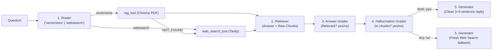

# Agentic RAG — Quick Revision & Cheatsheet

> **All 21 Guide Sections + CrewAI Codebase (`code/`)** in simple, bite-sized bullets — zero concepts skipped.

---

## 1. Plain RAG vs Agentic RAG (Sections 1–5, 10)

- **Why RAG *(Open-Book Exam)*:** Fixes LLM **knowledge cutoffs**, **no private file access**, and **confident guessing** by retrieving relevant text before answering.
- **Plain RAG (`step1_plain_rag.py`):**
  1. **Index *(once)*:** Load PDF → Split (`1,000–2,000` chars + **overlap**) → Embed (`BAAI/bge-small-en-v1.5`, `384d`, local CPU) → Save in **ChromaDB**.
  2. **Query *(every Q)*:** Embed question (**exact same model!**) → Top-`4` cosine match → Grounded LLM (`NOT_FOUND_IN_DOCUMENT` if absent).
- **4 Ways Plain RAG Fails:** **(1)** Wrong chunks retrieved · **(2)** Searches your ML PDF even for *"Delhi weather today"* · **(3)** Mixes guesses into weak chunks · **(4)** **Zero self-checks** (one-way pass).
- **Agentic RAG Upgrade:** Adds **smart routing + live web fallback + relevance check + hallucination check**.

| Feature | Plain RAG | Agentic RAG (5-Agent Crew) |
|---|---|---|
| **Sources & Fallback** | Static PDF only; gives up if missing | Routes **PDF vs Web**; auto-falls back to Web twice |
| **Self-Verification** | `0` checks | **2 Graders** (Relevance + Groundedness) |
| **Calls · Speed · Cost** | `1` call · `1–2 s` · `~₹0` | `~7–8` calls · `15–40 s` cloud (`2–5m` local) · `< ₹1` |

---

## 2. The 5 CrewAI Agents & Flow (Sections 6, 13–15)



- **Shared Safety Settings:** `Process.sequential`, `allow_delegation=False` (predictable order), `max_iter=5` (no infinite tool loops), `max_rpm=10` (protects free API tiers).
- **Design Rule:** Attach `tools` to **Tasks**, not Agents, so agents stay reusable.
- **Each Agent's Exact Job:**
  1. **Router:** Reads `PDF_TOPIC` summary only (**never opens the PDF**). Judges **semantic meaning** (not exact keywords) → outputs 1 word: `vectorstore` or `websearch`.
  2. **Retriever** *(reads Router)*: Runs `rag_tool` or `web_search_tool`. If PDF returns `NOT_FOUND_IN_DOCUMENT`, **auto-switches to web search**. Passes **both** draft answer and raw `CHUNKS USED`.
  3. **Answer Grader** *(reads Retriever)*: Does the draft actually answer the user's question? → `yes` or `no`.
  4. **Hallucination Grader** *(reads Retriever + Grader)*: Is every claim backed by raw chunks? → `yes` (**grounded = safe**) or `no` (**made up = reject**).
  5. **Answer Generator** *(reads Retriever + both Graders)*: Both `yes` → polishes a `3–6` sentence reply (**never** mentions internal agents/tools). Either `no` → runs a fresh `web_search_tool` call to recover.

---

## 3. Two LLMs, Two Tools & Real-World Ops (Sections 7–8, 11–12, 17–20)

- **Why Two Separate LLMs (`llms.py`)?**
  - **Main Brain** (`temp=0.1`, `@lru_cache` shared across all 5 agents): **MUST support tool/function calling** (`1.5B` models fail — use `>= 8B`!). Modes: `openrouter` (`deepseek/deepseek-v4-flash`, default) · `groq` (free `llama-3.3-70b-versatile` via OpenAI-compatible `base_url`; *Groq retired DeepSeek in Oct 2025*) · `ollama` (local `deepseek-r1:8b`, private, needs `~8 GB` RAM).
  - **Fast RAG Helper** (`temp=0.0`): Groq LPU (`RAG_LLM_MODE=groq`) summarizes the 4 PDF chunks inside `rag_tool` in `< 1s` (or `same` to reuse main brain).
  - **`<think>` Cleanup (`clean_text`):** Regex strips DeepSeek-R1 `<think>...</think>` tags before `one_word()` reads `vectorstore`/`yes`/`no`.
- **Two Crash-Proof Tools (`tools.py`):**
  - **`rag_tool`:** `PDFSearchTool` + ChromaDB using `collection_name = f"{pdf_stem}_{embed_model}"` (**prevents vector-dimension crashes** when changing PDFs or embedders). **Docstring = Agent Prompt** (explicit `"Input must be user's full question"` avoids missing-argument bugs).
  - **`web_search_tool`:** **Tavily** (`WEB_RESULTS=3` clean AI snippets), wrapped in `try/except` returning `"WEB_SEARCH_FAILED"` / `"NO_WEB_RESULTS"` text so the crew never crashes.
- **3 Prompt Fixes That Matter:** **(1)** Route by **meaning**, not keyword match · **(2)** Force **1-word lowercase** grader outputs + `one_word()` parser · **(3)** Ban *"Based on the grader..."* narration in final answers.
- **Swapping PDFs & Deploying:** Always update **both** `PDF_PATH` **and** `PDF_TOPIC` in `.env` (otherwise Router misroutes!). Deploy via **FastAPI + Redis background queue** (since 5-agent runs take `15–40 s`) on `2–4 GB+` RAM. *(Fits Banking, Hospital, HR, E-comm, University, Legal: private policy PDF + live web/API).*

---

## 4. ⚡ Cheatsheet

| `.env` Key / Error | Default / Fix |
|---|---|
| `LLM_MODE` / `RAG_LLM_MODE` | `openrouter` (`groq` \| `ollama`) / `groq` (`same` if no Groq key) |
| `EMBEDDING_MODEL` / `TOP_K` / `WEB_RESULTS` | `BAAI/bge-small-en-v1.5` (`384d`) / `4` PDF chunks / `3` web hits |
| `No endpoints support tool use` / `404` | Model lacks function calling or retired → use `deepseek-v4-flash`, `llama-3.3-70b`, or `deepseek-r1:8b` |
| `429 Rate limit` / `402 Credits` | Set `MAX_RPM=3` & wait 60s / top up OpenRouter or switch `LLM_MODE=groq` |
| Chroma `Dimension mismatch` | Model changed on old DB → `stem_model` names avoid this; delete `.chroma/` if stuck |
| Router ignores my new PDF | Forgot to update **`PDF_TOPIC`** in `.env` to match the new `PDF_PATH`! |

- [ ] **Ready Check:** `.venv` (`Python 3.10–3.12`) · `.env` keys pass `check_keys()` · Tool-capable model set · `PDF_TOPIC` matches `PDF_PATH` · Verify PDF route, Web route & Fallback in `answers_log.md`.

```bash
cd study-material/02-agentic-rag/code
python step0_simulate_flow.py                                 # 1. Offline flow simulator (no keys needed)
python step1_plain_rag.py "What is multi-head attention?"     # 2. Plain RAG baseline
python main.py "What is self-attention in Transformers?"      # 3. Full 5-agent Crew (PDF route)
python main.py "What is the latest version of Python?"        # 4. Full 5-agent Crew (Web route)
python main.py --chat                                         # 5. Interactive chat (logs to answers_log.md)
```
