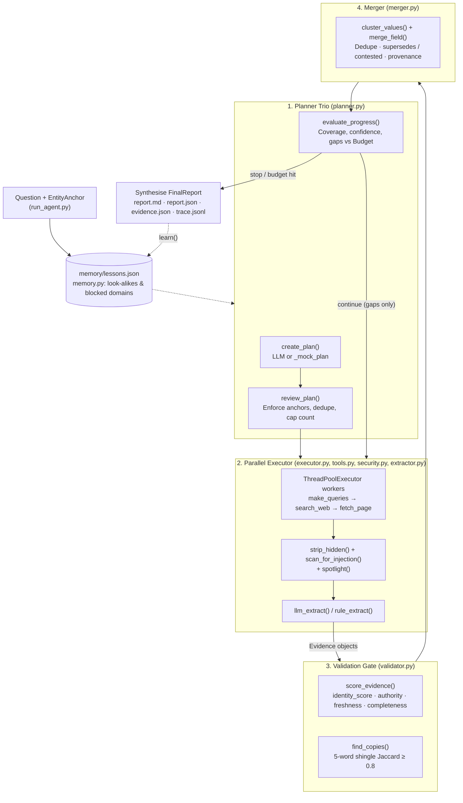

# Deep Search Agents — Project Map

> **Directory:** [`study-material/03-deep-search-agent/`](file:///Users/pankaj/Workspace/ai-bootcamp/study-material/03-deep-search-agent)  
> **Domain & Running Example:** Vendor due diligence on *NimbusPay* (fictional Indian payment gateway) over a deliberately messy 19-page corpus (`data/corpus.json`)  
> **Course Companion:** [`03-Deep-Search-Agents-Shivank-Agrawal.html`](file:///Users/pankaj/Workspace/ai-bootcamp/study-material/03-deep-search-agent/03-Deep-Search-Agents-Shivank-Agrawal.html) · [`03-Deep-Search-Agents_Revision_Notes.md`](file:///Users/pankaj/Workspace/ai-bootcamp/study-material/03-deep-search-agent/03-Deep-Search-Agents_Revision_Notes.md)

---

## 1. Architecture & Iterative Research Loop

The system implements a 4-layer iterative due-diligence workflow in [`deepsearch/orchestrator.py`](file:///Users/pankaj/Workspace/ai-bootcamp/study-material/03-deep-search-agent/deepsearch/orchestrator.py) (`DeepSearchAgent`) with strict Pydantic contracts ([`deepsearch/schemas.py`](file:///Users/pankaj/Workspace/ai-bootcamp/study-material/03-deep-search-agent/deepsearch/schemas.py)), offline/live search parity, layered prompt-injection defenses, and deterministic pre-merge validation.



---

## 2. Annotated Directory & File Tree

```text
study-material/03-deep-search-agent/
├── .env                                   # Active local config (defaults to LLM_PROVIDER=mock, SEARCH_PROVIDER=offline)
├── .env.example                           # Provider templates (Gemini, Groq, Ollama, OpenRouter, OpenAI, Anthropic, ddgs, tavily)
├── .gitignore                             # Ignores .venv, .env, runs/, memory/, __pycache__
├── 03-Deep-Search-Agents-Shivank-Agrawal.html  # Interactive 13-module course textbook & diagrams
├── 03-Deep-Search-Agents_Revision_Notes.md     # Quick revision notes, formulas & production checklist
├── 03-Deep-Search-Agents_Project_Map.md   # This project map
├── README.md                              # Setup, lab table (1–12), live mode instructions, troubleshooting
├── requirements.txt                       # pydantic, openai, python-dotenv, mcp>=2.0, langgraph>=1.0, ddgs, tavily-python, trafilatura, pytest
├── run_agent.py                           # Capstone CLI runner (--name, --city, --country, --industry, --domain, --exclude, --max-usd)
│
├── deepsearch/                            # Core multi-agent deep-search package (16 modules)
│   ├── __init__.py                        # Package marker
│   ├── config.py                          # Settings dataclass, PROVIDER_DEFAULTS, _parse_date(), describe()
│   ├── schemas.py                         # 17 Pydantic v2 contracts (EntityAnchor, ResearchPlan, Evidence, FinalReport, etc.)
│   ├── llm.py                             # Unified OpenAI-compatible + mock LLM wrapper with validate→repair loop & tool calling
│   ├── tools.py                           # search_web (offline BM25 / ddgs / tavily), fetch_page (trafilatura), think(), TOOL_SCHEMAS
│   ├── security.py                        # Multi-layer prompt-injection defense: scan_for_injection, is_suspicious, strip_hidden, spotlight
│   ├── extractor.py                       # Page → structured claims: llm_extract (spotlighted), rule_extract (offline), gullible_extract (Lab 9)
│   ├── planner.py                         # Planning trio: create_plan, review_plan, evaluate_progress
│   ├── executor.py                        # Orchestrator–worker parallel execution (Executor, make_queries, QueryList)
│   ├── validator.py                       # Pre-merge scoring: authority_score, freshness_score, identity_score, completeness_score, find_copies
│   ├── merger.py                          # Value normalization, near-dup clustering, conflict/timeline resolution, confidence_label
│   ├── memory.py                          # Persistent Memory (memory/lessons.json) for source track records, blocked domains & look-alikes
│   ├── budget.py                          # Thread-safe Budget & BudgetExceeded tracking tokens, USD cost, time & tool calls
│   ├── tracing.py                         # Per-run folder (runs/<ts>-deepsearch/) and JSONL event logger (start_run, trace, events)
│   ├── baselines.py                       # Comparison baselines for Lab 1 & 11: naive_search_answer, basic_rag_answer
│   ├── evaluation.py                      # Gold-set scorer (score_answers) + LLM-as-judge rubric (JudgeScores, judge)
│   └── orchestrator.py                    # Lead DeepSearchAgent + template_answer, report_to_markdown, default_entity
│
├── labs/                                  # 12 progressive course labs + shared helper
│   ├── _common.py                         # Console formatting helpers (banner, step, wrap, table, pause_note)
│   ├── lab01_search_vs_rag_vs_deep.py     # Mod 1: Naive search vs basic RAG vs deep search scored against gold_set.json
│   ├── lab02_tools_and_schemas.py         # Mod 4: Tool schemas, Pydantic validation, repair loop, ReAct tool-calling loop
│   ├── lab03_planner.py                   # Mod 3: Plan Creator → Plan Reviewer → Plan Evaluator & stop conditions
│   ├── lab04_executor_parallel.py         # Mod 4, 9: Parallel vs sequential workers and Evidence provenance objects
│   ├── lab05_mcp_server.py                # Mod 4: Exposes search, fetch, list_sources, research_brief over MCPServer (SDK v2)
│   ├── lab05_mcp_client.py                # Mod 4: Launches lab05_mcp_server.py via stdio, discovers tools & runs queries
│   ├── lab06_validation.py                # Mod 5: Reliability scoring, UK look-alike rejection, copy detection, freshness decay
│   ├── lab07_merge_and_conflicts.py       # Mod 6: Deduplication, CEO/licence timeline vs conflict resolution, provenance
│   ├── lab08_iteration_memory_context.py  # Mod 7: Iterative gap-filling, context compaction, long-term Memory lessons
│   ├── lab09_prompt_injection.py          # Mod 8: Gullible agent attack demo vs 4-layer defense + quarantine
│   ├── lab10_cost_latency_budget.py       # Mod 9: Token pricing, small/large model routing, hard Budget enforcement
│   ├── lab11_evaluation.py                # Mod 10: Gold-set metrics, validation ablation study, LLM-as-judge rubric
│   └── lab12_langgraph_version.py         # Mod 2, 12: Re-implements the Plan → Execute → Validate → Merge → Evaluate loop in LangGraph
│
├── data/                                  # Offline reproducible web corpus & evaluation truth
│   ├── corpus.json                        # 19 fictional web pages (official, press release copy, UK look-alike, rumour, injection trap)
│   └── gold_set.json                      # Ground-truth facts, required_rejections, and expected security quarantine checks
│
└── tests/
    └── test_course.py                     # Pytest suite (16 parametrized/unit tests covering logic, offline agent & all labs)
```

---

## 3. Core Package Breakdown (`deepsearch/`)

| Module | Key Classes / Functions | Responsibility |
|---|---|---|
| [`config.py`](file:///Users/pankaj/Workspace/ai-bootcamp/study-material/03-deep-search-agent/deepsearch/config.py) | `Settings`, `PROVIDER_DEFAULTS`, `describe()` | Resolves provider presets, base URLs, search backend (`offline`/`ddgs`/`tavily`), and budget/iteration limits |
| [`schemas.py`](file:///Users/pankaj/Workspace/ai-bootcamp/study-material/03-deep-search-agent/deepsearch/schemas.py) | `EntityAnchor`, `SubQuestion`, `ResearchPlan`, `PlanReview`, `PlanDecision`, `Document`, `ExtractedClaim`, `ClaimList`, `Evidence`, `MergedClaim`, `ConflictRecord`, `Finding`, `FinalReport` | Typed contracts passed across every stage of the pipeline |
| [`llm.py`](file:///Users/pankaj/Workspace/ai-bootcamp/study-material/03-deep-search-agent/deepsearch/llm.py) | `LLM`, `LLMError`, `_extract_json()` | Supports `complete()`, `complete_structured()` (Pydantic repair loop), and `run_with_tools()` |
| [`tools.py`](file:///Users/pankaj/Workspace/ai-bootcamp/study-material/03-deep-search-agent/deepsearch/tools.py) | `_BM25`, `load_corpus()`, `search_web()`, `fetch_page()`, `think()`, `TOOL_SCHEMAS`, `TOOL_FUNCTIONS` | Unified offline BM25 search and live `ddgs`/`tavily` search + `trafilatura` extraction |
| [`security.py`](file:///Users/pankaj/Workspace/ai-bootcamp/study-material/03-deep-search-agent/deepsearch/security.py) | `scan_for_injection()`, `is_suspicious()`, `strip_hidden()`, `spotlight()` | Removes hidden HTML/CSS/zero-width text, scans regex injection patterns, and fences untrusted content |
| [`extractor.py`](file:///Users/pankaj/Workspace/ai-bootcamp/study-material/03-deep-search-agent/deepsearch/extractor.py) | `llm_extract()`, `rule_extract()`, `gullible_extract()` | Extracts typed claims + exact supporting quotes (`gullible_extract` exists for Lab 9 attack demo) |
| [`planner.py`](file:///Users/pankaj/Workspace/ai-bootcamp/study-material/03-deep-search-agent/deepsearch/planner.py) | `create_plan()`, `review_plan()`, `evaluate_progress()`, `_mock_plan()` | Generates sub-questions, enforces entity anchors/caps, and decides `continue` vs `stop` per iteration |
| [`executor.py`](file:///Users/pankaj/Workspace/ai-bootcamp/study-material/03-deep-search-agent/deepsearch/executor.py) | `Executor`, `QueryList`, `make_queries()` | Fans out sub-questions across threads, deduplicates fetched URLs, quarantines injected pages |
| [`validator.py`](file:///Users/pankaj/Workspace/ai-bootcamp/study-material/03-deep-search-agent/deepsearch/validator.py) | `score_evidence()`, `authority_score()`, `freshness_score()`, `identity_score()`, `completeness_score()`, `find_copies()` | Rejects wrong-entity pages (gate), penalizes stale/syndicated copies (`0.1x`), scores reliability |
| [`merger.py`](file:///Users/pankaj/Workspace/ai-bootcamp/study-material/03-deep-search-agent/deepsearch/merger.py) | `normalize_value()`, `same_value()`, `cluster_values()`, `merge_field()`, `merge_all()`, `confidence_label()` | Groups near-duplicate claims, resolves historical timelines vs conflicts, preserves `[S#]` provenance |
| [`memory.py`](file:///Users/pankaj/Workspace/ai-bootcamp/study-material/03-deep-search-agent/deepsearch/memory.py) | `Memory` | Reads/writes `memory/lessons.json` (`record_source`, `known_look_alikes`, `blocked_domains`, `learn`) |
| [`budget.py`](file:///Users/pankaj/Workspace/ai-bootcamp/study-material/03-deep-search-agent/deepsearch/budget.py) | `Budget`, `BudgetExceeded`, `price_for()`, `estimate_tokens()` | Enforces hard caps on USD spend, tokens, wall-clock seconds, and tool calls across worker threads |
| [`tracing.py`](file:///Users/pankaj/Workspace/ai-bootcamp/study-material/03-deep-search-agent/deepsearch/tracing.py) | `start_run()`, `trace()`, `events()` | Logs structured events to `runs/<timestamp>-<tag>/trace.jsonl` |
| [`baselines.py`](file:///Users/pankaj/Workspace/ai-bootcamp/study-material/03-deep-search-agent/deepsearch/baselines.py) | `naive_search_answer()`, `basic_rag_answer()` | Single-pass baselines used in Lab 1 and Lab 11 to benchmark Deep Search improvements |
| [`evaluation.py`](file:///Users/pankaj/Workspace/ai-bootcamp/study-material/03-deep-search-agent/deepsearch/evaluation.py) | `score_answers()`, `judge()`, `JudgeScores` | Measures factual accuracy, look-alike/rumour rejections, injection defense, and rubric scores |
| [`orchestrator.py`](file:///Users/pankaj/Workspace/ai-bootcamp/study-material/03-deep-search-agent/deepsearch/orchestrator.py) | `DeepSearchAgent`, `report_to_markdown()`, `template_answer()`, `default_entity()` | Runs the full loop and saves `report.md`, `report.json`, `evidence.json`, `trace.jsonl` |

---

## 4. Quick Run & Config Reference

Run commands from [`study-material/03-deep-search-agent/`](file:///Users/pankaj/Workspace/ai-bootcamp/study-material/03-deep-search-agent):

```bash
python run_agent.py                # Offline NimbusPay due-diligence demo (no keys required)
python -m pytest -q                # Run all 16 checks (core logic + all 12 labs)
python labs/lab06_validation.py    # Run any individual lab (lab01 .. lab12)

# Live web + LLM mode example:
python run_agent.py "Is <Company> a reliable payment partner today?" \
  --name "<Company>" --city Mumbai --country India \
  --industry "payment gateway,payments" --domain company.com
```

- **Key `.env` variables** ([`.env.example`](file:///Users/pankaj/Workspace/ai-bootcamp/study-material/03-deep-search-agent/.env.example)): `LLM_PROVIDER` (`mock` | `gemini` | `groq` | `ollama` | `openrouter` | `openai` | `anthropic` | `custom`), `LLM_MODEL`, `LLM_SMALL_MODEL`, `SEARCH_PROVIDER` (`offline` | `ddgs` | `tavily`), `DS_AS_OF`, `DS_MAX_ITERATIONS`, `DS_MAX_PARALLEL`, `DS_RESULTS_PER_QUERY`.
