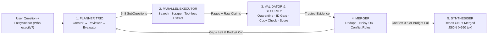
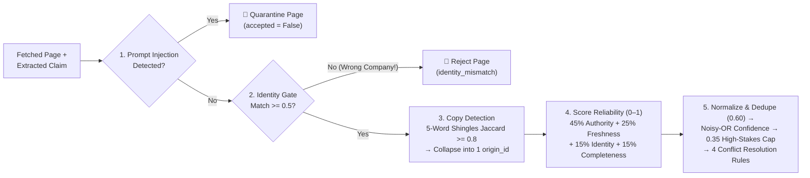

# Deep Search Agents — Simple Revision Guide & Cheatsheet

> **All 13 Modules (0–12 + Appendix) + 12 Labs + `deepsearch/`** explained in plain, everyday English with clear diagrams, a cheatsheet, and step-by-step run commands — zero concepts skipped.

---

## 1. Why Deep Search? (And When NOT to Use It) (Modules 0–2)

- **Simple Lookup vs Real Research:** Asking *"Capital of Karnataka?"* is a 1-step lookup. Asking *"Is **NimbusPay** a safe payment-gateway partner for our startup today?"* is **research** — facts are spread across many sites, sources disagree, CEOs and prices change over time, press releases get copied word-for-word, and shady SEO pages try to trick AI readers.
- **Why Normal Search (`2/10`) and Basic RAG (`5/10`) Both Fail Here:**
  - *Normal Web Search:* Just hands back SEO-ranked links, ignores dates and contradictions, and gets fooled by a fake SEO review page claiming *"RBI revoked NimbusPay's licence"*.
  - *Basic RAG:* Treats every chunk as equally trustworthy, strips dates, and runs only once — so it mixes up a **same-name UK company** (`Nimbus Pay Ltd`), reports the **old 2023 CEO** instead of the current 2026 CEO, and quotes **Series A (`$8M`)** instead of **Series B (`$40M`)**.
  - *Deep Search Agent (`10/10`):* Plans sub-questions → searches in parallel → blocks look-alike companies & prompt injections → weighs source authority + age → collapses copied articles → resolves conflicts honestly → loops again if gaps remain.
- **When NOT to Use Deep Search:** Multi-agent research burns **`~15×` more tokens** than normal chat (`~4×` for a single agent) and takes `15s–minutes`. **Skip it** for simple lookups, static internal-handbook Q&A (use Production RAG), `< 1s` live chat SLAs, or low-stakes ₹50 decisions!
- **Anthropic's 5 Agent Workflow Patterns *(Our codebase uses all 5!)*:**
  1. **Prompt Chaining:** `Plan Creator → Plan Reviewer`.
  2. **Routing:** Cheap fast `LLM.small()` for extraction vs strong `LLM.large()` for planning & final writing.
  3. **Parallelisation:** Multiple `asyncio` workers fetching & reading pages at the same time (cuts wait time up to **`90%`**).
  4. **Orchestrator–Workers:** Lead planner splits the job into sub-questions for isolated workers (*Anthropic's Claude Research showed Opus lead + Sonnet workers beat single Opus by **`+90.2%`**, and **80% of BrowseComp score variance** comes down to token budget!*).
  5. **Evaluator–Optimiser:** `Plan Evaluator` checks what's still weak and triggers Round 2 with fresh search angles. *Scale effort to the question:* `1` agent (simple) · `2–4` workers (comparisons) · `10+` workers (deep due diligence).



---

## 2. Planning Trio, Tools, Schemas & MCP (Modules 3–4)

### The Planner Trio (`planner.py` — 3 Separate Jobs, Even on 1 Model)
1. **Plan Creator:** Breaks the user's big question into `5–8` focused `SubQuestion`s using **5 Thinking Lenses**:
   - **Entity Lens:** Pins down `EntityAnchor` (*official domain, city, country*, plus `exclude` list of same-name look-alikes).
   - **Claim Lens:** Exact facts needed (CEO, funding, uptime, pricing).
   - **Time Lens:** Sets `freshness_days` (current vs historical).
   - **Source Type Lens:** Picks `preferred_sources` (*regulator* for licences, *status page/forums* for outages).
   - **Decision Lens:** Flags licence & security questions as `high_stakes=True`.
2. **Plan Reviewer *(Deterministic Code Rubric)*:** Inspects the draft plan *before* spending search money — auto-inserts a missing identity question, forces `high_stakes` flags on regulatory/security fields, adds stop rules + anti-injection rules, and rejects vague `< 5`-word sub-questions.
3. **Plan Evaluator (`evaluate_progress`):** Runs after each round. **Stops** when all high/medium sub-questions reach `confidence >= 0.6` (with zero unresolved conflicts), when `budget` or `max_iterations` is reached, or when the last round found **`0` new evidence** (diminishing returns). Otherwise it **continues** on open gaps using brand-new search queries (`queries_used` and `seen_urls` stop it from repeating itself!).

### 7-Tool Stack & 4 Pydantic Validation Gates (`executor.py`, `tools.py`)
- **Tools:** **(1) Web Search** (`Tavily`, `Brave`, or free `ddgs` — *note: PyPI `duckduckgo-search` was renamed to `ddgs`!*) · **(2) Clean Web Scraper** (`trafilatura` / Playwright for JS sites) · **(3) PDF Parser** · **(4) OCR / VLM** · **(5) Audio/Video Transcripts** (with `04:12` timestamps) · **(6) Company Registries** (MCA/RBI/SEC) · **(7) `think` Scratchpad** *(largely replaced on modern frontier models by built-in **extended/adaptive thinking**, though still helpful on small local edge models like Liquid AI `LFM2/2.5`)*.
  - *Tip:* Write tool descriptions like **instructions to a teammate**: state what it does, what it's best at, **when NOT to use it**, and exact inputs/outputs.
- **Crash-Proof Schemas:** Validate data with **Pydantic** at **4 checkpoints** (*Tool Input → Tool Output → Pre-Merge `Evidence` → `FinalReport`*). `LLM.structured()` wraps JSON calls in a **validate → send validation error back to LLM → repair retry loop**, alongside HTTP timeouts and `429/503` backoff.

### MCP — Model Context Protocol *(Never "Model Capability Protocol"!)*
- **Why It Exists:** Without a standard, connecting $M$ AI apps to $N$ tools requires $M \times N$ custom connectors. MCP turns that into **$M + N$**! Donated by Anthropic (Dec 2025) to the Linux Foundation's **Agentic AI Foundation**.
- **3 Building Blocks:** **`@tool`** (actions the *LLM chooses* to call) · **`@resource`** (read-only files/data the *app attaches*) · **`@prompt`** (reusable slash templates the *user triggers*).
- **Important 2025–2026 MCP Updates:**
  - **Transports:** Local **`stdio`** (**never use `print()` to stdout** in a stdio server — it corrupts the JSON-RPC stream; log to `stderr`!) and remote **`Streamable HTTP`** (replaced old `HTTP+SSE`, and became **stateless** in Spec `2026-07-28` so cloud load-balancers work smoothly).
  - **Python SDK v2 Rename:** `FastMCP` was renamed to **`MCPServer`** (`from mcp.server import MCPServer`). Always vet 3rd-party MCP servers against **tool-description prompt injection**!

---

## 3. Validating Sources, Handling Time & Merging Truth (Modules 5–6)



- **Why Identity MUST Be a Hard Gate (`< 0.5` Rejected), Not Just a Score Weight:** Suppose an official UK government page describes UK look-alike `Nimbus Pay Ltd`. Because it's a real government registry (`authority = 1.0`) and recent (`freshness = 0.9`), a weighted average still gives it **`~0.82` reliability** — leaking the UK CEO (`Daniel Hughes`) into your Indian report! Rejecting `identity_match < 0.5` upfront blocks it completely.
- **Catching Copy-Paste Reprints *(The "WhatsApp Forward" Trap)*:** If 5 news sites reprint the exact same press release, that is **1 source, not 5 independent confirmations**! Comparing **5-word shingles** (`Jaccard >= 0.80`) groups reprints under one `origin_id` so they only get **one vote**.
- **Scoring Each Piece of Evidence (`validator.py`):**
  $$\text{Reliability} = 0.45\,\text{Authority} + 0.25\,\text{Freshness} + 0.15\,\text{Identity} + 0.15\,\text{Completeness}$$
  - **Field-Specific Authority:** A regulator (`1.0`) rules on licences, an official page (`0.85`) rules on pricing, but a **review site jumps from `0.50 → 0.80` on `merchant_rating`**, and **independent news jumps to `0.80` on `security_incident`**.
  - **Freshness Half-Life ($\text{Freshness} = 0.5^{\,\text{age}/\text{half\_life}}$):** `uptime_90d` goes half-stale in `90` days, `pricing` in `180` days, `ceo/funding/licence` in `365` days, while `founded_year` (`36,500` days) practically never ages! *(Undated pages get a cautious `0.30`).*
  - **4 Dates & The Recency Trap:** Always rank dates in this order: **`event_date` (when it happened — #1!) > `last_updated` > `publication_date`**, plus `retrieval_date`. **Never let "newest date" beat authority** — in our corpus, the Oct 2026 fake SEO attack page is the newest page on the web!
- **Merging Evidence Into One Clean Answer (`merger.py`):**
  1. **Deduplicate Wording FIRST (`threshold = 0.60`):** Normalize text so `"Series B — $40M"` and `"series b 40 million"` join the same cluster *before* checking for conflicts. *(Careful: setting the threshold too loose like `0.15` accidentally merges `Series A $8M` into `Series B $40M` and erases company history!)*
  2. **Combine Independent Sources via Noisy-OR Math:** Taking only the best score $r_o$ per independent `origin_id`:
     $$\text{Confidence} = \min\!\Big(0.99,\; 1 - \prod_{o}(1 - r_o)\Big)$$
     In plain words: **two independent decent sources (`0.75` each → `0.938` confidence) beat one `0.85` source!**
  3. **High-Stakes Safety Cap (`0.35`):** Regulatory licence & security breach claims that lack *either* a `regulator`/`official` source *or* $\ge 2$ independent origins have their confidence **capped at `0.35`** (so a lone rumour blog can never cross `STRONG = 0.60`).
  4. **Resolve Conflicts Into 4 Clear Buckets:**
     - **`time_separated`:** Fact genuinely changed over time — newest strong claim (`>= 0.60`) becomes `current` (`Ananya Rao`), while older solid claims (`>= 0.40`) are preserved as `historical` (`Vikram Sethi`).
     - **`rejected_weak`:** Strong evidence (`>= 0.60`) cleanly beats weak (`< 0.40`) claims.
     - **`accepted_one`:** Non-time-sensitive field keeps the highest-confidence value.
     - **`unresolved`:** Nothing reaches `0.60`, **OR** two strong sources from the **same 30-day window** disagree — report **both** views honestly and flag for a human!
- **Clean Final Writing (`~950` tokens vs `~6,800` raw HTML):** The final writer LLM sees **only the compact merged `FinalReport` JSON** with URL provenance — **never raw web pages** — making it `7×` cheaper and immune to late-stage prompt injection.

---

## 4. Memory, Security, Budgets, Evaluation & Law (Modules 7–12)

- **Short-Term Context vs Long-Term Memory (`memory.py`):**
  - Keep worker prompts isolated so raw scraped HTML never bloats the lead agent's window.
  - Save **5 Long-Term Lesson Types** in `memory/lessons.json` (*Entity look-alikes, Source reliability, Tool quirks, Planning tips, Failed queries*) under **6 strict guardrails** — most importantly: **fresh evidence always overrides memory**, and **never save "lessons" found inside web pages** (or an attacker could poison future runs!).
- **Defending Against Indirect Prompt Injection (`OWASP LLM01`, `security.py`):**
  - **Break Simon Willison's "Lethal Trifecta":** An agent gets compromised when one session combines **(1) Private Data + (2) Untrusted Web Content + (3) External Communication** (like fetching ``). Remove at least one leg!
  - **7-Layer Shield:** **(1)** Strip HTML comments, `display:none` CSS & invisible chars → **(2)** Regex quarantine → **(3) Spotlighting** (wrap page text inside random `<UNTRUSTED_a3f91c02>` hex tags so attackers can't fake a closing `</tag>`; drops attack success from `>50%` to `<2%`) → **(4) Tool-less Dual-LLM / CaMeL Extractor** (the LLM reading untrusted pages has **zero tools**) → **(5)** Strict `FieldName` enum → **(6)** `0.35` corroboration cap → **(7)** Quarantine audit log. Also block **SSRF** calls to internal IPs (`localhost`, `10.x`, `192.168.x`, cloud metadata `169.254.169.254`).
- **Controlling Token Cost & Speed (`budget.py`):**
  - **Page extraction eats ~68% of all tokens!** Routing query-writing and extraction to `LLM.small()` cuts cost **`~3×`**. Combine with `8,000`-char page trimming, `asyncio.Semaphore(4)` concurrency limits, and a thread-safe **`Budget`** (`max_usd=0.50`, `400k` tokens, `300s`, `120` tool calls) that stops gracefully and lists open gaps instead of crashing.
- **Evaluation, Privacy Law & Adapting to New Domains:**
  - **7 Automated Gold-Set Metrics:** `field_accuracy`, `history_recall`, `citation_support`, `conflict_recall`, **`forbidden_leaks = 0`** (instantly catches UK look-alike `Daniel Hughes` or poisoned SEO claims!), `overconfident_errors`, and `cost` — backed by an **8-dimension LLM Judge** and public benchmarks (**`BrowseComp`**, **`BrowseComp-Plus`**, **`GAIA`**, **`FRAMES`**, **`SimpleQA`**, **`DeepResearch Bench`** RACE/FACT).
  - **Privacy & Law:** Research **companies and products, NEVER private individuals**. Under **India's DPDP Act 2023** (enforced May 2027, penalties up to **₹250 crore**), the "publicly available personal data" exemption applies **only** when shared publicly *by that person themselves* (or by law) — **not** third-party posts or bulk people-scraping! Follow **GDPR / EDPB July 2026** scraping rules and `robots.txt`.
  - **LangGraph (`lab12`) & 4-File Domain Swap:** Move from plain `asyncio` to **LangGraph `StateGraph`** when you need **crash-recovery checkpoints, human plan sign-off, or live UI streaming**. To retarget this codebase from fintech to healthcare, legal, or vendor security, **you only edit 4 files**: `schemas.py`, `validator.py`, `planner.py`, and `gold_set.json`!

---

## 5. ⚡ Master Cheatsheet

| Formula / Failure Symptom | Plain-English Rule or Fix |
|---|---|
| **Reliability Formula** | $0.45\,\text{Authority} + 0.25\,\text{Freshness} + 0.15\,\text{Identity} + 0.15\,\text{Completeness}$ · $\text{Freshness} = 0.5^{\text{age}/H}$ |
| **Noisy-OR Confidence** | $\min(0.99,\; 1 - \prod_o (1 - r_o))$ across **independent origins** · `STRONG >= 0.60`, `WEAK < 0.40`, Tie window `<= 30d` |
| UK look-alike CEO leaks into report | Soft weight wasn't enough → enforce **hard gate `identity_match >= 0.5`** + `entity.exclude` |
| 3 copied articles inflate confidence to `0.95` | Counting URLs instead of origins → collapse **5-word shingles (`Jaccard >= 0.80`)** before Noisy-OR |
| `Series A $8M` disappears into `Series B $40M` | Deduplication threshold too loose (`0.15`) → keep **`cluster_values(threshold = 0.60)`** |
| Brand-new fake SEO page beats RBI registry | Recency trap → quarantine injection + `regulator=1.0` + **`0.35` uncorroborated high-stakes cap** |

- [ ] **Production Launch Check:** Planner Trio + `EntityAnchor` · 4 Pydantic gates + repair loop · 7-layer injection + SSRF shield · Hard ID gate (`0.5`) + shingle copy collapse (`0.8`) · `event_date` priority · Normalize/dedupe (`0.6`) *before* Noisy-OR + `0.35` cap · JSON-only synthesis · `Budget` + `LLM.small()` · Gold-set CI (`forbidden_leaks=0`) + DPDP compliance.

---

## 6. ▶️ Step-by-Step Guide to Run the Code

### Step 1: Offline Setup *(Zero API Keys & Zero Internet Needed)*
```bash
cd study-material/03-deep-search-agent
python3 -m venv .venv && source .venv/bin/activate   # Windows: .venv\Scripts\Activate.ps1
pip install -r requirements.txt
cp .env.example .env                                 # Starts in safe offline mode (LLM_PROVIDER=mock, SEARCH_PROVIDER=offline)
```

### Step 2: Run the Full Capstone Agent & Verify All 16 Automated Tests
```bash
python run_agent.py                                  # Runs 2-round due diligence on fictional NimbusPay
python -m pytest -q                                  # Confirms all 16 automated checks pass
```
- **How you know it worked:** The printed report shows CEO **`Ananya Rao`**, regulatory status **`final authorisation`**, latest funding **`Series B — $40M`**, and **1 page quarantined** under Security notes.
- **Inspect the agent's brain:** Open the newest folder inside `runs/` to read `report.md`, `report.json`, `evidence.json`, and the step-by-step `trace.jsonl`.

### Step 3: Run All 12 Progressive Labs *(Always run from `03-deep-search-agent/` root)*
```bash
python labs/lab01_search_vs_rag_vs_deep.py           # Mod 1: Compare Search (2/10) vs RAG (5/10) vs Deep Search (10/10)
python labs/lab02_tools_and_schemas.py               # Mod 4: Pydantic schemas + LLM validate-repair loop
python labs/lab03_planner.py                         # Mod 3: Plan Creator -> Reviewer -> Evaluator + stop rules
python labs/lab04_executor_parallel.py               # Mod 4: Parallel workers & wall-clock speed-up
python labs/lab05_mcp_client.py                      # Mod 4: Build & call a working MCP server (SDK v2 MCPServer)
python labs/lab06_validation.py                      # Mod 5: Authority, freshness decay, ID gate & shingle copies
python labs/lab07_merge_and_conflicts.py             # Mod 6: Dedupe thresholds, Noisy-OR math & 4 conflict outcomes
python labs/lab08_iteration_memory_context.py        # Mod 7: Round-2 gap filling, context compaction & lessons.json
python labs/lab09_prompt_injection.py                # Mod 8: Attack the agent, then stop it with 7 defence layers
python labs/lab10_cost_latency_budget.py             # Mod 9: Model routing (~3x cheaper), hard Budget & concurrency
python labs/lab11_evaluation.py                      # Mod 10: Gold-set metrics, ablations (validation=False) & LLM judge
python labs/lab12_langgraph_version.py               # Mod 12: Same research loop built as a LangGraph StateGraph
```

### Step 4: Switch On a Live LLM & Real Web Search *(Optional)*
1. Open `.env` and uncomment **one** LLM block:
   - *Free Cloud:* `LLM_PROVIDER=gemini` + `GEMINI_API_KEY=...` **or** `LLM_PROVIDER=groq` + `GROQ_API_KEY=...`
   - *Free Local Laptop:* `ollama pull qwen3:8b` → set `LLM_PROVIDER=ollama` and `LLM_MODEL=qwen3:8b`
   - *Paid Cloud:* `openai`, `anthropic`, or `openrouter` (+ API key)
2. Switch `SEARCH_PROVIDER=ddgs` *(free live web search, no key)* or `SEARCH_PROVIDER=tavily` + `TAVILY_API_KEY=...`.
3. Research a real company *(always pass identity flags so same-name companies are filtered out)*:
   ```bash
   python run_agent.py "Is Razorpay a reliable payment partner today?" \
     --name "Razorpay" --city Bengaluru --country India \
     --industry "payment gateway,payments" --domain razorpay.com --max-usd 0.50
   ```
*(Tip: On strict free-tier rate limits (`429`), set `DS_MAX_PARALLEL=1` in `.env` or pass `--sequential`; delete the `memory/` folder anytime to reset learned lessons).*
