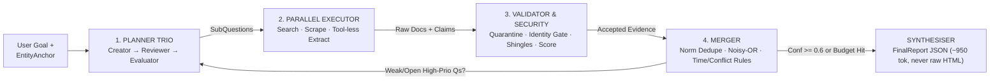
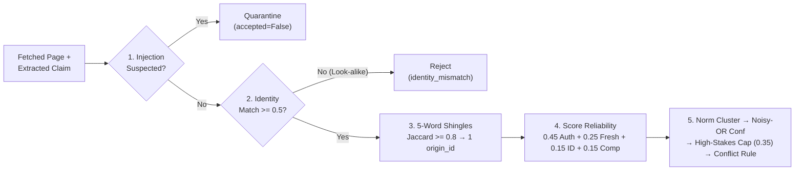

# Deep Search Agents — Rapid Revision & Cheatsheet

> Covers **all 13 Modules (0–12 + Appendix)**, **12 Hands-on Labs (`labs/`)**, and the **Production Package (`deepsearch/`)** in a 5-minute scan with zero concepts skipped.

---

## 1. Why Deep Search & Multi-Agent Architecture (Modules 0–2, Lab 1)

- **Lookup vs Research:** Lookup = 1 fact, 1 source, 1 step. Research = **open-ended, multi-faceted, contradictory, time-sensitive, high-stakes** (*e.g., NimbusPay payment-gateway due diligence*).
- **Why Normal Search (`2/10`) & Basic RAG (`5/10`) Fail on NimbusPay:**
  - *Normal Web Search:* Returns SEO-ranked links, ignores contradictions/dates, falls for **poisoned SEO attack page** (*"RBI revoked licence"*).
  - *Basic RAG:* Fixed corpus, treats every chunk as equally trustworthy, strips dates, single pass — mixes **UK look-alike `Nimbus Pay Ltd`** (`Daniel Hughes`), picks **stale 2023 CEO** (`Vikram Sethi` vs Jan 2026 `Ananya Rao`) & **Series A** (\$8M vs Series B \$40M).
  - *Deep Search (`10/10`):* Plans → collects in parallel → quarantines injection & look-alikes → weights authority + freshness → deduplicates syndicated copies → merges w/ provenance → loops on gaps. *(Products: Gemini/OpenAI Deep Research, Perplexity/Claude Research).*
  - **When NOT to Use (`15×` token cost, `15s–min` latency):** Simple factual lookups, static internal-handbook QA (use Production RAG), `< 1s` chat SLAs, or low-stakes ₹50 decisions.
- **LLM vs Agent (ReAct) vs Deep Search Agent:** LLM = `Prompt → Text` · Basic Agent = `Goal → Think/Act/Observe` loop · Deep Search = **explicit Plan + Multi-Source Collection + Source/Time Validation + Structured Provenance Merge + Gap Iteration**.
- **Anthropic's 5 Workflow Patterns *(all 5 used in `deepsearch/`)*:** **(1) Prompt chaining** (`Plan → Review`) · **(2) Routing** (`LLM.small()` vs `LLM.large()`) · **(3) Parallelisation** (`asyncio.gather` workers) · **(4) Orchestrator–workers** (planner delegates sub-questions to isolated workers) · **(5) Evaluator–optimiser** (`evaluate_progress` loops until `conf >= 0.6`).
  - **Claude Research Benchmarks:** Opus 4 lead + Sonnet 4 workers beat single Opus 4 by **`+90.2%`**; **80% of BrowseComp variance** = token usage (+ tool calls + model choice); single agents use **`~4×` tokens**, multi-agent **`~15×` tokens** vs chat; `3–5` parallel subagents cut time up to **`90%`**. *Effort scaling:* `1` agent / `3–10` calls (simple) · `2–4` subagents / `10–15` calls each (comparisons) · `10+` subagents (complex research).



---

## 2. Planning Trio, Executor, Schemas & MCP (Modules 3–4, Labs 2–5)

- **Planner Trio (`planner.py` — separate responsibilities, even on 1 model):**
  1. **Plan Creator:** Decomposes goal into `5–8` typed `SubQuestion`s using **5 Lenses**: **Entity** (`EntityAnchor` w/ `official_domain`, `city/country`, `exclude` look-alikes) · **Claim** · **Time** (`freshness_days`) · **Source Type** (`preferred_sources`) · **Decision Criteria** (`high_stakes=True` on `regulatory_status` & `security_incident`).
  2. **Plan Reviewer *(Code Rubric)*:** Auto-injects missing `entity` sub-question `q0`, enforces `high_stakes` flags, sets default `preferred_sources`, flags `< 5`-word vague questions, adds `stop_criteria` & anti-injection rule.
  3. **Plan Evaluator (`evaluate_progress`):** Returns **`stop`** if `budget.exhausted()`, all high/medium sub-questions reach `confidence >= 0.6` (with zero `unresolved_fields`), `iteration >= max_iterations`, or `iteration > 1 and new_evidence == 0` (diminishing returns); else **`continue`** with `open_sub_questions`.
- **Executor & 7-Tool Stack (`executor.py`, `tools.py`, `extractor.py`):**
  - *Tools:* **(1) Web search** (Tavily / Brave / `ddgs` — *`duckduckgo-search` was renamed to `ddgs`*) · **(2) Scraper** (`trafilatura` / Readability / Playwright / Apify) · **(3) PDF parser** · **(4) OCR / VLM** · **(5) Audio/Video transcript w/ timestamps** (`04:12`) · **(6) Structured entity registries** (MCA/RBI/SEC/OpenCorporates) · **(7) `think` scratchpad tool** *(mostly superseded by native **extended/adaptive thinking** in frontier models, Dec 2025 update; small edge tool-callers: Liquid AI `LFM2 / LFM2.5`)*.
  - *Tool Descriptions = Control Logic:* State **what it does**, **best for**, **do NOT use for**, and **exact input/output types**.
  - *Resilience & 4 Pydantic Gates:* Validate at **(1) Tool Input**, **(2) Tool Output**, **(3) Pre-Merge `Evidence`**, **(4) `FinalReport`**. `LLM.structured()` runs a **validate → feed error back → repair retry loop**. Wrap tools with timeouts, `429/503` exponential backoff, empty-result returns (never crash), `seen_urls` dedupe, and `budget.charge_tool()`.
- **Model Context Protocol — MCP *(NOT "Model Capability Protocol"!)*:**
  - Turns $M \text{ models} \times N \text{ tools}$ custom glue into **$M + N$** standard implementations. Donated by Anthropic (Dec 2025) to the **Agentic AI Foundation (Linux Foundation)**.
  - **3 Primitives:** `@mcp.tool()` (**model-chosen** actions) · `@mcp.resource("uri://...")` (**app-attached** read-only context) · `@mcp.prompt()` (**user-chosen** slash templates).
  - **2025–2026 Spec & SDK Updates:** Transports = **`stdio`** (local subprocess; **never `print()` to stdout**, corrupts JSON-RPC!) + **`Streamable HTTP`** (remote; replaced `HTTP+SSE` deprecated Mar 2025). **Spec `2026-07-28`** made core transport **stateless** (dropped mandatory `initialize` handshake & session IDs for cloud load-balancers). **Python SDK v2** renamed `FastMCP` → **`from mcp.server import MCPServer`** (`mcp>=1.25,<2` keeps `FastMCP`). *Security:* Vet third-party MCP servers for **tool-description prompt injection** ("rug-pull" tool mutations).

---

## 3. Validation, Copy Collapse, Dates & Merging (Modules 5–6, Labs 6–7)



- **Hard Gates Before Scoring (`validator.py`):**
  1. **Prompt Injection Quarantine:** `is_suspicious()` → `accepted = False`, `quarantined_source`.
  2. **Identity Hard Gate (`identity_match < 0.5` → rejected!):** Weighted average alone fails (a real UK regulator page for look-alike `Nimbus Pay Ltd` still scores `~0.82`!). Returns `0.0` if `entity.exclude` matches, `1.0` on `official_domain`, else fraction of `(domain, country, city, industry_keywords)` matched.
  3. **Syndicated Copy Detection *(WhatsApp Forward Trap)*:** `5`-word `shingles` + **`Jaccard >= 0.80`** collapses wire reprints onto the highest-authority / earliest `origin_id` so 3 copies of a Series B press release get **1 vote**, not 3!
- **4 Dates per Claim & The Recency Trap:** Track **`event_date`** *(priority #1 for freshness!)* > **`last_updated`** > **`publication_date`**, plus **`retrieval_date`** (audit). *Recency Trap:* Never let recency alone beat authority/confidence — the Oct 2026 SEO attack page is the newest document in the corpus!
- **Merging Order (`merger.py` — ALWAYS Deduplicate BEFORE Resolving Conflicts!):**
  1. **Normalize & Cluster (`threshold = 0.60`):** `normalize_value()` (`million→m`, strip titles/punct) + cluster via exact match, token Jaccard `>= 0.60`, or $\ge 2$-token subset (`"ananya rao"` $\subset$ `"ananya rao since 2026"`). *(Warning: setting threshold to `0.15` over-merges `Series A $8M` into `Series B $40M`!)*
  2. **Noisy-OR Confidence Across Independent Origins:** Keep max reliability $r_o$ per `origin_id`; $\text{conf} = \min\!\big(0.99,\; 1 - \prod_o (1 - r_o)\big)$. Two independent decent sources (`0.75` each → `0.938`) beat one `0.85` source!
  3. **High-Stakes Corroboration Rule:** `regulatory_status` & `security_incident` lacking a `regulator`/`official` source **OR** $\ge 2$ independent origins are **capped at `0.35`** (cannot cross `STRONG = 0.60`).
  4. **6 Contradiction Causes & 4 Outcomes:** *(Causes: time change, look-alike entity, scope/metric mismatch, syndicated rumour, stale cache, adversarial/SEO spam).*
     - **`time_separated`:** Time-sensitive field where newest strong claim (`>= 0.60`) wins (`status="current"`) and older non-weak claims (`>= 0.40`) become `status="historical"` (e.g., former CEO `Vikram Sethi`, `Series A`).
     - **`rejected_weak`:** Strong winner (`>= 0.60`) beats weak (`< 0.40`) rivals.
     - **`accepted_one`:** Non-time-sensitive field keeps highest-confidence strong claim.
     - **`unresolved`:** **No** cluster reaches `0.60`, OR two strong claims (`>= 0.60`) on a time-sensitive field have dates within **`<= 30 days`** — report both & flag for human review!
- **Grounded Synthesis (`~950 tok` vs `~6,800 tok` raw dump = `7×` smaller):** Synthesis LLM receives **only merged JSON (`FinalReport` w/ provenance `evidence_ids` + `supporting_sources`) — never raw web pages**, eliminating late-stage injection and hallucination.

---

## 4. Context, Memory, Security, Budgets, Eval & Law (Modules 7–12, Labs 8–12)

- **Iterative Gap-Filling, Working Context & Long-Term Memory (`memory.py`, Mod 7):**
  - *Round 2:* Targets only `open_sub_questions` using **new query angles** (`queries_used` + `seen_urls` block repeats).
  - *Short-Term Context Hygiene:* Workers run in **isolated contexts**; raw HTML stays on disk/store; orchestrator holds compact `MergedClaim` state.
  - *5 Long-Term Memory Types (`lessons.json`):* **Entity** (known look-alikes) · **Source** (reliable registries) · **Tool** (which scraper works) · **Planning** (sub-question templates) · **Failure** (dead-end queries).
  - *6 Memory Guardrails:* Revalidate cached facts · Fresh evidence always wins · Store timestamps + confidence · Store general lessons (not raw personal data) · Require multi-run confirmation · **NEVER write lessons extracted from untrusted web pages** (prevents persistent memory poisoning!).
- **Prompt Injection (`OWASP LLM01:2025`) & Security (`security.py`, Mod 8):**
  - **Simon Willison's Lethal Trifecta:** **Private Data** + **Untrusted Content** + **External Communication** = exfiltration (e.g., ``). Break **at least one leg**!
  - **7 Defence-in-Depth Layers:** **(1)** `strip_hidden()` (HTML comments, CSS `display:none`, zero-width chars) → **(2)** `scan_for_injection()` regex quarantine → **(3) Spotlighting** (`<UNTRUSTED_a3f91c02>` random hex tags so pages can't fake closing tags; cuts attack success `>50% → <2%`, Hines et al. 2024) → **(4) Dual-LLM / CaMeL containment** (extractor LLM has **zero tools**) → **(5) Strict Pydantic `FieldName` enum** → **(6) High-stakes `0.35` cap** → **(7) Quarantine audit log** in `FinalReport`. *(Also block **SSRF** to `localhost`, `10.x`, `192.168.x`, cloud metadata `169.254.169.254`; sandbox file parsers; keep keys in `.env`).*
  - *6 Published Secure Agent Patterns (Beurer-Kellner et al. 2025):* Action-Selector · **Plan-Then-Execute** · **LLM Map-Reduce** · **Dual LLM** *(course uses these 3)* · Code-Then-Execute · Context-Minimisation.
- **Cost, Latency & Concurrency (`budget.py`, Mod 9):**
  - **Extraction = ~68% of total tokens!** Cut costs `~3×` via **Model Routing** (`LLM.small()` for query-gen & extraction; `LLM.large()` for planning & final synthesis), trimming pages (`~8,000` chars), early quarantine, provider prompt caching, and `seen_urls` dedupe.
  - **Hard Thread-Safe `Budget`:** `max_usd=0.50`, `max_tokens=400_000`, `max_seconds=300`, `max_tool_calls=120` (reserve headroom across parallel workers; on limit hit, **degrade gracefully** & list `open_questions`). Bound concurrency via `asyncio.Semaphore(max_parallel=4)` (Amdahl's Law + avoids HTTP `429` storms).
- **Evaluation & Benchmarks (`evaluate.py`, Mod 10):**
  - **7 Code Metrics on Gold Set (`10–20+` cases):** `field_accuracy` · `history_recall` · `citation_support` · `conflict_recall` · **`forbidden_leaks` (`0` allowed — catches UK look-alike `Daniel Hughes` & SEO injection!)** · `overconfident_errors` (`conf >= 0.7` & wrong) · `usd_cost`. *(Ablation proof: `validation=False` leaks `Daniel Hughes` & breaks RBI status!)*
  - **8-Dim LLM Judge:** Relevance, Coverage, Factuality, Source Quality, Conflict Handling, Uncertainty Honesty, Clarity, Safety *(mitigate verbosity, position, self-preference & drift biases)*.
  - **6 Public Benchmarks:** **BrowseComp** (hard web navigation) · **BrowseComp-Plus** (fixed corpus, fair retrieval comparison) · **GAIA** (multi-step tool/file tasks) · **FRAMES** (multi-hop factuality + temporal reasoning) · **SimpleQA** (short factuality + calibration) · **DeepResearch Bench** (`RACE` report quality + `FACT` citation support).
- **Privacy, Law & Capstone Adaptation (Mods 11–12):**
  - **Research Companies, Not Private Individuals** (avoids unlawful automated profiling/doxxing).
  - **India DPDP Act 2023** *(Rules notified Nov 2025; core obligations May 2027; penalties up to **₹250 crore**)*: Sec 3 public-data exemption covers **only** data made public *by the individual themselves* or under legal mandate — **NOT** third-party posts/leaks or bulk people-scraping! **GDPR & EDPB July 2026 Guidelines:** Publicly accessible $\neq$ blanket "legitimate interest" to scrape personal data. Respect `robots.txt` / ToS / rate limits.
  - **LangGraph Equivalent (`lab12_langgraph_version.py`):** `StateGraph(ResearchState)` w/ `plan → collect → validate_merge → evaluate` conditional edge; add LangGraph when you need **durable checkpoints**, **human-in-the-loop plan approval (`interrupt_before`)**, or **UI state streaming**.
  - **Adapt to Any New Domain (Edit Only 4 Files):** `schemas.py` (`FieldName` enum) → `validator.py` (`AUTHORITY` & `HALF_LIFE_DAYS`) → `planner.py` (rubric & `high_stakes` fields) → `gold_set.json` (10+ test cases).

---

## 5. ⚡ Master Cheatsheet

### A. Core Formulas & Threshold Constants
| Mechanism | Exact Formula / Code Constant |
|---|---|
| **Evidence Reliability** | $R = 0.45\,\text{Auth} + 0.25\,\text{Fresh} + 0.15\,\text{ID} + 0.15\,\text{Comp}$ |
| **Authority (`validator.py`)** | `regulator=1.0`, `official=0.85`, `news=0.75` (`0.80` security), `video=0.60`, `pr=0.55`, `review=0.50` (`0.80` rating), `syndicated=0.45`, `forum=0.35` (`0.50` outage), `blog=0.25`, `unknown=0.20` |
| **Freshness Half-Life** | $\text{Fresh} = 0.5^{\text{age}/H}$ (`uptime=90d`, `price/rating=180d`, `ceo/fund/reg/outage=365d`, `sec=730d`, `hq=1825d`, `founded=36500d`; undated `= 0.30`); Date priority: `event > updated > pub` |
| **Completeness & Gates** | `Comp` = `+0.50` date `+0.25` snippet $\ge 30$c (else `+0.10`) `+0.25` publisher · **Hard Reject:** `ID < 0.50` or `injection` · **Copy Shingles:** 5-word Jaccard $\ge 0.80$ |
| **Noisy-OR & Merge** | $\text{Conf} = \min\!\big(0.99,\; 1 - \prod_{o}(1 - r_{\max,o})\big)$ · Cluster Jaccard $\ge 0.60$ · High-stakes uncorroborated cap `= 0.35` · `STRONG >= 0.60`, `WEAK < 0.40`, Tie window `<= 30d` · Labels: `>=0.80` high, `>=0.55` med |

### B. Symptom → Failing Metric → Exact Fix
| Symptom | Metric Hit | Root Cause & Fix |
|---|---|---|
| UK look-alike CEO `Daniel Hughes` appears | `forbidden_leaks > 0` | Identity treated only as soft weight → enforce **hard gate `identity_match >= 0.5`** + `entity.exclude` |
| 3 wire reprints inflate confidence to `0.95` | `overconfident_errors` | Counting URLs instead of origins → run **5-word shingle collapse (`Jaccard >= 0.8`)** before Noisy-OR |
| `Series A $8M` merged into `Series B $40M` | `history_recall` drops | Value dedup threshold too loose (`0.15`) → keep `cluster_values(threshold=0.60)` |
| Oct 2026 fake "licence revoked" page wins | `field_accuracy` + `forbidden` | Recency beating authority + injection → quarantine injection + `regulator=1.0` + **`0.35` high-stakes cap** |
| Agent loops forever & burns API wallet | `usd_cost` / timeout | Missing stop criteria → enforce `Budget` caps + stop when `new_evidence == 0` |

### C. Key 2025–2026 Ecosystem Corrections (Appendix)
- **MCP Name & Governance:** **Model Context Protocol** (never *"Capability"*); donated Dec 2025 to Linux Foundation's **Agentic AI Foundation**.
- **MCP Transport & SDK v2:** `HTTP+SSE` deprecated → use **`Streamable HTTP`** (stateless in Spec `2026-07-28`); Python SDK v2 renamed `FastMCP` → **`MCPServer`** (`from mcp.server import MCPServer`).
- **Search & Thinking Tools:** PyPI `duckduckgo-search` → **`ddgs`**; explicit `think` tool largely superseded by native **extended / adaptive thinking** on frontier models (still useful on small local models).

### D. 10-Point Production Checklist & CLI Quick-Run
- [ ] **1.** Planner Trio active (`EntityAnchor` + `exclude` look-alikes + `high_stakes` + explicit stop rules)
- [ ] **2.** 4 Pydantic validation gates + `LLM.structured()` repair loop + resilient tool timeouts/backoff
- [ ] **3.** 7-layer prompt-injection defence (`strip_hidden`, quarantine, random-tag spotlighting, tool-less extractor, SSRF block)
- [ ] **4.** Hard `identity_match >= 0.5` gate + 5-word shingle copy collapse (`Jaccard >= 0.8`)
- [ ] **5.** `event_date` prioritized over `publication_date` + field-specific `HALF_LIFE_DAYS`
- [ ] **6.** Normalize/cluster (`0.60`) **before** conflict resolution + Noisy-OR over independent origins + `0.35` high-stakes cap
- [ ] **7.** Synthesis LLM fed **only** merged `FinalReport` JSON (`~950` tok), never raw HTML
- [ ] **8.** Memory guardrails enforced (never learn persistent lessons from untrusted web text)
- [ ] **9.** Thread-safe `Budget` + `LLM.small()` routing (`~3×` cheaper extraction) + `asyncio.Semaphore`
- [ ] **10.** CI gold-set regression (`forbidden_leaks == 0`) + DPDP 2023 / GDPR / `robots.txt` compliance

```bash
cd study-material/03-deep-search-agent
python -m deepsearch                                              # Full offline 2-round due-diligence run on NimbusPay
python -m deepsearch --live -q "Assess Stripe as a payment partner" --country US --domain stripe.com
python -m deepsearch --evaluate                                   # Run programmatic metrics + ablations on gold_set.json
for f in labs/lab*.py; do python "$f"; done                       # Run all 12 hands-on labs (lab01..lab12_langgraph)
```
