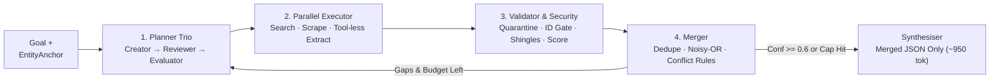

# Deep Search Agents — Quick Revision & Cheatsheet

> **All 13 Modules (0–12 + Appendix) + 12 Labs + `deepsearch/`** in simple, bite-sized bullets — zero concepts skipped.

---

## 1. Why Deep Search & Architecture (Modules 0–2)

- **Lookup vs Research:** Lookup = 1 fact, 1 step. Research = **multi-source, contradictory, time-changing, high-stakes** (company due diligence).
  - *Normal Search (`2/10`):* SEO-gamed links, ignores dates/conflicts, falls for poisoned pages.
  - *Basic RAG (`5/10`):* Fixed docs, trusts all chunks equally, drops dates, mixes same-name look-alike companies.
  - *Skip Deep Search when:* Simple lookup, static handbook QA (use RAG), `< 1s` chat SLA, or low-stakes task (**uses `~15×` more tokens**!).
- **Anthropic's 5 Workflow Patterns *(all 5 used)*:** **Prompt Chaining** · **Routing** (small vs large LLM) · **Parallelisation** (`asyncio`) · **Orchestrator–Workers** · **Evaluator–Optimiser** (gap loop).
  - *Claude Research Benchmarks:* Opus lead + Sonnet workers = **`+90.2%`** over single Opus; **`80%` of score variance = token budget**; `~4×` tokens (1 agent) / `~15×` (multi-agent); `3–5` parallel workers cut latency up to **`90%`**. *Scale effort:* `1` agent (simple) · `2–4` (comparisons) · `10+` (complex).



---

## 2. Planning, Tools, Schemas & MCP (Modules 3–4)

- **Planner Trio (`planner.py`):**
  1. **Creator:** Writes `5–8` `SubQuestion`s across **5 Lenses**: **Entity** (`EntityAnchor`: domain, country/city, `exclude` look-alikes) · **Claim** · **Time** (`freshness_days`) · **Source Type** · **Decision Criteria** (`high_stakes=True` on licence & security).
  2. **Reviewer *(Code Rubric)*:** Auto-adds missing identity Q, `high_stakes` flags, preferred sources, stop rules & anti-injection rule; flags `< 5`-word vague Qs.
  3. **Evaluator:** **`stop`** if `budget` hit, all high/med Qs reach `conf >= 0.6` (no unresolved conflicts), `max_iterations` hit, or `new_evidence == 0`; else **`continue`** on open gaps with **new query angles** (`queries_used` + `seen_urls` prevent repeats).
- **7-Tool Stack & 4 Pydantic Gates:**
  - *Tools:* Web search (`Tavily / Brave / ddgs` — renamed from `duckduckgo-search`) · Scraper (`trafilatura` / Playwright) · PDF · OCR/VLM · Audio/Video w/ timestamps · Company registries · `think` scratchpad *(largely replaced by native **extended/adaptive thinking** on frontier models; edge tool-callers: Liquid AI `LFM2/2.5`)*. Write tool descriptions as **control logic** (*what, best for, NOT for, I/O*).
  - *Reliability:* Pydantic validation at **Tool In, Tool Out, `Evidence`, `FinalReport`** + `LLM.structured()` **validate-repair retry loop** + timeouts, `429/503` backoff & empty returns (never crash).
- **MCP — Model Context Protocol *(NOT "Capability"!)*:**
  - Turns $M \times N$ custom integrations into **$M + N$**; under Linux Foundation (**Agentic AI Foundation**, Dec 2025).
  - **3 Primitives:** `@tool` (**model-chosen** action) · `@resource` (**app-attached** data) · `@prompt` (**user-chosen** template).
  - **2025–2026 Updates:** Transports = **`stdio`** (never `print()` to stdout!) + **stateless `Streamable HTTP`** (Spec `2026-07-28`; `HTTP+SSE` deprecated). Python SDK v2 renamed `FastMCP` → **`from mcp.server import MCPServer`**. Vet 3rd-party MCP servers for **tool-description injection**.

---

## 3. Validation, Dates & Merging (Modules 5–6)

- **3 Pre-Merge Filters (`validator.py`):**
  1. **Injection Quarantine:** Suspicious instruction text → `accepted = False`.
  2. **Identity Hard Gate (`< 0.5` → rejected!):** Soft weights aren't enough (a real UK regulator page for a same-name UK company still scores `0.82`!).
  3. **Syndicated Copy Collapse:** `5`-word **shingles** + **`Jaccard >= 0.80`** merges wire reprints into **1 `origin_id`** (3 copies of 1 press release = **1 vote**, not 3!).
- **Reliability Score:** $R = 0.45\,\text{Authority} + 0.25\,\text{Freshness} + 0.15\,\text{Identity} + 0.15\,\text{Completeness}$, with $\text{Freshness} = 0.5^{\text{age}/\text{half\_life}}$ (field-tuned authority & half-life, e.g. `regulator=1.0`, `uptime=90d`, `ceo=365d`; undated `= 0.30`).
- **4 Dates & Recency Trap:** Use **`event_date` > `last_updated` > `publication_date`** (+ `retrieval_date`). **Never let recency beat authority** (an attacker's fake page is often the newest!).
- **Merge Pipeline (`merger.py` — ALWAYS Deduplicate BEFORE Resolving Conflicts!):**
  1. **Normalize & Cluster (`0.60`):** Merge `"Series B $40M"` == `"series b 40 million"` (*too loose like `0.15` wrongly merges Series A `$8M` into Series B!*).
  2. **Noisy-OR Confidence Across Independent Origins:** $\text{Conf} = \min\!\big(0.99,\; 1 - \prod_o (1 - r_o)\big)$ — two `0.75` independent sources (`0.938`) beat one `0.85` source.
  3. **High-Stakes Cap (`0.35`):** Licence & security claims without `regulator`/`official` **or** $\ge 2$ independent origins are capped at `0.35` (below `STRONG = 0.60`).
  4. **4 Conflict Outcomes:** **`time_separated`** (newest strong wins `current`, older `>=0.40` kept as `historical`) · **`rejected_weak`** (`<0.40` dropped) · **`accepted_one`** · **`unresolved`** (nothing `>=0.60`, or two strong claims within **`<= 30 days`** → report both!).
- **Safe Synthesis:** Final LLM gets **only merged `FinalReport` JSON (`~950` tok vs `~6,800` raw) — never raw web pages**.

---

## 4. Memory, Security, Budgets, Eval & Law (Modules 7–12)

- **Context & Memory:** Isolate worker contexts; keep raw HTML off the main prompt. **5 Long-Term Memories** (*Entity, Source, Tool, Planning, Failure*) + **6 Guardrails:** revalidate cached facts, fresh evidence wins, keep dates/confidence, avoid personal data, require multi-run proof, and **never save lessons from untrusted web pages** (prevents memory poisoning).
- **Prompt Injection (`OWASP LLM01`) & Security (`security.py`):**
  - Break **Willison's Lethal Trifecta:** *Private Data + Untrusted Content + External Communication* (e.g. markdown image exfiltration).
  - **7 Defence Layers:** **(1)** Strip HTML comments / hidden CSS / zero-width chars → **(2)** Regex quarantine → **(3) Spotlighting** (random `<UNTRUSTED_hex>` tags; cuts attacks `>50% → <2%`) → **(4) Tool-less Dual-LLM / CaMeL extractor** → **(5)** Strict `FieldName` enum → **(6)** `0.35` corroboration cap → **(7)** Audit log. Also block **SSRF** (`localhost`, private IPs, `169.254.169.254`). *(Secure patterns: Plan-Then-Execute, Map-Reduce, Dual-LLM).*
- **Cost & Speed (`budget.py`):** **Extraction = ~68% of tokens** → route extraction/query-gen to **`LLM.small()` (~3× cheaper)**, trim pages (`8k` chars), enforce thread-safe **`Budget`** (`$0.50`, `400k` tok, `300s`, `120` tools; degrade gracefully listing open gaps), cap parallelism with `asyncio.Semaphore`.
- **Evaluation, Law & Domain Adaptation:**
  - **7 Code Metrics:** `field_accuracy`, `history_recall`, `citation_support`, `conflict_recall`, **`forbidden_leaks = 0`** (catches look-alikes & injections; fails when `validation=False`!), `overconfident_errors`, `cost` + **8-dim LLM Judge** (watch verbosity/position/self-bias) + **6 Benchmarks** (`BrowseComp`, `BrowseComp-Plus`, `GAIA`, `FRAMES`, `SimpleQA`, `DeepResearch Bench` RACE/FACT).
  - **Law & Ethics:** Research **companies, not private individuals**. **India DPDP Act 2023** (May 2027 enforcement; fines up to **₹250 crore**; public exemption *only* covers data self-published by that person, **not** 3rd-party posts/scraping!) · **GDPR / EDPB July 2026** scraping rules · obey `robots.txt`.
  - **LangGraph (`lab12`):** Use `StateGraph` when you need **checkpoints, human plan approval, or live UI streaming**. **New Domain = Edit 4 Files:** `schemas.py`, `validator.py`, `planner.py`, `gold_set.json`.

---

## 5. ⚡ Cheatsheet

| Formula / Symptom | Rule / Exact Fix |
|---|---|
| **Reliability & Freshness** | $0.45\,\text{Auth} + 0.25\,\text{Fresh} + 0.15\,\text{ID} + 0.15\,\text{Comp}$ · $\text{Fresh}=0.5^{\text{age}/H}$ · Date: `event > updated > pub` |
| **Noisy-OR & Thresholds** | $\text{Conf} = \min(0.99, 1 - \prod_o(1-r_o))$ · `ID >= 0.5` · Shingle `>= 0.8` · Dedupe `0.6` · Strong `>= 0.6` · High-stakes cap `0.35` · Tie `<= 30d` |
| Look-alike CEO leaks into report | `forbidden_leaks > 0` → enforce **hard gate `identity_match >= 0.5`** + `entity.exclude` |
| Wire copies inflate confidence | Counting URLs instead of origins → run **5-word shingle collapse (`>= 0.8`)** before Noisy-OR |
| Recent fake page beats regulator | Recency trap → quarantine injection + `regulator=1.0` + **`0.35` high-stakes corroboration cap** |

- [ ] **Launch Gate:** Planner Trio + `EntityAnchor` · 4 Pydantic gates + repair loop · 7-layer injection + SSRF defence · Hard ID gate + shingle collapse · Dedupe (`0.6`) before Noisy-OR + `0.35` cap · JSON-only synthesis · `Budget` + `LLM.small()` · Gold-set CI (`forbidden_leaks=0`) + DPDP compliance.

```bash
cd study-material/03-deep-search-agent
python -m deepsearch                                              # Offline 2-round due-diligence run
python -m deepsearch --live -q "Assess Stripe" --country US --domain stripe.com
python -m deepsearch --evaluate                                   # Gold-set metrics + ablations
for f in labs/lab*.py; do python "$f"; done                       # Run all 12 hands-on labs
```
