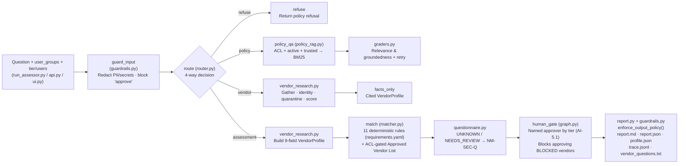

# AI Vendor Risk Assessor (Capstone) — Project Map

> **Directory:** [`study-material/project-vendor-risk-assessor/`](file:///Users/pankaj/Workspace/ai-bootcamp/study-material/project-vendor-risk-assessor)  
> **Organization & Domain:** *Nimbu Mart* — Automates vendor security/privacy due diligence against internal policies and open-web evidence. **AI finds & dates facts; deterministic Python judges; a human approves.**  
> **Course Companion:** [`Capstone-AI-Vendor-Risk-Assessor-Shivank-Agrawal.html`](file:///Users/pankaj/Workspace/ai-bootcamp/study-material/project-vendor-risk-assessor/Capstone-AI-Vendor-Risk-Assessor-Shivank-Agrawal.html) · [`Capstone-AI-Vendor-Risk-Assessor_Revision_Notes.md`](file:///Users/pankaj/Workspace/ai-bootcamp/study-material/project-vendor-risk-assessor/Capstone-AI-Vendor-Risk-Assessor_Revision_Notes.md)

---

## 1. Cross-Course Synthesis & Architecture Flow

This capstone integrates all three preceding courses into one auditable product orchestrated by [`assessor/graph.py`](file:///Users/pankaj/Workspace/ai-bootcamp/study-material/project-vendor-risk-assessor/assessor/graph.py) (supporting both plain Python and LangGraph `StateGraph`):

- **From Course 1 (`01-production-rag`):** Clause-level chunking, BM25 policy retrieval, ACL pre-filtering, active/archived version gating, untrusted source exclusion, and grounded citations ([`assessor/policy_rag.py`](file:///Users/pankaj/Workspace/ai-bootcamp/study-material/project-vendor-risk-assessor/assessor/policy_rag.py), [`app/api.py`](file:///Users/pankaj/Workspace/ai-bootcamp/study-material/project-vendor-risk-assessor/app/api.py)).
- **From Course 2 (`02-agentic-rag`):** Semantic 4-way Router ([`assessor/router.py`](file:///Users/pankaj/Workspace/ai-bootcamp/study-material/project-vendor-risk-assessor/assessor/router.py)) + Answer Relevance & Hallucination Graders ([`assessor/graders.py`](file:///Users/pankaj/Workspace/ai-bootcamp/study-material/project-vendor-risk-assessor/assessor/graders.py)).
- **From Course 3 (`03-deep-search-agent`):** Vendor research planner, parallel gatherer, identity gate, prompt-injection quarantine, freshness decay + authority scoring, conflict/provenance merger, and budgets/tracing ([`assessor/vendor_research.py`](file:///Users/pankaj/Workspace/ai-bootcamp/study-material/project-vendor-risk-assessor/assessor/vendor_research.py), [`assessor/tracing.py`](file:///Users/pankaj/Workspace/ai-bootcamp/study-material/project-vendor-risk-assessor/assessor/tracing.py)).
- **New Capstone Glue:** Deterministic rule matcher ([`assessor/matcher.py`](file:///Users/pankaj/Workspace/ai-bootcamp/study-material/project-vendor-risk-assessor/assessor/matcher.py)), vendor questionnaire drafter ([`assessor/questionnaire.py`](file:///Users/pankaj/Workspace/ai-bootcamp/study-material/project-vendor-risk-assessor/assessor/questionnaire.py)), input/output guardrails ([`assessor/guardrails.py`](file:///Users/pankaj/Workspace/ai-bootcamp/study-material/project-vendor-risk-assessor/assessor/guardrails.py)), human approval gate (`human_gate`), and Streamlit UI ([`app/ui.py`](file:///Users/pankaj/Workspace/ai-bootcamp/study-material/project-vendor-risk-assessor/app/ui.py)).



---

## 2. Annotated Directory & File Tree

```text
study-material/project-vendor-risk-assessor/
├── .env                                            # Active local config (defaults to mock LLM + offline web)
├── .env.example                                    # Provider templates & VRA_* budget/research settings
├── .gitignore                                      # Ignores .venv, .env, runs/, reports/, __pycache__
├── Capstone-AI-Vendor-Risk-Assessor-Shivank-Agrawal.html  # Full capstone brief: milestones M0–M6, rubric, demo checklist
├── Capstone-AI-Vendor-Risk-Assessor_Revision_Notes.md     # Quick revision notes, data-pack map & cheat sheet
├── Capstone-AI-Vendor-Risk-Assessor_Project_Map.md  # This project map
├── README.md                                       # Setup, CLI examples, offline vs live mode, code reading order
├── requirements.txt                                # Core (pydantic, pyyaml, numpy, pytest, langgraph) + optional live/app deps
├── run_assessor.py                                 # CLI entry point for policy Q&A, vendor facts & full assessments
│
├── assessor/                                       # Core application package (14 modules)
│   ├── __init__.py                                 # Package metadata (__version__ = "0.1.0")
│   ├── config.py                                   # Settings dataclass, PROVIDER_DEFAULTS, DATA_DIR/RUNS_DIR, SETTINGS
│   ├── schemas.py                                  # 15 Pydantic models + VENDOR_FIELDS (9 fields) & HIGH_STAKES_FIELDS
│   ├── llm.py                                      # Unified LLM client (mock/live) + complete_structured() repair loop
│   ├── tracing.py                                  # Tracer (runs/<ts>-<tag>/trace.jsonl), Budget & BudgetExceeded
│   ├── guardrails.py                               # redact_input(), check_intent(), enforce_output_policy()
│   ├── router.py                                   # decide() & guess_vendor() across 4 routes (policy, vendor, assessment, refuse)
│   ├── policy_rag.py                               # PolicyChunk, BM25, chunk_markdown(), PolicyLibrary (ACL, versions, trust, AVL lookup)
│   ├── graders.py                                  # GradeResult, grade_relevance(), grade_grounded(), grade_policy_answer()
│   ├── vendor_research.py                          # OfflineWeb, IdentityCheck, VendorResearcher, scan_injection(), freshness(), authority()
│   ├── matcher.py                                  # load_requirements(), Matcher & 8 deterministic rule_* evaluators + overall_outcome()
│   ├── questionnaire.py                            # build_questions() & as_email() converting gaps to NM-SEC-Q vendor questions
│   ├── report.py                                   # to_markdown() rendering PROC-2.1 review file with verdicts, facts & approval block
│   └── graph.py                                    # State TypedDict, new_state(), Pipeline (run_plain & build_langgraph engines)
│
├── app/                                            # Web API & Reviewer Workbench
│   ├── api.py                                      # FastAPI server: /health, /ask, /assess, /approve/{run_id}, /runs/{run_id}/report.md
│   └── ui.py                                       # Streamlit 1-page reviewer UI: ACL/tier controls, verdict table, trace viewer
│
├── data/                                           # Rules, internal policies, fictional vendor web & gold sets
│   ├── requirements.yaml                           # 11 machine-checkable rules mapped to policy clauses & VendorFields
│   ├── gold_set.json                               # 5 hand-checked vendor cases + 9 policy Q&A cases (ACL, version, trust)
│   ├── gold_set_template.json                      # Starter template for Milestone 2 real-vendor gold sets
│   ├── policies/                                   # Nimbu Mart's 8 internal policy/procedure documents + metadata
│   │   ├── _metadata.json                          # doc_id, access groups, version, effective_date, status, trust
│   │   ├── information_security_policy_2026.md     # NM-SEC-POL (active): SEC-4.2, SEC-7.1, SEC-9.3, SEC-9.4
│   │   ├── information_security_policy_2025.md     # NM-SEC-POL (archived, superseded by 2026)
│   │   ├── data_protection_policy.md               # NM-DP-POL (active): DP-2.2, DP-3.1, DP-3.2, DP-5.4
│   │   ├── ai_acceptable_use_policy.md             # NM-AI-POL (public): AI-2.1, AI-3.4, AI-5.1
│   │   ├── vendor_onboarding_checklist.md          # NM-PROC-CHK (employees): PROC-1.1, PROC-2.1, PROC-2.2
│   │   ├── approved_vendor_list.md                 # NM-PROC-AVL (restricted: procurement, security)
│   │   ├── security_questionnaire_template.md      # NM-SEC-Q (employees): standard vendor question bank
│   │   └── team_chat_vendor_notes_untrusted.md     # CHAT-EXPORT (trust: untrusted — must never be cited as policy)
│   └── vendor_web/
│       └── corpus.json                             # 23 fictional pages across LedgerLens AI, QuillDesk & Parakeet Translate
│
├── eval/
│   └── run_eval.py                                 # Evaluation harness (verdict/overall/field acc, guess_rate, safety, policy QA) + --strict CI gate
│
├── scripts/
│   └── check_setup.py                              # Verifies Python version, packages, corpus/policies & runs smoke check
│
└── tests/                                          # Automated test suite (70 tests)
    ├── conftest.py                                 # Shared pytest fixtures (library, fact, profile)
    ├── test_matcher.py                             # Unit tests for all deterministic rules & tier conditions
    ├── test_policy_rag.py                          # Clause chunking, ACL isolation (AVL), archived & untrusted filtering
    ├── test_vendor_research.py                     # Identity gate, injection quarantine, rumour drop, copy down-weight, freshness decay
    ├── test_router_guardrails.py                   # 4-way routing, secret/PII redaction, approval intent blocking
    └── test_end_to_end.py                          # Full gold-set runs on plain & LangGraph engines + blocked-approval enforcement
```

---

## 3. Core Module & Data Breakdown

### `assessor/` Modules

| Module | Key Symbols | Responsibility |
|---|---|---|
| [`schemas.py`](file:///Users/pankaj/Workspace/ai-bootcamp/study-material/project-vendor-risk-assessor/assessor/schemas.py) | `VENDOR_FIELDS`, `HIGH_STAKES_FIELDS`, `Evidence`, `VendorFact`, `VendorProfile`, `PolicyAnswer`, `Requirement`, `RequirementResult`, `AssessmentReport`, `Approval` | Strict Pydantic v2 contracts across all stages (`VendorProfile` covers 9 fields from `legal_entity` to `dpa_available`) |
| [`guardrails.py`](file:///Users/pankaj/Workspace/ai-bootcamp/study-material/project-vendor-risk-assessor/assessor/guardrails.py) | `redact_input()`, `check_intent()`, `enforce_output_policy()` | Scrubs keys/PAN/Aadhaar/emails/phones on input; blocks self-approval bypasses; downgrades uncited `PASS`/`FAIL` verdicts to `UNKNOWN` on output |
| [`router.py`](file:///Users/pankaj/Workspace/ai-bootcamp/study-material/project-vendor-risk-assessor/assessor/router.py) | `decide()`, `guess_vendor()`, `RouteDecision` | Routes queries to `policy`, `vendor`, `assessment`, or `refuse` |
| [`policy_rag.py`](file:///Users/pankaj/Workspace/ai-bootcamp/study-material/project-vendor-risk-assessor/assessor/policy_rag.py) | `PolicyLibrary`, `PolicyChunk`, `BM25`, `chunk_markdown()`, `approved_vendor_entry()` | Splits markdown policies by clause (`SEC-4.2`, etc.), filters ACL/archived/untrusted pre-ranking, and looks up `NM-PROC-AVL` |
| [`graders.py`](file:///Users/pankaj/Workspace/ai-bootcamp/study-material/project-vendor-risk-assessor/assessor/graders.py) | `GradeResult`, `grade_relevance()`, `grade_grounded()`, `grade_policy_answer()` | Verifies retrieved policy answers address the question and stay grounded in citations |
| [`vendor_research.py`](file:///Users/pankaj/Workspace/ai-bootcamp/study-material/project-vendor-risk-assessor/assessor/vendor_research.py) | `VendorResearcher`, `OfflineWeb`, `IdentityCheck`, `scan_injection()`, `freshness()`, `authority()` | Plans queries, gathers pages (`offline`/`ddgs`/`tavily`), gates look-alikes, quarantines injections, down-weights copies (`0.1x`), and merges with half-life decay |
| [`matcher.py`](file:///Users/pankaj/Workspace/ai-bootcamp/study-material/project-vendor-risk-assessor/assessor/matcher.py) | `Matcher`, `load_requirements()`, `rule_certification_valid()`, `rule_region_includes()`, `rule_value_known()`, `rule_enum_verdict()`, `rule_list_disclosed()`, `rule_retention_within()`, `rule_no_unresolved_incident()`, `rule_approved_for_tier()` | Evaluates 11 rules from `data/requirements.yaml` deterministically (`PASS`/`FAIL`/`NEEDS_REVIEW`/`UNKNOWN`/`NOT_APPLICABLE`) and computes `BLOCKED`/`CONDITIONAL`/`READY_FOR_APPROVAL` |
| [`questionnaire.py`](file:///Users/pankaj/Workspace/ai-bootcamp/study-material/project-vendor-risk-assessor/assessor/questionnaire.py) | `build_questions()`, `as_email()` | Generates clause-linked vendor questions & outreach email from `NM-SEC-Q` for non-passing rules |
| [`report.py`](file:///Users/pankaj/Workspace/ai-bootcamp/study-material/project-vendor-risk-assessor/assessor/report.py) | `to_markdown()` | Formats `PROC-2.1` review report with verdict table, source URLs/dates, conflicts, and human approval block |
| [`graph.py`](file:///Users/pankaj/Workspace/ai-bootcamp/study-material/project-vendor-risk-assessor/assessor/graph.py) | `Pipeline`, `State`, `new_state()`, `APPROVERS` | Runs the 10-node graph identically in plain Python (`run_plain`) or LangGraph (`build_langgraph`) |

### Deterministic Rules ([`data/requirements.yaml`](file:///Users/pankaj/Workspace/ai-bootcamp/study-material/project-vendor-risk-assessor/data/requirements.yaml)) & Fictional Test Vendors

| Rule ID | Clause & Severity | Vendor Field Checked | Test Vendors in `data/vendor_web/corpus.json` |
|---|---|---|---|
| `SEC-4.2` / `SEC-4.2-T2` | `SEC-4.2` (blocker T3 / major T2) | `security_certifications` | **LedgerLens AI** (T3 → `BLOCKED`: US/EU only, India planned; tests UK look-alike, stale 2024 page, forum rumour & injection) |
| `DP-3.1` / `DP-3.2` | `DP-3.1` (blocker T3) / `DP-3.2` (minor T2) | `data_regions` | **QuillDesk** (T3 → `BLOCKED`: trains on content, no SOC 2 report, US-only, unresolved July 2026 incident, syndicated copy) |
| `AI-2.1` / `AI-3.4` | `AI-2.1` (blocker) / `AI-3.4` (major) | `trains_on_customer_data` / `subprocessors` | **Parakeet Translate** (T3 → `CONDITIONAL`; T2 → `READY FOR APPROVAL`: ISO 27001, India region, DPA with DPDP addendum) |
| `DP-5.4` / `DP-2.2` | `DP-5.4` (major T3) / `DP-2.2` (blocker T3) | `data_retention` / `dpa_available` | — |
| `SEC-7.1` / `SEC-9.3` / `PROC-1.1` | `SEC-7.1`, `SEC-9.3` (blocker T3), `PROC-1.1` (major) | `sso_saml`, `security_incidents`, `approved_vendor_list` | `PROC-1.1` reads from ACL-protected `approved_vendor_list.md` (requires `security` or `procurement` group) |

---

## 4. Quick Run & Config Reference

Run commands from [`study-material/project-vendor-risk-assessor/`](file:///Users/pankaj/Workspace/ai-bootcamp/study-material/project-vendor-risk-assessor):

```bash
python scripts/check_setup.py      # Verify environment & offline corpus
python run_assessor.py             # Default offline assessment (LedgerLens AI, T3, 35 users -> BLOCKED)
python -m pytest -q                # Run all 70 automated tests
python eval/run_eval.py --strict   # Run gold_set.json scorecard with CI thresholds

# Start API & Streamlit Reviewer UI:
uvicorn app.api:app --reload --port 8000
streamlit run app/ui.py
```

- **Key `.env` variables** ([`.env.example`](file:///Users/pankaj/Workspace/ai-bootcamp/study-material/project-vendor-risk-assessor/.env.example)): `LLM_PROVIDER` (`mock` | `gemini` | `groq` | `ollama` | `openrouter` | `openai` | `anthropic` | `custom`), `SEARCH_PROVIDER` (`offline` | `ddgs` | `tavily`), `VRA_AS_OF`, `VRA_MAX_USD`, `VRA_MAX_PARALLEL`, `VRA_RESULTS_PER_QUERY`.
