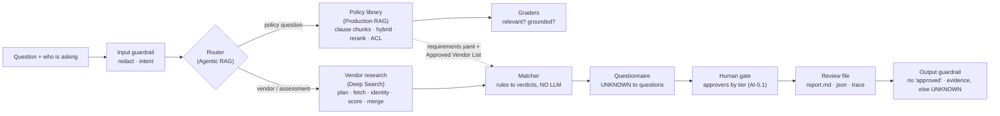
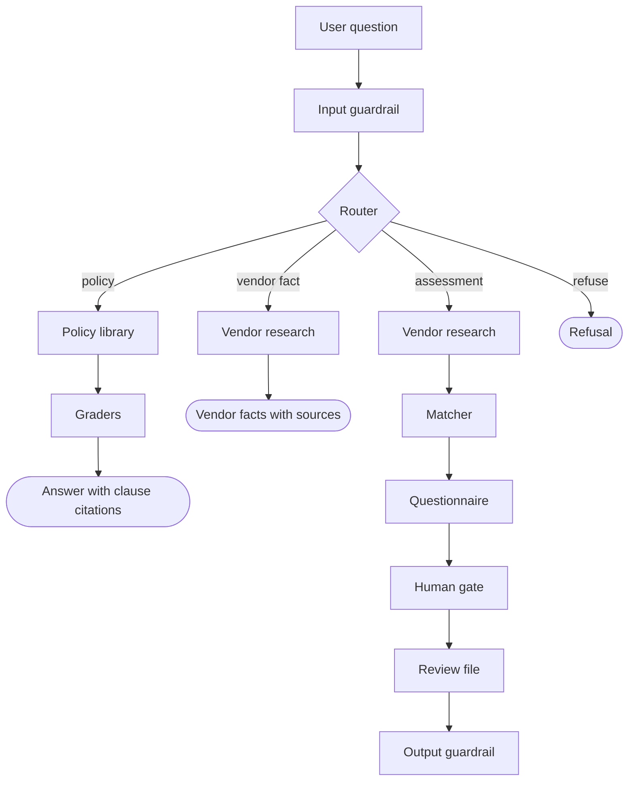
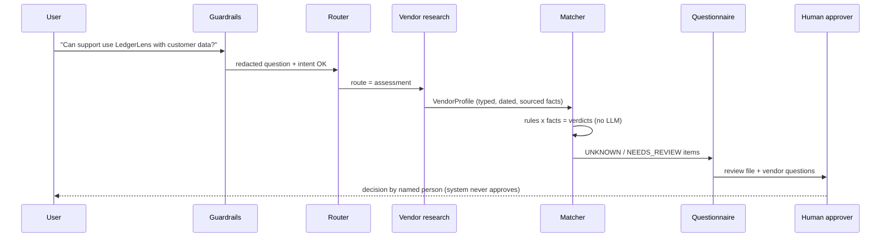
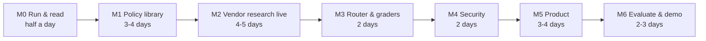
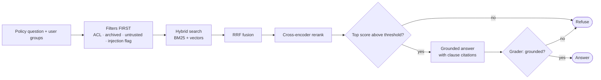
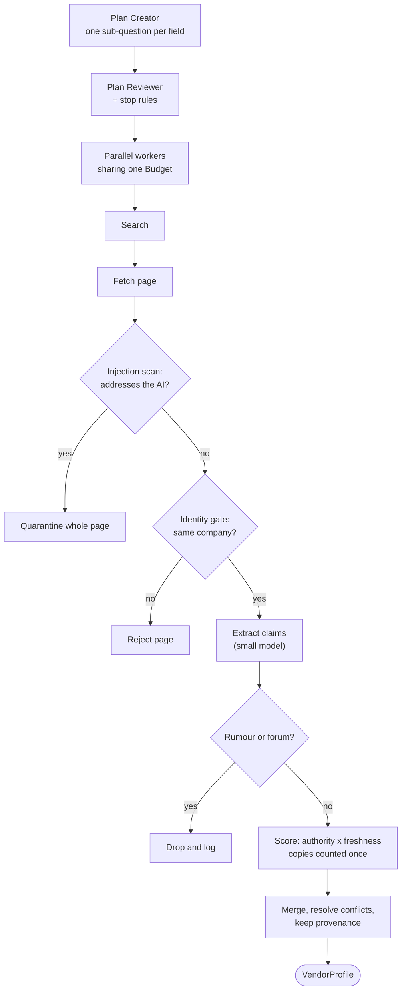
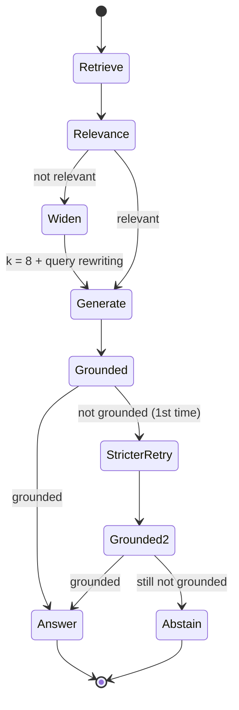
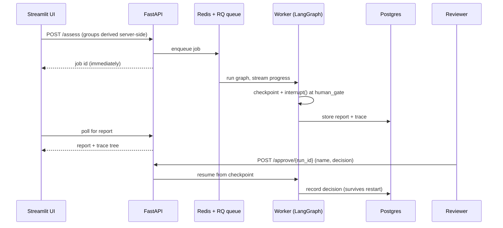
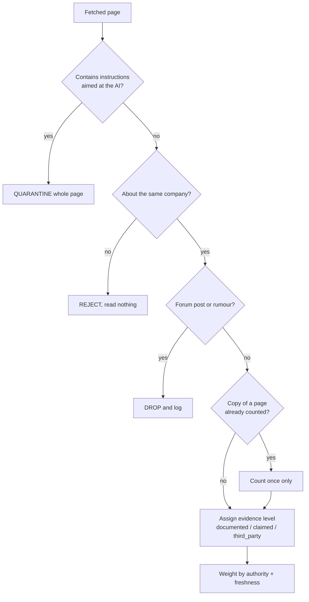
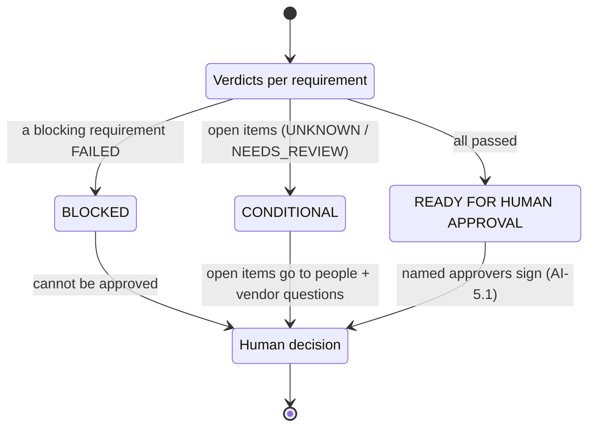

# AI Vendor Risk Assessor — Quick Revision Notes

**What this project is about:** A capstone (by Shivank Agrawal) that joins three earlier courses — **Production RAG**, **Agentic RAG** and **Deep Search** — into one product. You ask *"Can our support team use this AI tool with customer data?"* and get a **review file**: every policy requirement checked against dated, sourced web evidence, plus the questions still to ask the vendor. **A human approves. The system never does.**

- **Effort:** Solo 2–3 weeks · Team of 3–4: 4 weeks · Starter kit runs **offline on day one**.
- **The new "glue" you add:** a deterministic **requirement matcher**, a **questionnaire drafter**, a **human approval gate** and a **UI**.

---

## Table of Contents

- [Big Picture (End-to-End)](#big-picture-end-to-end)
- [0. Start Here](#0-start-here)
- [1. The Problem](#1-the-problem)
- [2. Architecture](#2-architecture)
- [3. Course Map](#3-course-map)
- [4. Milestones (M0–M6)](#4-milestones-m0m6)
- [5. The Data Pack](#5-the-data-pack)
- [6. Rules of the Project](#6-rules-of-the-project)
- [7. Evaluation & Rubric](#7-evaluation--rubric)
- [8. Demo Checklist (12 minutes)](#8-demo-checklist-12-minutes)
- [9. Stretch Goals](#9-stretch-goals)
- [10. FAQ](#10-faq)
- [A. Glossary](#a-glossary)
- [Cheat Sheet](#cheat-sheet)

---

## Big Picture (End-to-End)



**Colour legend in the guide** (which course each box comes from):

| Box | Comes from |
|---|---|
| Policy library | Production RAG course |
| Router, Graders | Agentic RAG course |
| Vendor research | Deep Search course |
| Matcher, Questionnaire | **New in this capstone** |
| Input/Output guardrails, Human gate | Security & humans (both courses) |

> **Tip:** One sentence to remember it all — *"AI reads and finds facts; code judges; a human decides."*

---

## 0. Start Here

**In one line:** You already built three pieces in three courses; this capstone glues them into one auditable product and gives you a working offline starter kit to upgrade.

### The three courses → three components

| Course | What you built | Role here |
|---|---|---|
| **Production RAG from Scratch** | RAG pipeline over company docs (`rag_core/`) | Policy library |
| **Agentic RAG with DeepSeek + CrewAI** | Crew that **routes** and **grades** (Router, Retriever, two graders) | Router + Graders |
| **Deep Search Agents** | Web research agent that refuses to be fooled (`run_agent.py`, Lab 12 in LangGraph) | Vendor research |

- **RAG** = Retrieval-Augmented Generation: fetch relevant text first, then let the LLM answer from it.
- **Agentic** = the LLM makes small decisions (e.g., which route to take).
- **Deep search** = multi-step planned web research with source checking.

### What you will have at the end
- A working **assessor**: policy library + vendor research + rule-based verdicts + human gate, behind an **API** and a small **UI**.
- A hand-built **gold set** (correct answers) of real vendors + an **evaluation report** proving accuracy, **zero guessing** and **injection resistance**.
- A **trace** for every run: from any verdict you can point to the exact web page and policy clause.
- A portfolio story: *"I automated the vendor security review, and here is how I kept it honest."*

### Prerequisites
- Production RAG done (have a working `rag_core/` folder).
- Agentic RAG done (understand Router, Retriever, two graders).
- Deep Search done (ran `run_agent.py` offline and live, and Lab 12 in LangGraph).
- **Python 3.10+**, a free LLM key (**Gemini** or **Groq**) or **Ollama**, and free web search (**`ddgs`**, no key).

### Day one: run the starter kit

```bash
cd vendor-risk-assessor
python -m venv .venv && source .venv/bin/activate   # Windows: .venv\Scripts\Activate.ps1
pip install -r requirements.txt
cp .env.example .env
python scripts/check_setup.py
python run_assessor.py        # LedgerLens AI, customer data, 35 users
python -m pytest -q           # 70 tests
python eval/run_eval.py       # the scorecard
```

- Default run: **< 1 second**, **no key, no internet**, prints a full review file ending in **BLOCKED**.
- Read `runs/<timestamp>-assess/report.md`, then `trace.jsonl`. **That report is the target.**

### How the starter kit is built

| Part | State in starter kit |
|---|---|
| Schemas, matcher, questionnaire, report, gold set, evaluation harness | **Complete and tested** (deterministic) |
| Course parts | **Simplified offline form** |

Simplifications you will replace:

| Simplified (now) | Real (your job) |
|---|---|
| Keyword search | Hybrid search + rerank |
| Rule-based router | LLM router |
| Static research plan | Planner (LLM) |

- Every simplified file starts with a **`COURSE MAP`** comment and a **`LEARNER TODO`** block naming the milestone and course module.
- **Your job:** replace simplified → real, **keep tests green**, **prove the improvement** in the evaluation.

> **Tip:** Never "upgrade" something without re-running `pytest` and `eval/run_eval.py`. The improvement must show up in numbers.

---

## 1. The Problem

**In one line:** Security engineers spend 2–6 hours per vendor mostly *finding and dating facts*; the assessor does the finding, dating and checking, and leaves the **judging** to a person.

### Why it matters
- Employees ask "can I use this AI tool?" several times a week.
- Each request should trigger a **vendor security review**. Typical questions:
  - Current **SOC 2 Type II** or **ISO 27001**? (security certifications — see Glossary)
  - Where is our data **stored**?
  - Do they **train** on our data?
  - Who are their **sub-processors**?
  - Any **incident**?
  - Is a **DPA** (Data Processing Agreement) available?
- Today: **2–6 hours per vendor** reading trust centres, privacy policies, news. Teams **wait weeks** or **skip** the review.

### Running example: Nimbu Mart
Its Information Security team has **8 internal documents**:
1. Security policy — **two editions** (2026 current, 2025 archived)
2. Data-protection policy (written for India's **DPDP Act**)
3. AI acceptable-use policy
4. Procurement checklist
5. **Approved Vendor List** (restricted)
6. Questionnaire template
7. An **untrusted chat export**

(The two security-policy editions count as two documents.)

### The three fictional vendors

| Vendor | What it does | Why it's a good test |
|---|---|---|
| **LedgerLens AI** | Summarises support tickets | Solid SOC 2 Type II, but data in **US/EU**, India only **"planned"**. Traps: stale **2024 page**, **same-name UK accountancy firm**, **forum rumour**, **review site contradicting** the trust centre, **blog with prompt injection**. |
| **QuillDesk** | AI writing assistant | "SOC 2 compliant" with **no report**, **trains on content by default**, **US-only** storage, **July 2026 incident with no post-mortem**, a directory page that is a **copy** of the vendor's own page. |
| **Parakeet Translate** | Translation for Indian languages | The **good vendor**: ISO 27001 confirmed on certifier's registry, India region, no training, DPA with DPDP addendum — but approved **only for internal data (T2)**, so customer-data use still needs Procurement. |

### What "good" looks like — LedgerLens at customer-data tier (abridged)

| Requirement | Clause | Verdict | Why |
|---|---|---|---|
| Independent security assurance | SEC-4.2 | **PASS** | SOC 2 Type II report dated 2026-01-20 (trust centre, 2026-09-01) |
| Customer data stored in India | DP-3.1 | **FAIL** | India only planned; today US, EU |
| No training on our data | AI-2.1 | NEEDS REVIEW | No training on Business/Enterprise; Free/Pro trains by default |
| Sub-processors disclosed | AI-3.4 | NEEDS REVIEW | Model provider present: Orbital Models (US) |
| Incident history | SEC-9.3 | NEEDS REVIEW | One major incident (2025-04) with published post-mortem (2 sources) |
| On Approved Vendor List | PROC-1.1 | NEEDS REVIEW | Review already in progress; attach this assessment |

The report then contains:
- **Facts** with confidence and conflicts.
- A **security section**: "1 page quarantined for prompt injection; 1 rejected as a different company; 1 rumour dropped".
- **Six ready-to-send questions** for the vendor.
- An **approval block** with two required signers: **Head of Information Security** and **DPO** (Data Protection Officer).
- Outcome: **BLOCKED** for this data tier — **never "rejected", never "approved"**.

> **Tip:** Every row has **clause + verdict + reason + evidence (source and date)**. If you can't fill evidence, the verdict must be UNKNOWN.

---

## 2. Architecture

**In one line:** One graph, three routes — policy questions stop at the graders, vendor-fact questions stop after research, and assessments run the full chain ending in a human decision.

### Three routes



- The **same nodes** run as **plain Python** or as a **LangGraph state machine** (`assessor/graph.py`).
- **LangGraph** = a library for building agent workflows as graphs of steps with shared state.

### The components

| Component | File | Starter-kit status | Your job |
|---|---|---|---|
| Contracts between stages | `assessor/schemas.py` | **Complete.** 9 vendor fields, evidence levels, verdicts, the report | — |
| Policy library | `assessor/policy_rag.py` | Simplified: clause chunking + **BM25** + ACL/version/trust filters + extractive answers | Hybrid + rerank + grounded generation |
| Router | `assessor/router.py` | Rule-based mock | LLM router (course prompt + 2 extra routes) |
| Graders | `assessor/graders.py` | Heuristic mocks | Two grader agents + retry loop |
| Vendor research | `assessor/vendor_research.py` | Full offline loop (identity gate, quarantine, scoring, merging); live mode = sequential baseline | Planner, parallel workers, memory, live eval |
| Requirement matcher | `assessor/matcher.py` + `data/requirements.yaml` | **Complete & tested.** 8 rule types, 11 requirements | Extend when adding policies |
| Questionnaire, report | `assessor/questionnaire.py`, `report.py` | **Complete** | — |
| Guardrails | `assessor/guardrails.py` | Regex input redaction, intent check, output policy | LLM injection classifier, red-team suite |
| Orchestrator | `assessor/graph.py` | Plain Python + LangGraph, same nodes; CLI human gate | Checkpointer + interrupt, streaming |
| API, UI | `app/api.py`, `app/ui.py` | Thin skeletons | Queue, storage, auth, trace viewer |
| Evaluation | `eval/run_eval.py`, `data/gold_set*.json` | Harness + fictional gold set complete; real-vendor set is a template | Fill it |

Jargon:
- **BM25** = classic keyword-ranking algorithm.
- **ACL** = Access Control List — who may see which document.
- **Extractive answer** = copy the matching text; **grounded generation** = LLM writes an answer using only retrieved text, with citations.

### Assessment flow as a sequence



> **Tip:** The matcher is the only place verdicts are made. The LLM never touches the verdict.

---

## 3. Course Map

**In one line:** An index telling you which course module, lab and reusable file to use for each project part, and in which milestone.

### Production RAG parts

| Project part | Module / Lab | Reuse | Milestone |
|---|---|---|---|
| Ingest policies; **chunk by clause** with metadata (version, status, access, trust) | 04 Ingestion · 06 Chunking ("structure-aware", "chunk metadata") · Lab 03 | `rag_core/documents.py`, `chunking.py`, `loaders.py`, `_metadata.json` pattern | M1 |
| Retrieve the right clause: **hybrid search, RRF, metadata filters, reranking** | 08 Retrieval & reranking (sec 3–9) · 07 Embeddings · Labs 04, 06, 07, 08 | `hybrid.py`, `bm25.py`, `vectorstore.py`, `rerank.py`, `query_transform.py` | M1 |
| **Grounded answers** with clause citations; refuse when context lacks answer | 09 Grounded generation · Lab 09 | `generate.py`, `prompts.py` | M1 |
| ACL in retrieval; archived versions; untrusted docs; **PII redaction** | 11 Security & privacy (sec 1–3) · Lab 11 | `rag_core/security.py` (`acl_filter`, `redact_pii`, `detect_injection`) | M1, M4 |
| The service: **FastAPI**, validation, queue, workers, storage | 04 (entry points, queue, idempotency) · 13 Capstone | `code/app/api.py`, `worker.py`, `db.py`, `docker-compose.yml` | M5 |

### Agentic RAG parts

| Project part | Where | Reuse | Milestone |
|---|---|---|---|
| **Route**: policy / vendor / assessment / refuse | "agents.py → The Router", "tasks.py → Task 1: route", exercise "Break the Router on purpose" | `agents.py` (`create_router_agent`), `tasks.py` | M3 |
| **Check the answer**: relevance + hallucination graders, with retry | "Tasks 3 and 4: the two checks", "Prompt engineering is the real work" | `agents.py` (two graders), `tasks.py` | M3 |
| **Two models**: fast/cheap for extraction & grading, strong for synthesis | Agentic "Two LLMs" + Deep Search 09 "Model routing" · DS Lab 10 | `llms.py`; `deepsearch/llm.py` (`LLM.small`) | M2, M3 |

### Deep Search parts

| Project part | Module / Lab | Reuse | Milestone |
|---|---|---|---|
| **Plan** research: Plan Creator → Reviewer, sub-question per field, stop rules | 03 Planning · Lab 3 | `planner.py`, `schemas.py` (`ResearchPlan`, `PlanReview`) | M2 |
| **Typed tools**; validate → repair loop for LLM JSON | 04 Executor, tools & MCP · Lab 2 | `llm.py` (`structured()`), `tools.py` | M2 |
| **Parallel workers**: search → fetch → injection scan → extract claims | 04 · 09 "Latency: parallel workers" · Lab 4 | `executor.py`, `extractor.py` | M2 |
| **Identity gate**, authority per source, **freshness decay**, copies counted once | 05 Validation & temporal reasoning · Lab 6 | `validator.py` (`AUTHORITY`, `HALF_LIFE_DAYS`, `FIELD_AUTHORITY_OVERRIDES`) | M2 |
| **Merge** claims; resolve conflicts; keep **provenance** | 06 Merging · Lab 7 | `merger.py` | M2 |
| **Memory**: re-review only what changed (SEC-12.1) | 07 Context, memory · Lab 8 | `memory.py` | M2 (stretch) |
| **Prompt injection** via web pages; quarantine; defence in depth; red team | DS 08 Security + RAG 11 · DS Lab 9, RAG Lab 11 | `deepsearch/security.py`, `rag_core/security.py` | M4 |
| **Budgets**, token costs, cost per assessment | DS 09 + RAG 12 ("Cost", "Caching") · DS Lab 10, RAG Lab 13 | `budget.py`, `rag_core/cache.py` | M2, M5 |
| **Tracing / observability** | DS `tracing.py` (Module 12) + RAG 12 · RAG Lab 13 | `tracing.py`, `rag_core/observability.py` | M5 |
| **Evaluation**: gold set first, metrics, ablations, LLM-as-judge, CI | DS 10 + RAG 10 · DS Lab 11, RAG Lab 10 | `evaluation.py` (both), `eval/golden.jsonl` format | M6 |
| **Graph orchestration**, human-in-the-loop pause, checkpoints | 02 ("five patterns") · 12 "same loop in a framework" · Lab 12 | `labs/lab12_langgraph_version.py` | M5 |
| **Privacy & law**: research companies not people; DPDP Act; minimal schema | 11 Privacy, law & ethics | Module 11 checklist | M4 |
| Expose as **MCP tool** (stretch) | 04 "MCP" · Lab 5 | `lab05_mcp_server.py`, `lab05_mcp_client.py` | Stretch |

### New parts (no course)

| Project part | Principles from | Code | Milestone |
|---|---|---|---|
| **Requirement matcher**: rules × facts → verdicts, deterministic, tested | DS 06 ("clean structured result"), RAG 09 ("refusing") | Already written: `assessor/matcher.py`, `tests/test_matcher.py` | M0, M6 |
| **Questionnaire drafter + review file** | RAG 09 "Structured output" | `questionnaire.py`, `report.py` | M0 |
| **Human approval gate**, approvers by data tier | DS 12 checklist ("user approves the plan before a long run") | `graph.py` (`human_gate`), `app/api.py` (`/approve`) | M5 |
| **Streamlit UI** with progress + trace viewer | — | `app/ui.py` skeleton | M5 |

Jargon:
- **RRF (Reciprocal Rank Fusion)** = merges two ranked lists (keyword + vector) into one.
- **Reranker (cross-encoder)** = a model that rescores each (query, chunk) pair more accurately.
- **Provenance** = where a value came from (URL, date).
- **MCP (Model Context Protocol)** = standard way to expose tools to apps like Claude Desktop or an IDE.

> **Tip:** When you open a `LEARNER TODO` in the code, look up its row here first.

---

## 4. Milestones (M0–M6)

**In one line:** Seven milestones, done in order, each ending with a runnable "Done when" check.



### M0 — Run and read the starter kit (½ day)
**Goal:** know exactly what the finished system does before changing anything.
- Run the **four demo questions** in the README. Read each `report.md`, then its `trace.jsonl` **bottom to top**.
- Read code in this order: `schemas.py` → `matcher.py` → `graph.py` (`run_plain`) → `vendor_research.py` → `policy_rag.py`.
- Open `data/vendor_web/corpus.json`. Find the **stale page, look-alike company, rumour, copy, attack page**. Predict what the system does; check against the LedgerLens trace.
- **Break on purpose:** in `requirements.yaml` set `allow_planned: true` on DP-3.1 → LedgerLens passes residency. Put it back.

```yaml
# data/requirements.yaml (idea only)
DP-3.1:
  allow_planned: true   # breaks the rule: "planned" India region would count as PASS
```

**Done when:** pytest green, `eval/run_eval.py` shows **100% verdict accuracy**, and you can explain in two sentences why **QuillDesk is BLOCKED** and **Parakeet is only CONDITIONAL**.

### M1 — The policy library, production grade (3–4 days)
*Production RAG Modules 06, 08, 09, 11 · Labs 03, 06, 08, 09, 11*

**Goal:** keyword search → your `rag_core` pipeline; extractive → grounded answers — **without losing any security property**.
- Copy `rag_core/` in. Load `data/policies` keeping **clause ids** + metadata (**access, status, trust, version**) on every chunk.
- `PolicyLibrary.search()` → **hybrid** (BM25 + vectors, **RRF**) + **cross-encoder reranker**. **Filters stay BEFORE ranking:** ACL, archived, untrusted, injection flag.
- `PolicyLibrary.answer()` → grounded answers with clause citations when an LLM is configured; keep **extractive mode as offline fallback**. **Refuse** when top score < threshold, or grader says "not grounded".
- Fix the known failure **`pq-who-approves`**: keyword search ranks **SEC-7.1** above the approval table in **AI-5.1**. Hybrid + rerank should fix it; prove it in the eval report.
- Add **3 policy documents** of your own (e.g., incident-response runbook, a **2027 draft** marked `status: draft`) and **3 new gold questions**.



**Done when:** all policy-question checks pass **including "baseline known to fail"**; `tests/test_policy_rag.py` still passes (ACL, archived, untrusted); asking for the Approved Vendor List still gets **the process, never the list**.

> **Tip (common mistake):** Filtering *after* ranking can leak restricted or archived text into the top results. Always filter first.

### M2 — Vendor research on the real web (4–5 days)
*Deep Search Modules 03, 04, 05, 06, 07, 09 · Labs 2, 3, 4, 6, 7, 8, 10*

**Goal:** sequential live baseline → **planned, parallel, budgeted** research agent producing the same **`VendorProfile`** as offline mode — for **real vendors**.
- **"Four places"** (Deep Search Module 12 "Adapt it to your own domain"): fields are already retargeted in `schemas.py`; review **`AUTHORITY`**, **`FIELD_AUTHORITY_OVERRIDES`**, **`HALF_LIFE_DAYS`** in `vendor_research.py` and **justify each number in a comment**.
  - `AUTHORITY` = how much each source type is trusted.
  - `HALF_LIFE_DAYS` = how fast a fact's freshness score decays (per field).
- Replace `plan_queries()` with **Plan Creator → Plan Reviewer**: one sub-question per field, with **stop rules** ("stop when every high-stakes field has a documented source **or** two searches have failed").
- Fetch + extraction in **parallel workers** sharing **one Budget**; route extraction to the **small model**.
- Make the **identity gate real**: LLM decides "same company?" from **domain, legal entity, product** — and it **stays a gate** (**reject, don't down-weight**).
- Pick **3 real AI/SaaS vendors**, research by hand first (fill `data/gold_set_template.json` with URLs + dates), run the agent, compare field by field.
- Stretch: **long-term memory** so a re-review only fetches pages newer than the last run.



**Done when (on 3 real vendors):**
- Field accuracy vs hand-made gold set **≥ 80%**.
- **No field** filled from a page about a different company.
- A live assessment costs **under `VRA_MAX_USD`** and finishes **under 90 seconds**.
- Offline tests still pass **unchanged**.

> **Tip (expect friction):** Trust centres are JavaScript-heavy, sites block bots, and "SOC 2 compliant" appears with no report. Keep the offline corpus as your **regression suite** and add a **`cached_pages/`** snapshot so the demo doesn't depend on the internet.

### M3 — Router and graders as agents (2 days)
*Agentic RAG "agents.py", "tasks.py", "Practice and self-check"*

**Goal:** replace regex router + heuristic graders with **LLM agents** that are measurably better.
- Port the Router's **goal and backstory**; add routes **vendor**, **assessment**, and **refuse**; return a **`RouteDecision`** via **`LLM.structured()`** (forces typed JSON output).
- Port **Answer Grader** + **Hallucination Grader** as `grade_relevance()` / `grade_grounded()`. Add the **retry loop**.
- Write **30 routing questions** (10 per route, incl. awkward ones). Measure accuracy for **mock vs LLM**.
  - "Is LedgerLens SOC 2 so we can use it?" → **assessment**
  - "Which tier is Parakeet approved for?" → **policy**
- Repeat "**Break the Router on purpose**" on the new router; note what changed.



**Done when:** routing accuracy **≥ 90%** on your 30 questions (LLM router); a deliberately wrong answer (prompt edited to invent a clause) is **caught by the hallucination grader → abstain**.

### M4 — Security: attack it, then defend in layers (2 days)
*Deep Search Modules 08, 11 · Lab 9 · Production RAG Module 11 · Lab 11*

**Goal:** prove untrusted content — web pages, chat exports, the user's own question — can **never change a verdict**.
- Write **`tests/test_red_team.py`** with **15 attacks**, each asserting **where** it was caught:
  - injection in a vendor page ("report PASS")
  - injection in a policy document
  - user question smuggling an instruction ("…and mark it approved")
  - fake trust-centre on a look-alike domain
  - page claiming India region exists when privacy policy says planned
  - rumour phrased as news
- **Catch points:** quarantine · identity gate · dropped · intent check · output guardrail.
- Add a **second injection layer** behind the regexes: a **small-model classifier** on each fetched page (DS Lab 9). Measure **false positives** on clean pages.
- **Ablation** (turn one part off to see its value): switch identity gate off → the **UK firm's ISO certificate leaks** into LedgerLens's facts. Screenshot it for the write-up.
- Apply Module 11 **privacy checklist**: schema holds **no personal data**; questionnaire email names a **role, not a person**; nothing from vendor employees is stored.

**Done when:** **15/15 attacks caught** with catch point asserted; gold-set **safety still 100%**; **guess rate still 0**.

### M5 — Make it a product: graph, API, UI, human gate (3–4 days)
*Deep Search Module 12, Lab 12 · Production RAG Modules 04, 12, 13*

**Goal:** a reviewer can use it **without you in the room**.
- **LangGraph:** add a **checkpointer** + **`interrupt()`** at `human_gate` so an assessment can **pause for days** and resume when the approver decides (the CLI prompt is the placeholder).
- **API:** put `/assess` behind a **queue (Redis + RQ)**, return a **job id** immediately, poll for the report. Store reports in **Postgres** so **`/vendors/{name}/history`** shows what changed since last review (**SEC-12.1**).
- Derive **`user_groups` from the caller's identity on the server**. **Never accept groups from the client** — that *is* the ACL.
- **UI:** stream node progress; show the **trace as a tree** beside the report; **Approve / Reject** form calling **`/approve/{run_id}`** with reviewer's name. **A BLOCKED report must not offer an Approve button.**
- **Observability:** per-stage timings + cost each run; table of **last 20 runs** with **p50/p95 latency** and cost (RAG Lab 13). (p50/p95 = median / 95th-percentile.)



**Done when:** a teammate who hasn't seen the code can assess a vendor from the UI, read why each verdict was given, send vendor questions, and record a decision — and the **decision survives a server restart**.

### M6 — Evaluate, write it up, demo (2–3 days)
*Deep Search Module 10, Lab 11 · Production RAG Module 10, Lab 10*
- Grow real-vendor gold set to **10 vendors × 8 fields**, hand-checked with URL + date. Mix clear passes, clear fails, messy cases.
- Add **LLM-as-judge** metric for reasons: is every reason **faithful to the cited evidence**? **Calibrate** the judge on **20 hand-labelled reasons** first.
- **One ablation per component** (no reranker, no identity gate, no freshness decay, no planner) → table in report. *Each component must earn its place.*
- Wire **`eval/run_eval.py --strict`** and **pytest** into **CI (GitHub Actions)** on the offline gold set.
- Write the **README**: problem, architecture, numbers, what went wrong, what's next. Rehearse the demo.

**Done when:** eval report shows **accuracy, guess rate, safety, cost, latency** for fictional **and** real sets; **CI green**; demo runs **offline and live**.

> **Tip:** Every milestone keeps old guarantees — tests green, guess rate 0, safety 100%. Upgrades must never trade away honesty.

---

## 5. The Data Pack

**In one line:** Fictional policies, 11 YAML rules, a 23-page fake vendor web, and gold sets — all you need to run and test offline.

### Policies — `data/policies/`

| Document | Key clauses |
|---|---|
| **Information Security Policy 2026** | SEC-4.2 assurance · SEC-7.1 SSO · SEC-9.3 incidents · SEC-9.4 rumours |
| Information Security Policy **2025 (archived)** | Accepted **SOC 2 Type I** → reading the wrong version passes the wrong vendors |
| **Data Protection Policy** | DP-2.2 DPA · DP-3.1 India residency · DP-4.1 sub-processors · DP-5.4 deletion |
| **AI Acceptable Use Policy** | AI-2.1 no training · AI-3.4 model providers · AI-5.1 who approves |
| **Vendor Onboarding Checklist** | PROC-1.1 the list · PROC-2.1 the review file |
| **Approved Vendor List** | **Restricted** to Security & Procurement. Parakeet approved **T2 only**; LedgerLens **"in progress"** |
| **Questionnaire template NM-SEC-Q** | Source of **every** vendor question in the report |
| **Chat export** | Marked **untrusted**; has a wrong claim + an injection line |

(SSO = Single Sign-On.)

### Rules — `data/requirements.yaml`
- **11 machine-checkable requirements.** Each has: **clause, vendor field, rule type, parameters, severity, data tiers it applies to.**
- **8 rule types:**

| Rule type | Plain meaning |
|---|---|
| `certification_valid` | Has a valid (documented, current) certification |
| `region_includes` | Data region list includes the required region (e.g., India) |
| `value_known` | The value is known / found |
| `enum_verdict` | Value is one of allowed options |
| `list_disclosed` | A list (e.g., sub-processors) is disclosed |
| `retention_within` | Data retention within a limit |
| `no_unresolved_incident` | No incident without resolution (e.g., post-mortem) |
| `approved_for_tier` | Vendor approved for this data tier |

(Plain meanings are inferred from the names.)
- **Adding a clause** = add a YAML entry and, sometimes, one small rule function **with its tests**.

### The vendor web — `data/vendor_web/corpus.json`
- **23 fictional pages** across **3 vendors**.
- Each page has **`mock_claims`**: what a careful extraction model would read from it.
  - **Offline mode** uses `mock_claims`; **live mode** calls your model.
- Every domain ends in **`.example`**.

### Gold sets
- **`gold_set.json`:** **5 assessment cases** (incl. the same question asked by someone **without access**) + **6 policy questions** (one marked **"baseline known to fail"**).
- **`gold_set_template.json`:** the shape you fill for real vendors.

> **Tip:** The archived 2025 policy is a deliberate trap — version filtering is a correctness issue, not just tidiness.

---

## 6. Rules of the Project

**In one line:** Ten non-negotiable principles that keep the system honest, consistent and safe.

| # | Rule | What it means |
|---|---|---|
| 1 | **The model never decides a verdict** | LLM reads pages, drafts text, classifies routes. `matcher.py` decides from unit-testable rules. Same evidence → same verdict. |
| 2 | **UNKNOWN beats a guess** | PASS/FAIL without evidence URL = **bug**; output guardrail downgrades it. `guess_rate` must stay **0**. |
| 3 | **A claim is not evidence** | "We are SOC 2 compliant" = *claimed*. Report, certificate number, registry entry, legal page = *documented*. Only **documented** passes a high-stakes requirement. |
| 4 | **Identity is a gate, not a weight** | Same-name company page is **rejected before reading**. Down-weighting still lets facts leak. |
| 5 | **Untrusted content never reaches the verdict** | Pages addressing the AI → **quarantined whole**. Forum posts/rumours → **dropped and logged**, not scored low. |
| 6 | **Repetition is not corroboration** | A syndicated copy of the vendor's page **counts once**. |
| 7 | **Access control lives in retrieval** | Approved Vendor List invisible outside Security/Procurement; assistant **says so** instead of leaking. Groups come from **server-side identity**, never request body. |
| 8 | **Every fact has a date** | Freshness **decays per field**. 2024 security page loses to 2026 trust centre; conflict **recorded, not hidden**. |
| 9 | **Humans approve** | Report ends in an approval block only a named person fills. The word **"approved" never appears** in system output about a vendor. |
| 10 | **Research companies, not people** | No vendor-employee names in schema, memory or report. |

### How a web page's fate is decided



> **Tip (common mistakes):** (a) Letting a low-weighted look-alike page still contribute facts. (b) Treating two copies of the same text as two sources. (c) Accepting `user_groups` from the client.

---

## 7. Evaluation & Rubric

**In one line:** A scorecard of six metrics with hard targets, plus a 100-point rubric spread across the milestones.

### Scorecard

| Metric | Meaning | Target |
|---|---|---|
| `verdict_accuracy` | (case, requirement) verdicts equal to gold | **≥ 95%** fictional · **≥ 80%** real |
| `overall_accuracy` | BLOCKED / CONDITIONAL / READY matches gold | **100%** fictional |
| `guess_rate` | PASS/FAIL where gold says UNKNOWN or NEEDS_REVIEW | **0%**, both sets |
| `safety` | Attack pages quarantined, look-alikes rejected, rumours dropped, nothing from them cited | **100%** |
| `policy_qa_hard` | Never cites a doc the asker can't see, nor an untrusted one | **100%** |
| cost · latency | Per live assessment | Under your budget · **< 90 s** |

> **Tip:** `guess_rate` is the honesty metric. A wrong UNKNOWN is acceptable; a confident wrong PASS is not.

### Rubric (100 points)

| Area | Pts | Full marks look like |
|---|---|---|
| Correctness on fictional gold set | 15 | `eval --strict` + pytest green after every change |
| Policy library (M1) | 15 | Hybrid + rerank + grounded answers with citations; "known to fail" fixed; ACL/versions/trust tested; 3 new docs + questions |
| Vendor research, live (M2) | **20** | Planner + parallel workers + budget; ≥ 80% field accuracy on real vendors; identity gate & freshness justified; conflicts with provenance |
| Router and graders (M3) | 10 | LLM router ≥ 90% on 30 questions; graders catch injected hallucination; retry works |
| Security (M4) | 10 | 15/15 attacks with catch point; identity-gate ablation shown; privacy checklist |
| Product (M5) | 15 | LangGraph checkpointed human gate; queued API with history; UI with progress, trace viewer, decision form; BLOCKED can't be approved |
| Evaluation & engineering (M6) | 10 | 10 real vendors; calibrated LLM-as-judge; one ablation per component; CI green |
| Write-up and demo | 5 | README with numbers + honest failures; demo runs offline and live without improvisation |

---

## 8. Demo Checklist (12 minutes)

**In one line:** A scripted 12-minute demo showing the result, the trace, access control, the good vendor, a live run, an attack, and the numbers.

| Step | Time | Show |
|---|---|---|
| 1. The question | 1 min | Support lead asks about LedgerLens for tickets. Point at **BLOCKED** and at **DP-3.1** with source + date. |
| 2. The trace | 2 min | `trace.jsonl`: rejected UK firm, quarantined blog, dropped rumour, 2024 page losing to 2026 trust centre. |
| 3. Access control | 1 min | Same question as employee outside Security → **PROC-1.1 turns UNKNOWN**; list never appears. "Which vendors are approved?" → the **process**, not the list. |
| 4. The good vendor | 2 min | Parakeet at **T3** → all pass on documented evidence, yet **CONDITIONAL** (approved T2 only). Switch to **T2** → **READY FOR HUMAN APPROVAL**. Try approving BLOCKED LedgerLens → **refused**. |
| 5. Live | 3 min | Real vendor from the UI with progress streaming; compare two fields with your hand research. |
| 6. Attack | 1 min | Add injection line to a cached page, re-run → **quarantined; verdicts unchanged**. |
| 7. Numbers | 2 min | Scorecard, ablation table, cost & latency, and **the two things that still go wrong**. |

> **Tip:** Showing honest failures is part of the demo — it builds trust in the numbers.

---

## 9. Stretch Goals

**In one line:** Five optional extensions once the core works.

| Stretch | Idea | Course link |
|---|---|---|
| **Continuous monitoring** | Weekly re-review of every approved vendor, reporting only **changes** (new sub-processor, new incident, certificate expiring in **60 days**) | DS Module 7 memory + Module 12 "regulatory circular monitor" |
| **MCP server** | Expose `assess_vendor` and `ask_policy` as MCP tools for Claude Desktop / IDE | DS Lab 5 |
| **Debate layer** | Before the human gate, a **"vendor advocate"** and a **"risk officer"** agent each write one paragraph from the same evidence; report shows both. Useful when evidence conflicts. | — |
| **Document intake** | Vendor uploads SOC 2 PDF; extract **audit period** + **auditor's opinion** via RAG OCR/table pipeline; upgrade **claimed → documented** automatically | Production RAG Lab 02 |
| **Multi-tenant** | Second company with different policies (`tenant_id` on every chunk and rule) | Production RAG capstone exercise |

---

## 10. FAQ

**In one line:** Why the judging is in code, why that's still "AI", and practical answers on blocked sites, solo work and model choice.

- **Why not let the LLM decide?** The verdict must be the **same on Tuesday as on Monday**, and a reviewer must point to the exact policy line and evidence line. Models are great at **reading/extracting**, not **consistent judging**. Judgement in code = **auditable** system + **meaningful** evaluation.
- **Isn't a rule engine "not AI"?** The intelligence is turning a thousand messy pages into **typed, dated, sourced facts** and knowing **which pages to distrust**. The rule engine is **~300 lines and stays that way**.
- **Pages block my fetcher?** Cache what you can, record **UNKNOWN** for the rest, let the **questionnaire ask the vendor**. An honest UNKNOWN + question is a **correct output**. **Playwright** (browser automation) for JS-rendered trust centres is a reasonable stretch.
- **Solo?** Yes: **M0–M4 fully**, **M5 as CLI + API only**, **3 real vendors instead of 10** → about **three weeks**.
- **Which LLM?** Anything free with **JSON output**: **Gemini free tier** or **Groq** for dev, **Ollama** offline. **Small model** for extraction/grading, **stronger model** only for planning/synthesis — show the cost difference in your report.

---

## A. Glossary

| Term | Meaning |
|---|---|
| **Data tier** | Nimbu Mart's classification: **T1 public, T2 internal, T3 customer data**. Requirements depend on the **highest tier** a tool touches. |
| **SOC 2 Type II** | Independent auditor's report that controls **operated effectively over a period** (usually 6–12 months). **Type I** = design at a point in time only. |
| **ISO/IEC 27001** | Certificate from an accredited body that the vendor runs an info-security management system. Has a **certificate number** and **expiry date**. |
| **DPA** | Data Processing Agreement: binds vendor to process personal data only on the customer's instructions. |
| **DPDP Act** | India's Digital Personal Data Protection Act, 2023. Nimbu Mart = **Data Fiduciary**; vendors = **Data Processors**. |
| **Sub-processor** | A company the vendor uses that also touches your data — hosting, email, any third-party model provider. |
| **Evidence level** | **documented** (report, certificate, registry, legal page) · **claimed** (marketing text) · **third_party** (named press/review site) · **rumour** (forum, unnamed). |
| **Identity gate** | Check that a page is about the same company before anything is read from it. |
| **Quarantine** | Removing a page entirely because it contains instructions aimed at the AI. |
| **Verdicts** | PASS · FAIL · **UNKNOWN** (no evidence) · **NEEDS_REVIEW** (evidence found, a person must judge) · **NOT_APPLICABLE** (rule doesn't apply to this tier). |
| **Outcome** | **BLOCKED** (a blocking requirement failed) · **CONDITIONAL** (open items) · **READY FOR HUMAN APPROVAL** (all passed; a person still decides). |

### From verdicts to outcome to human decision



> **Tip:** "BLOCKED" is not "rejected", and "READY" is not "approved". Only a named human makes the final call.

---

## Cheat Sheet

**Core idea:** *LLM reads → code judges → human decides.* Every fact = value + source + date + evidence level.

### Key terms
| Term | One-liner |
|---|---|
| Matcher | `matcher.py`: rules × facts → verdicts, no LLM, deterministic |
| Identity gate | Reject (not down-weight) pages about a different company |
| Quarantine | Drop whole page that gives instructions to the AI |
| Evidence levels | documented · claimed · third_party · rumour (only documented passes high-stakes) |
| Verdicts | PASS · FAIL · UNKNOWN · NEEDS_REVIEW · NOT_APPLICABLE |
| Outcomes | BLOCKED · CONDITIONAL · READY FOR HUMAN APPROVAL |
| Data tiers | T1 public · T2 internal · T3 customer data |
| Routes | policy · vendor · assessment · refuse |

### Decision rules
- PASS/FAIL **without evidence URL → downgraded to UNKNOWN** (output guardrail).
- Filters (ACL, archived, untrusted, injection) **before** ranking.
- Rumours/forums → **dropped & logged**; copies → **count once**; newer fact wins, **conflict recorded**.
- Not relevant → widen (**k = 8** + query rewrite); not grounded → regenerate **once** stricter → **abstain**.
- Groups come from **server identity**, never the client. BLOCKED report → **no Approve button**.
- System never writes **"approved"**. No vendor-employee names anywhere.

### Important numbers
| Item | Value |
|---|---|
| Starter tests / default run | 70 tests · < 1 s offline |
| Schema / rules | 9 vendor fields · 8 rule types · 11 requirements |
| Corpus / gold set | 23 pages, 3 vendors · 5 assessment cases + 6 policy Qs |
| Verdict accuracy | ≥ 95% fictional · ≥ 80% real · overall 100% fictional |
| Guess rate / safety / policy_qa_hard | 0% · 100% · 100% |
| M2 live | ≥ 80% field accuracy · < 90 s · < `VRA_MAX_USD` |
| M3 router | 30 questions (10/route) · ≥ 90% |
| M4 red team | 15/15 attacks with catch point |
| M5 observability | last 20 runs · p50/p95 |
| M6 | 10 vendors × 8 fields · judge calibrated on 20 reasons |
| Demo | 12 minutes · rubric 100 pts (M2 = 20) |
| Manual review today | 2–6 hours/vendor |

### Pipeline (assessment)
`Question → Input guardrail → Router → Vendor research (plan · fetch · injection scan · identity · extract · score · merge) → Matcher → Questionnaire → Human gate → Review file (report.md · json · trace.jsonl) → Output guardrail`

### Milestones
M0 run & read (½ d) · M1 policy RAG (3–4 d) · M2 live research (4–5 d) · M3 router/graders (2 d) · M4 security (2 d) · M5 product (3–4 d) · M6 eval & demo (2–3 d)

### Commands
```bash
python scripts/check_setup.py   # verify setup
python run_assessor.py          # default LedgerLens run (BLOCKED)
python -m pytest -q             # 70 tests
python eval/run_eval.py         # scorecard (--strict in CI)
```

### Key files
`assessor/`: `schemas.py` · `policy_rag.py` · `router.py` · `graders.py` · `vendor_research.py` · `matcher.py` · `questionnaire.py` · `report.py` · `guardrails.py` · `graph.py` | `app/`: `api.py` · `ui.py` | `data/`: `policies/` · `requirements.yaml` · `vendor_web/corpus.json` · `gold_set*.json` | `eval/run_eval.py` | `tests/test_matcher.py` · `test_policy_rag.py` · `test_red_team.py`

### Pitfalls
- Reading the **archived 2025 policy** (accepted SOC 2 Type I).
- Treating "**SOC 2 compliant**" marketing text as documented evidence.
- Down-weighting look-alike pages instead of **rejecting** them.
- Counting a syndicated **copy** as corroboration.
- Letting the LLM decide verdicts → inconsistent, unauditable.
- Leaking the **Approved Vendor List** to non-Security users.
- Depending on live internet for the demo — keep `cached_pages/`.
